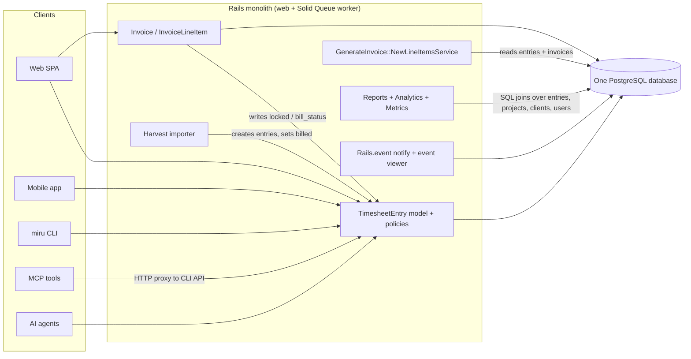

# Cobb Your Dependencies: separating timekeeping from billing and reporting

**Status:** Proposed design for review. This document does not authorize anyone to implement the architecture or start the migration.

**Publishing note:** The docs site build (`docs/docusaurus.config.js`) includes only `intro.md`, `contributing-guide/`, `product-guide/` and `ai/`. This file is therefore not published on the docs site. It is meant to be read in the repository and in review.

## How to read this document

Each statement in this document falls into one of three kinds, and every section labels which one it holds:

- **Observed:** read from the code or specs in this repository. Every observed statement cites the file it comes from. Line numbers appear only where they were checked while writing.
- **Assumption:** believed true but not proven by the code here, for example how production data is distributed. An assumption is never used as the only ground for a decision.
- **Proposed:** part of the target design. A proposed rule is not current behaviour, even when it reads like a requirement.

"Monolith" means the single Rails application in this repository. "Tenant", "company" and "workspace" all mean the `Company` record that owns a customer's data.

## 1. Existing architecture and its important dependencies

### 1.1 Runtime shape (observed)

- One Rails application image is deployed with Kamal (`config/deploy.yml`). The deployment defines a `web` role and a `worker` role. The worker runs `bundle exec rake solid_queue:start`, so background jobs run on Solid Queue.
- One PostgreSQL database holds every table, including time entries, invoices, payments and reports data (`db/schema.rb`). The app is configured through environment keys such as `DATABASE_URL` and `REDIS_URL`. This document names configuration only by key, never by value.
- Jobs inherit retry rules from `app/jobs/application_job.rb`: `ActiveRecord::Deadlocked` is retried 3 times, and connection failures 5 times.
- The existing architecture overview is `docs/contributing-guide/architecture-diagram.md`.

### 1.2 The time entry record (observed)

Source: `app/models/timesheet_entry.rb`, table `timesheet_entries` in `db/schema.rb`.

- One row carries three separate state fields:
  - `bill_status`, an integer enum: `non_billable`, `unbilled`, `billed`.
  - `review_status`, an integer enum: `not_required`, `pending_review`, `approved`, `rejected`.
  - `locked`, a boolean that defaults to `false`.
- `duration` is a `float` column holding minutes. The model allows values from `0.0` to `6000000`.
- The row has no `company_id`. Tenancy is derived through `project → client → company` (`has_one :client, through: :project`, `has_one :company, through: :client`). The scope `in_workspace(company)` filters on `company.project_ids`.
- The model is `audited associated_with: :company`. The audited columns are `duration`, `work_date`, `note`, `bill_status`, `review_status`, `project_id`, `user_id`, `agent_id`, `source`, `source_metadata`, `proof_url`, `proof_metadata` and `discarded_at`. **`locked` is not in that list, so lock and unlock changes leave no audit record today.**
- `has_one :invoice_line_item, dependent: :destroy` ties the entry to billing. Entries are normally soft-deleted through `Discardable`, so this destroy cascade only runs on a hard delete.
- After create, the model emits `TimesheetEntries::Created` (`app/events/timesheet_entries/created.rb`).
- `source` takes one of `manual`, `cli`, `mcp`, `automation`, `import`. The model infers it from `source_metadata`.

### 1.3 Writers of time entries (observed)

| Entry point | Code | User context |
|---|---|---|
| Web API (also used by mobile) | `app/controllers/api/v1/timesheet_entry_controller.rb`; mobile routes to it through `config/routes/api.rb` (`controller: "/api/v1/timesheet_entry"`), covered by `spec/requests/api/v1/mobile/timesheet_entries_spec.rb` | Signed-in user; `Current.user` set by `app/controllers/concerns/set_current_details.rb` |
| Bulk move and delete | `app/controllers/api/v1/timesheet_entry/bulk_action_controller.rb` | Signed-in user |
| CLI | `app/controllers/api/v1/cli/timesheet_entries_controller.rb` | Signed-in user; reads entries through `current_user.timesheet_entries.kept.in_workspace(current_company)` |
| MCP tools | `app/mcp/tools/time_create_tool.rb`, `time_update_tool.rb`, `time_delete_tool.rb` | The user's credential; tools forward HTTP requests to the CLI API through `app/mcp/tools/base_tool.rb` |
| Agent | `app/controllers/api/v1/agent/timesheet_entries_controller.rb` | `Current.user` set to the agent's user (`app/controllers/api/v1/agent/base_controller.rb`); forces `source: "automation"` |
| Harvest import | `app/services/imports/harvest_time_entries_importer.rb` (`create_entry`) | Runs as a job; no request user |
| Billing callbacks | `app/models/invoice.rb`, `app/models/invoice_line_item.rb` (section 1.4) | Whatever user saved the invoice |

The desktop timer client was not traced while writing this section. Whether it calls the web API or the CLI API is an open question for the review.

### 1.4 Billing writes timekeeping state directly (observed)

This coupling is the main reason timekeeping cannot be deployed on its own today.

- `app/models/invoice.rb:62` runs `after_save :lock_timesheet_entries, if: :draft?`. On every save of a draft invoice, it sets `locked: true` on every entry the invoice references, through `TimesheetEntry.in_workspace(company)`.
- `app/models/invoice.rb:63` runs `after_discard :unlock_timesheet_entries, if: :draft?`. It unlocks only when the invoice is still a draft. **A discarded invoice that has left draft leaves its entries locked.**
- `app/models/invoice_line_item.rb:10` runs `before_destroy :unlock_timesheet_entries`. It unlocks only when the parent invoice is a draft. It uses `TimesheetEntry.where(id: associated_timesheet_entry_ids)` with **no workspace filter**.
- `Invoice#update_timesheet_entry_status!` (`app/models/invoice.rb:126`) sets `bill_status: :billed` on the invoice's kept entries.
- An entry is referenced by an invoice in one of two ways:
  - Directly, through `invoice_line_items.timesheet_entry_id`.
  - As part of a project aggregate line, through the join table `invoice_line_item_time_entries` (`linked_timesheet_entry_ids`). `app/mcp/tools/invoice_create_tool.rb` accepts these ids too.
- Both line-item validations, `timesheet_entry_belongs_to_invoice_company` and `linked_timesheet_entries_belong_to_invoice_company` (`app/models/invoice_line_item.rb`), require the entry's company to equal the invoice's company.
- `db/schema.rb` declares foreign keys from both billing tables to `timesheet_entries`.
- Spec: `spec/requests/api/v1/invoices/create_spec.rb` (around lines 180–212) asserts that entries are locked after an invoice is created.

### 1.5 Choosing entries to invoice (observed)

Source: `app/services/generate_invoice/new_line_items_service.rb`.

- Candidates are limited to the client's kept projects (`client.projects.kept`), `bill_status: "unbilled"` and `discarded_at: nil`.
- `filtered_ids` excludes entries that are already on a line item of a kept invoice and are still unbilled. To find those invoices it calls `Invoice.kept.pluck(:id)` **across all companies**. The local variable is named `discarded_invoice_ids` but holds kept invoice ids. The result still only contains the client's own projects, so the global list widens the work done, not the returned rows.
- Entries on a discarded invoice are no longer excluded. Because `locked` is not part of the candidate filter, an entry that stayed locked after a non-draft discard can still be offered for a new invoice if it is unbilled.
- Rates come from `ProjectMembersPresenter#project_to_member_hourly_rate`. The service returns the entry's `duration` as `quantity`, and the line item stores it.
- Nothing in the database stops one entry from appearing on two invoices. `invoice_line_items.timesheet_entry_id` has only non-unique indexes. `invoice_line_item_time_entries` is unique only on the pair `(invoice_line_item_id, timesheet_entry_id)` (`db/schema.rb`, `idx_line_item_time_entries_unique_pair`).

### 1.6 Money and rounding (observed)

Sources: `app/models/invoice.rb`, `app/models/invoice_line_item.rb`, `db/schema.rb`.

- Stored columns:
  - `invoices.amount`, `amount_due`, `amount_paid`, `outstanding_amount`, `discount`, `tax` and `base_currency_amount` are `decimal(20,2)`.
  - `invoices.exchange_rate` is `decimal(18,10)`.
  - `invoice_line_items.rate` is `decimal(20,2)`, and `quantity` is an `integer` of minutes.
  - `invoice_taxes.amount` is `decimal(20,2)` and `value` is `decimal(20,4)`.
- The invoice subtotal is computed in floats: `sum((quantity.to_f / 60) * rate.to_f).round(2)`. The total is `(subtotal - discount.to_f + tax.to_f).round(2)`.
- Tax amounts are summed as `BigDecimal` and rounded to 2 places. Each tax line is recalculated from the subtotal only while the invoice is new or a draft (`should_recalculate_invoice_taxes?`).
- `totals_recalculation_needed?` is also true when `status` changes. So a status change can rewrite `amount`, `amount_due` and `outstanding_amount` from the stored line items. For a paid or waived invoice, `amount_due` and `outstanding_amount` become `0`.
- Line-level `total_cost` rounds to 3 places: `(quantity / 60.0 * rate).round(3)`. `InvoiceLineItem.total_cost_of_all_line_items` uses SQL `sum(quantity * rate) / 60.0`, rounded to 3. The two invoice-level and line-level paths therefore round differently.
- `base_currency_amount = (amount * rate).round(2)`. The rate is looked up for the issue date (or today) through `CurrencyConversionService.get_exchange_rate` and stored with `exchange_rate_date`.
- Invoice money and status changes are audited (`audited associated_with: :company` on `Invoice`).

### 1.7 Reporting reads timekeeping data in SQL (observed)

- `app/services/reports/time_entries/report_service.rb` builds report rows from `TimesheetEntry` with `includes(:user, project: :client)` and company and date filters. It groups and sums duration.
- `app/services/analytics/team_productivity_analytics.rb` sums duration by user and splits it into billable (`unbilled` or `billed`) and non-billable.
- `app/services/metrics/data_builder.rb` (lines 85, 86 and 140) filters `bill_status: :billable`. `billable` is not one of the enum's values. What this query returns at runtime was not checked while writing this document; it is recorded as a defect to confirm, not as behaviour to preserve.
- Revenue and receivables reports read only billing tables: `app/services/reports/client_revenues/`, `accounts_aging/` and `outstanding_overdue_invoices/`.

### 1.8 Events and idempotency (observed)

- Events are in-process. `app/events/application_event.rb` builds `{ actor, data }`. The time-entry events cover creation only (`TimesheetEntries::Created`). Invoices emit `Invoices::Created`, `Invoices::Sent` and `Invoices::StatusChanged`.
- `docs/ai/events.md` says events are stored in the same transaction, behind a savepoint, so a failed insert cannot abort the operation. It calls the history "best-effort observability, not a mandatory audit trail or delivery queue". Pruning is manual with a seven-day default. No outbox or message broker exists.
- MCP write tools deduplicate through `app/mcp/idempotency_store.rb`:
  - The key is a SHA-256 digest of the tool name, a digest of the caller's authorization value, and the client's idempotency key. The key is therefore scoped to the caller.
  - A Postgres advisory lock guards each key.
  - Only successful responses are cached, in `mcp_idempotency_records`, for 24 hours.
  - Spec: `spec/mcp/idempotency_store_spec.rb`.
  - The store sits in front of the HTTP proxy, so deduplication happens before the request reaches the time-entry API.

## 2. Observed behaviour that must be preserved

Each row below is current behaviour, cited to its source. The target design must keep it unless a later section names it as a deliberate, disclosed departure. Rows marked **(quirk)** are odd but observed. Changing them would change customer-visible state, so they are preserved as they are, and any correction needs a separate owner decision.

### 2.1 Authorization

| # | Behaviour | Source |
|---|---|---|
| A1 | Owner and admin see every kept entry in their current workspace; other users see only their own kept entries in it. | `TimesheetEntryPolicy::Scope#resolve` in `app/policies/timesheet_entry_policy.rb` |
| A2 | `update?` and `destroy?` refuse any `billed` entry, for every role. | `app/policies/timesheet_entry_policy.rb`; `spec/policies/timesheet_entry_policy_spec.rb` |
| A3 | A user who is not owner or admin of the entry's company cannot change an entry whose `work_date` is older than `company.timesheet_edit_days` days. | `stale_entry_for_non_privileged?` in the policy; `timesheet_edit_days` validated to `1..365` in `app/models/company.rb:83` |
| A4 | Non-privileged users may change only their own entries. | `update?` in the policy |
| A5 | Only owner or admin may create an entry for another user in the web API; others get `Pundit::NotAuthorizedError`. | `timesheet_entry_user` in `app/controllers/api/v1/timesheet_entry_controller.rb` |
| A6 | An employee cannot edit a `locked` entry; an admin can. | `prevent_edit_if_locked` in `app/models/timesheet_entry.rb`; `spec/models/timesheet_entry_spec.rb:421-455` |
| A7 | An employee cannot change an entry away from `billed`. | `ensure_billed_status_should_not_be_changed` in the model |
| A8 **(quirk)** | Both A6 and A7 are skipped when `Current.user` is nil, which is the case for jobs and imports. | Same model methods (`return if Current.user.nil?`) |
| A9 **(quirk)** | The bulk controller re-implements the checks in `entry_locked?` (billed, or past the edit window for non-privileged users). It does **not** check `locked`. Bulk move uses non-raising `update`, so an entry that fails validation is skipped silently while the response still reports success. | `app/controllers/api/v1/timesheet_entry/bulk_action_controller.rb` |
| A10 **(quirk)** | Delete paths (`discard!`, `discard_all`) do not run validations, so A6 never applies to deletes. Policy and bulk checks still apply. | Controllers above; `Discardable` |
| A11 **(quirk)** | Any user allowed to update an entry can set `bill_status` to `billed` through the web, CLI or MCP update parameters, because only changes *away from* `billed` are guarded. | `timesheet_entry_params` and `cli_timesheet_entry_params` permit `bill_status`; `app/mcp/tools/time_update_tool.rb` allows `billed` |

### 2.2 State values and transitions

| # | Behaviour | Source |
|---|---|---|
| S1 | A new entry gets `unbilled` on a billable project and `non_billable` otherwise, unless a value is given. | `ensure_bill_status_is_set` |
| S2 | An entry cannot be created as `billed`. | `ensure_bill_status_is_not_billed` |
| S3 | `unbilled` is rejected on a non-billable project. | `validate_billable_project` |
| S4 | An entry with an agent is forced to `pending_review` when its review status is blank or `not_required`; other entries default to `not_required`. | `ensure_review_status_is_set`; `spec/models/timesheet_entry_spec.rb:140` |
| S5 | **No code moves an entry to `approved` or `rejected`.** A search of `app/` for `review_status` finds only the model and the demo seeder. The review queue described in `docs/miru-ai-agent-billing-autoplan.md` is not built. | Search of `app/**/*.rb` |
| S6 | Invoicing ignores `review_status`: `pending_review` entries can be offered and invoiced today. | `app/services/generate_invoice/new_line_items_service.rb` has no review filter |
| S7 | An agent entry must belong to the agent's company, and its user must be the agent's user. | `validate_agent_belongs_to_workspace` |

### 2.3 Locking and billing

| # | Behaviour | Source |
|---|---|---|
| L1 | Every save of a draft invoice locks every entry it references, scoped to the invoice's company. | `app/models/invoice.rb:62`, `lock_timesheet_entries` |
| L2 | Discarding a draft invoice unlocks its entries. | `app/models/invoice.rb:63` |
| L3 **(quirk)** | Discarding an invoice that has left draft does **not** unlock its entries; they stay locked with no kept invoice holding them. | Same callback, `if: :draft?` |
| L4 | Destroying a line item on a draft invoice unlocks its entries; on a non-draft invoice it does not. | `app/models/invoice_line_item.rb:10`, `unlock_timesheet_entries` |
| L5 **(quirk)** | Only `InvoiceMailer#invoice` marks entries `billed`, through `after_action :update_status` (`app/mailers/invoice_mailer.rb:4`, `:73`). That mailer is enqueued only by `Invoice#send_to_email` (`app/models/concerns/invoice_sendable.rb`). A repository search finds no production caller of `send_to_email`; only `spec/models/invoice_spec.rb:200-215` calls it. | Search for `send_to_email` |
| L6 **(quirk)** | The live send path, `send_invoice` in `app/controllers/api/v1/invoices_controller.rb`, uses `InvoiceMailer#send_invoice` and `record_send!`. These set the invoice to `sent` and emit `Invoices::Sent`, but never mark entries billed. **Entries on sent invoices therefore usually stay `locked` and `unbilled`.** | `app/controllers/api/v1/invoices_controller.rb:64`; `app/models/concerns/invoice_sendable.rb` |
| L7 **(quirk)** | The Harvest import creates entries as `unbilled` and then calls `entry.update!(bill_status: :billed)` with no invoice. So `billed` is not always backed by an invoice link. | `app/services/imports/harvest_time_entries_importer.rb` (`create_entry`); `spec/services/imports/harvest_time_entries_importer_spec.rb` |
| L8 | A line item's linked entries must belong to the invoice's company. | `app/models/invoice_line_item.rb` validations; no spec in `spec/models/invoice_line_item_spec.rb` covers this rule |

### 2.4 Money and history

| # | Behaviour | Source |
|---|---|---|
| M1 | Stored invoice and line-item amounts (section 1.6) are the customer's record. Past invoices show these stored values, not values recomputed from current rates. | `db/schema.rb`; `Invoice` callbacks only recompute on changes |
| M2 | Line items copy `rate` and `quantity` when they are created; later entry or rate changes do not reach existing line items. | `app/services/generate_invoice/new_line_items_service.rb`; `app/models/invoice_line_item.rb` |
| M3 | Rounding differs by path (2 places at invoice level, 3 at line level) as described in section 1.6. Any figure a customer has seen must still come out the same. | `app/models/invoice.rb`, `app/models/invoice_line_item.rb` |
| M4 | Time-entry and invoice audit history is kept per company through `audited`. | `app/models/timesheet_entry.rb`, `app/models/invoice.rb` |

### 2.5 Behaviour recorded but not preserved as-is

These are observed, but the target design must not expose them across a service boundary, because doing so would let one tenant reach another tenant's data. Later sections state the replacement and disclose it as a deliberate departure.

| # | Behaviour | Source | Why it is not carried forward |
|---|---|---|---|
| X1 | The line-item unlock looks entries up with `TimesheetEntry.where(id:)` and no company filter. | `app/models/invoice_line_item.rb`, `unlock_timesheet_entries` | Inside one process, the ids come from rows the company-match validations already checked. As a network command taking raw ids, the same lookup would let one tenant unlock another tenant's entries. |
| X2 | The candidate filter reads `Invoice.kept.pluck(:id)` for every company. | `app/services/generate_invoice/new_line_items_service.rb`, `filtered_ids` | The returned rows are still limited to the client's projects, so no data leaks today. As a cross-service query, the same shape would collect invoice ids across tenants. |

For a single tenant, replacing X1 and X2 with company-scoped versions leaves the visible result unchanged.

### 2.6 Assumptions used later

These are not proven by the repository. They are stated here so later sections do not treat them as facts.

- **Assumption:** production holds entries in each quirk state (L3, L6, L7). The code allows them, but no production data was inspected.
- **Assumption:** the desktop timer writes through one of the APIs in section 1.3. This was not traced (section 1.3).
- **Assumption:** no external system reads `rails_event_viewer_entries` as a feed. No subscriber exists in `app/` (a search of the repository for `Rails.event.subscribe` finds no code), but other deployments were not checked.
