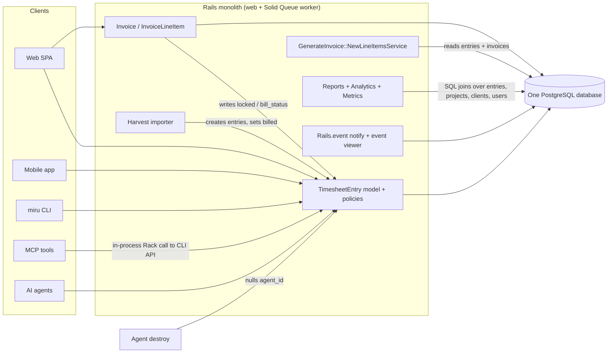
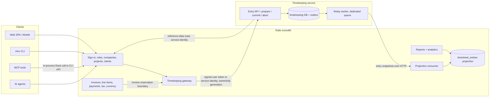
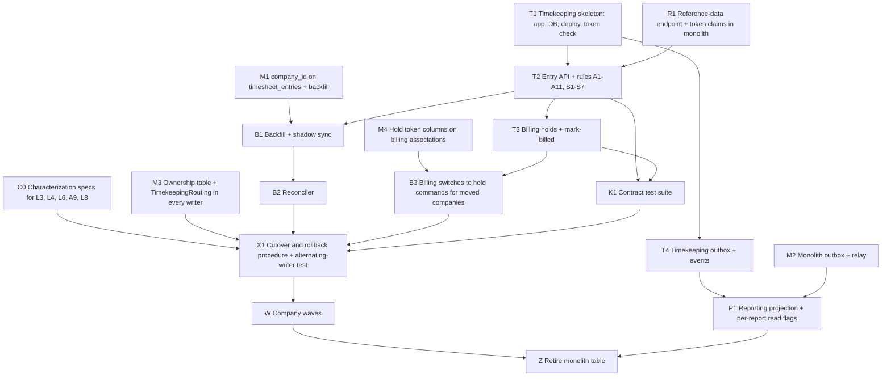

# Cobb Your Dependencies: separating timekeeping from billing and reporting

**Status:** Proposed design for review. This document does not authorize anyone to implement the architecture or start the migration.

**Publishing note:** The docs site build (`docs/docusaurus.config.js`) includes only `intro.md`, `contributing-guide/`, `product-guide/` and `ai/`. This file is therefore not published on the docs site. It is meant to be read in the repository and in review.

## How to read this document

Each statement in this document falls into one of three kinds, and every section labels which one it holds:

- **Observed:** read from the code or specs in this repository. Every observed statement cites the file it comes from. Line numbers appear only where they were checked while writing.
- **Assumption:** believed true but not proven by the code here, for example how production data is distributed. An assumption is never used as the only ground for a decision.
- **Proposed:** part of the target design. A proposed rule is not current behaviour, even when it reads like a requirement.

"Monolith" means the single Rails application in this repository. "Tenant", "company" and "workspace" all mean the `Company` record that owns a customer's data.

## 1. Existing architecture and its important dependencies

### 1.1 Runtime shape (observed)

- One Rails application image is deployed with Kamal (`config/deploy.yml`). The deployment defines a `web` role and a `worker` role. The worker runs `bundle exec rake solid_queue:start`, so background jobs run on Solid Queue.
- One PostgreSQL database holds every table, including time entries, invoices, payments and reports data (`db/schema.rb`). The app is configured through environment keys such as `DATABASE_URL` and `REDIS_URL`. This document names configuration only by key, never by value.
- Jobs inherit retry rules from `app/jobs/application_job.rb`: `ActiveRecord::Deadlocked` gets `attempts: 3`, and connection failures (`ActiveRecord::ConnectionFailed`, `PG::ConnectionBad`) get `attempts: 5`. `attempts` counts the first run, so these are 2 and 4 retries.
- The existing architecture overview is `docs/contributing-guide/architecture-diagram.md`.



### 1.2 The time entry record (observed)

Source: `app/models/timesheet_entry.rb`, table `timesheet_entries` in `db/schema.rb`.

- One row carries three separate state fields:
  - `bill_status`, an integer enum: `non_billable`, `unbilled`, `billed`.
  - `review_status`, an integer enum: `not_required`, `pending_review`, `approved`, `rejected`.
  - `locked`, a boolean that defaults to `false`.
- `duration` is a `float` column holding minutes. The model allows values from `0.0` to `6000000`.
- The row has no `company_id`. Tenancy is derived through `project → client → company` (`has_one :client, through: :project`, `has_one :company, through: :client`). The scope `in_workspace(company)` filters on `company.project_ids`.
- Tenancy is enforced by convention, not by a default scope. No model in `app/models/` declares `default_scope`. Controllers scope their queries through `current_company` (`app/controllers/concerns/current_company_concern.rb`), and a query that does not start from it is not filtered by tenant.
- The model is `audited associated_with: :company`. The audited columns are `duration`, `work_date`, `note`, `bill_status`, `review_status`, `project_id`, `user_id`, `agent_id`, `source`, `source_metadata`, `proof_url`, `proof_metadata` and `discarded_at`. **`locked` is not in that list, so lock and unlock changes leave no audit record today.**
- `has_one :invoice_line_item, dependent: :destroy` ties the entry to billing. Entries are normally soft-deleted through `Discardable`, so this destroy cascade only runs on a hard delete.
- After create, the model emits `TimesheetEntries::Created` (`app/events/timesheet_entries/created.rb`).
- `source` takes one of `manual`, `cli`, `mcp`, `automation`, `import`. The model infers it from `source_metadata`.

### 1.3 Writers of time entries (observed)

| Entry point | Code | User context |
|---|---|---|
| Web API (also used by mobile) | `app/controllers/api/v1/timesheet_entry_controller.rb`; mobile routes to it through `config/routes/api.rb` (`controller: "/api/v1/timesheet_entry"`), covered by `spec/requests/api/v1/mobile/timesheet_entries_spec.rb` | Signed-in user; `Current.user` set by `app/controllers/concerns/set_current_details.rb` |
| Bulk move and delete | `app/controllers/api/v1/timesheet_entry/bulk_action_controller.rb` | Signed-in user |
| CLI | `app/controllers/api/v1/cli/timesheet_entries_controller.rb` | Signed-in user; reads entries through `current_user.timesheet_entries.kept.in_workspace(current_company)` |
| MCP tools | `app/mcp/tools/time_create_tool.rb`, `time_update_tool.rb`, `time_delete_tool.rb` | The user's credential. The tools call the CLI API **in-process**, not over HTTP: `app/mcp/tools/base_tool.rb` calls `MCP::Miru::ApiProxy.request`, which runs `Rack::MockRequest.new(Rails.application).request(...)` and sets `miru.event_source = "mcp"` (`app/mcp/api_proxy.rb:40`). So the CLI controller is the MCP writer too. |
| Agent | `app/controllers/api/v1/agent/timesheet_entries_controller.rb` | `Current.user` set to the agent's user (`app/controllers/api/v1/agent/base_controller.rb`). The controller passes `source: "automation"`, but the model's `normalize_source_fields` rewrites it to `mcp` when `source_metadata["mcp_server"]` is present (`inferred_source`, `app/models/timesheet_entry.rb:232-235`). |
| Harvest import | `app/services/imports/harvest_time_entries_importer.rb` (`create_entry`) | Runs as a job; no request user |
| Billing callbacks | `app/models/invoice.rb`, `app/models/invoice_line_item.rb` (section 1.4) | Whatever user saved the invoice |
| Agent destroy | `app/models/agent.rb:11`, `has_many :timesheet_entries, dependent: :nullify`. Destroying an agent rewrites `agent_id` to `NULL` on its entries. No controller destroys an agent directly; the destroy runs through `has_many :agents, dependent: :destroy` on `User` (`app/models/user.rb:39`) and on `Company` (`app/models/company.rb:49`). | Whoever destroys the user or company |
| Seed and demo data | `db/seeds.rb:322-326` (`seed_entry!`, which also sets `locked: false`), `db/seeds.rb:432` and `:602` (`update!(bill_status: :billed)`), `db/seeds/timesheet_data.rb:185` (`find_or_create_by!`), and `Analytics::DemoSeeder#seed_timesheet_entries` (`app/services/analytics/demo_seeder.rb:162`, run by `lib/tasks/analytics_demo.rake`) | No request user |

The desktop timer client was not traced while writing this section. Whether it calls the web API or the CLI API is an open question for the review.

**User hard delete (observed).** A super admin can permanently delete a user: `Api::V1::UsersController#destroy` calls `target_user.destroy!` (`app/controllers/api/v1/users_controller.rb:51-82`). `User` declares `has_many :timesheet_entries` with no `dependent:` option (`app/models/user.rb:38`). The foreign key `timesheet_entries → users` (`db/schema.rb:1327`) therefore makes the delete fail when the user has any entry. The destroy's transaction rolls back, including the agent destroys and their `agent_id` nulls; the `super_admin_delete` audit row the controller writes before calling `destroy!` is not part of that transaction. Today that key is the only check that stops a user with time entries from being deleted.

### 1.4 Billing writes timekeeping state directly (observed)

This coupling is the main reason timekeeping cannot be deployed on its own today.

- `app/models/invoice.rb:62` runs `after_save :lock_timesheet_entries, if: :draft?`. On every save of a draft invoice, it sets `locked: true` on every entry the invoice references, through `TimesheetEntry.in_workspace(company)`.
- `app/models/invoice.rb:63` runs `after_discard :unlock_timesheet_entries, if: :draft?`. It unlocks only when the invoice is still a draft. **A discarded invoice that has left draft leaves its entries locked.**
- **Discarding a draft also leaves its entries locked.** The unlock at line 63 runs first. Then `after_discard :update_invoice_number` (line 64) calls `self.update(invoice_number: "ARC-...")` (`app/models/invoice.rb:323-325`). That save fires `after_save :lock_timesheet_entries, if: :draft?` (line 62) again, because the invoice is still a draft, and the entries end the discard locked.
- Single invoice delete is a soft `invoice.discard!` (`app/controllers/api/v1/invoices_controller.rb:59-62`). Bulk delete is a hard destroy: `current_company.invoices.where(id: params[:invoices_ids])`, with no `.kept` filter, then `destroy` on each (`app/controllers/api/v1/invoices/bulk_deletion_controller.rb:7-8`). An invoice with payments fails to destroy (`has_many :payments, dependent: :restrict_with_error`, `app/models/invoice.rb:42`) and is reported back with a 422. Otherwise `has_many :invoice_line_items, dependent: :destroy` (line 40) runs each line item's `before_destroy :unlock_timesheet_entries`, which unlocks only when the invoice is a draft. **So a hard-destroyed non-draft invoice leaves its entries locked with no invoice, kept or discarded, that references them.**
- `app/models/invoice_line_item.rb:10` runs `before_destroy :unlock_timesheet_entries`. It unlocks only when the parent invoice is a draft. It uses `TimesheetEntry.where(id: associated_timesheet_entry_ids)` with **no workspace filter**.
- `Invoice#update_timesheet_entry_status!` (`app/models/invoice.rb:126-128`) sets `bill_status: :billed` on the invoice's kept entries, through `TimesheetEntry.kept.where(id:)` with no workspace filter.
- An entry is referenced by an invoice in one of two ways:
  - Directly, through `invoice_line_items.timesheet_entry_id`.
  - As part of a project aggregate line, through the join table `invoice_line_item_time_entries` (`linked_timesheet_entry_ids`). `app/mcp/tools/invoice_create_tool.rb` accepts these ids too.
- Both line-item validations, `timesheet_entry_belongs_to_invoice_company` and `linked_timesheet_entries_belong_to_invoice_company` (`app/models/invoice_line_item.rb`), require the entry's company to equal the invoice's company.
- `db/schema.rb` declares foreign keys from both billing tables to `timesheet_entries`: `invoice_line_item_time_entries → timesheet_entries` (`db/schema.rb:1282`) and `invoice_line_items → timesheet_entries` (`:1284`). The target design drops both keys before cutover, in their own migration (section 10).
- Spec: `spec/requests/api/v1/invoices/create_spec.rb` (around lines 180–212) asserts that entries are locked after an invoice is created.
- Mobile collections create invoices and payments outside `InvoicePolicy`. `Api::V1::Mobile::CollectionsController` skips Pundit's `verify_authorized` and checks only that the company has pro access and that the user is an owner, admin, book keeper or **employee** (`authorize_mobile_collection!`, `app/controllers/api/v1/mobile/collections_controller.rb`). An employee can therefore create a `sent` invoice (`create_invoice!`) and record a cash or UPI payment (`record_manual_payment!`). These invoices carry one line item with no time entry, so they reference no entries.

### 1.5 Choosing entries to invoice (observed)

Source: `app/services/generate_invoice/new_line_items_service.rb`.

- Candidates are limited to the client's kept projects (`client.projects.kept`), `bill_status: "unbilled"` and `discarded_at: nil`.
- `filtered_ids` excludes entries that are already on a line item of a kept invoice and are still unbilled. To find those invoices it calls `Invoice.kept.pluck(:id)` **across all companies**. The local variable is named `discarded_invoice_ids` but holds kept invoice ids. The result still only contains the client's own projects, so the global list widens the work done, not the returned rows.
- Entries on a discarded invoice are no longer excluded. Because `locked` is not part of the candidate filter, an entry that stayed locked after a non-draft discard can still be offered for a new invoice if it is unbilled.
- Rates come from `ProjectMembersPresenter#project_to_member_hourly_rate`. The service only **suggests** a quantity: the entry's float `duration` for a direct line (`app/services/generate_invoice/new_line_items_service.rb:110`) and the float sum `entries.sum(&:duration)` for a project aggregate (`:140`). The client then posts the line item's `quantity`, and `invoice_line_items.quantity` is an `integer` column (`db/schema.rb:560`), so any fractional minutes are cast away when the line item is stored.
- Nothing in the database stops one entry from appearing on two invoices. `invoice_line_items.timesheet_entry_id` has only non-unique indexes. `invoice_line_item_time_entries` is unique only on the pair `(invoice_line_item_id, timesheet_entry_id)` (`db/schema.rb`, `idx_line_item_time_entries_unique_pair`).

### 1.6 Money and rounding (observed)

Sources: `app/models/invoice.rb`, `app/models/invoice_line_item.rb`, `db/schema.rb`.

- Stored columns:
  - `invoices.amount`, `amount_due`, `amount_paid`, `outstanding_amount`, `discount`, `tax` and `base_currency_amount` are `decimal(20,2)`.
  - `invoices.exchange_rate` is `decimal(18,10)`.
  - `invoice_line_items.rate` is `decimal(20,2)`, and `quantity` is an `integer` of minutes.
  - `invoice_taxes.amount` is `decimal(20,2)` and `value` is `decimal(20,4)`.
- The invoice subtotal is computed in floats: `sum((quantity.to_f / 60) * rate.to_f).round(2)`. The total is `(subtotal - discount.to_f + tax.to_f).round(2)`.
- Tax amounts are summed as `BigDecimal` and rounded to 2 places. Each tax line is recalculated from the subtotal only while the invoice is new or a draft (`should_recalculate_invoice_taxes?`).
- `totals_recalculation_needed?` is also true when `status` changes. So a status change can rewrite `amount`, `amount_due` and `outstanding_amount` from the stored line items. For a paid or waived invoice, `amount_due` and `outstanding_amount` become `0`.
- Line-level `total_cost` rounds to 3 places: `(hours_spent * rate).round(3)` (`app/models/invoice_line_item.rb:46-48`). `InvoiceLineItem.total_cost_of_all_line_items` uses SQL `sum(quantity * rate) / 60.0`, rounded to 3 (`app/models/invoice_line_item.rb:20-22`). The two invoice-level and line-level paths therefore round differently.
- **The PDF does not print the stored `amount` as its total.** `PdfGeneration::InvoiceService` recomputes the subtotal as `total_cost_of_all_line_items` (rounded to 3) and the total as `subtotal + tax - discount`, unrounded (`app/services/pdf_generation/invoice_service.rb:24-25`, `46-54`). The stored `amount` is `(subtotal - discount + tax).round(2)` from a float subtotal rounded to 2 (`total_attributes_for` in `app/models/invoice.rb`). So the printed total can differ from the stored `amount`.
- `base_currency_amount = (amount * rate).round(2)`. The rate is looked up for the issue date (or today) through `CurrencyConversionService.get_exchange_rate` and stored with `exchange_rate_date`.
- The audit log does not cover the invoice's money. `audited` on `Invoice` lists only `amount`, `base_currency_amount`, `exchange_rate`, `exchange_rate_date`, `currency`, `status`, `amount_paid` and `amount_due` (`app/models/invoice.rb:10-11`). It omits `discount`, `tax` and `outstanding_amount`. `InvoiceLineItem` and `InvoiceTax` are not audited at all. Financial parity across a migration therefore has to be proven by comparing snapshots of the stored values and the rendered PDF totals (section 13), not by reading the audit log.

### 1.7 Reporting reads timekeeping data in SQL (observed)

- `app/services/reports/time_entries/report_service.rb` builds report rows from `TimesheetEntry` with `includes(:user, project: :client)` and company and date filters. It groups and sums duration.
- `app/services/analytics/team_productivity_analytics.rb` sums duration by user and splits it into billable (`unbilled` or `billed`) and non-billable.
- `app/services/metrics/data_builder.rb` filters `bill_status: :billable` at lines 85 and 140. `billable` is not one of the enum's values. Line 86 filters `:non_billable`, which is a real value. What the `:billable` queries return at runtime was not checked while writing this document; they are recorded as a defect to confirm, and kept as they are (section 15.1).
- The client revenue report also reads time entries: `Reports::ClientRevenues` sums `TimesheetEntry.kept` duration per client in `hours_logged_by_client` (`app/services/reports/client_revenues/report_decorator.rb:159-168`). The accounts-aging and outstanding/overdue reports (`app/services/reports/accounts_aging/`, `outstanding_overdue_invoices/`) read only billing tables.
- Other readers that aggregate entries: `app/controllers/analytics_controller.rb` (`analytics_timesheet_entries`, line 371), `app/controllers/api/v1/projects_controller.rb:21`, the totals in `app/models/client.rb` and `app/models/project.rb`, `app/services/clients/index_service.rb`, `app/services/team/index_decorator.rb`, `app/services/team/removal_impact_service.rb`, `app/services/weekly_reminder_for_missed_entries_service.rb`, `app/services/reports/time_entries/` and `app/services/analytics/growth_metrics_service.rb`.
- The entry API's own list reads go through `TimeTrackingIndexService` (`app/services/time_tracking_index_service.rb`), used by `app/controllers/api/v1/timesheet_entry_controller.rb` and `app/controllers/api/v1/time_tracking_controller.rb`.

### 1.8 Events and idempotency (observed)

- Events are in-process. `app/events/application_event.rb` builds `{ actor, data }`. The time-entry events cover creation only (`TimesheetEntries::Created`). Invoices emit `Invoices::Created`, `Invoices::Sent` and `Invoices::StatusChanged`.
- `docs/ai/events.md` says events are stored in the same transaction, behind a savepoint, so a failed insert cannot abort the operation. It calls the history "best-effort observability, not a mandatory audit trail or delivery queue". Pruning is manual with a seven-day default. No outbox or message broker exists.
- MCP write tools deduplicate through `app/mcp/idempotency_store.rb`:
  - The key is a SHA-256 digest of the tool name, a digest of the caller's authorization value, and the client's idempotency key. The key is therefore scoped to the caller.
  - A Postgres advisory lock guards each key.
  - Only successful responses are cached, in `mcp_idempotency_records`, for 24 hours.
  - Spec: `spec/mcp/idempotency_store_spec.rb`.
  - The store wraps the in-process call to the CLI API (`write_request` in `app/mcp/tools/base_tool.rb`), so deduplication happens before the request reaches the time-entry controller.

## 2. Observed behaviour that must be preserved

Each row below is current behaviour, cited to its source. The target design must keep it unless it is listed in the deliberate-fixes table (section 2.3). Rows marked **(quirk)** are odd but observed. Changing them would change customer-visible state, so they are preserved as they are, and any correction needs a separate owner decision.

**Agent calls do not get every row in 2.1.** The agent API skips Pundit (`skip_after_action :verify_authorized`, `app/controllers/api/v1/agent/base_controller.rb:7`) and only creates entries. Its one check before saving is a project scope: the project must be found in `ProjectPolicy::Scope.new(current_agent.user, current_company).resolve` (`app/controllers/api/v1/agent/timesheet_entries_controller.rb:4-18`, `:28-31`). The model validations, including S1–S4 and S7 below, still run on `save!`. The policy rows A1–A5 do not apply to it.

### 2.1 Authorization

| # | Behaviour | Source |
|---|---|---|
| A1 | Owner and admin see every kept entry in their current workspace; other users see only their own kept entries in it. | `TimesheetEntryPolicy::Scope#resolve` in `app/policies/timesheet_entry_policy.rb` |
| A2 | `update?` and `destroy?` refuse any `billed` entry, for every role. | `app/policies/timesheet_entry_policy.rb`; `spec/policies/timesheet_entry_policy_spec.rb` |
| A3 | A user who is not owner or admin of the entry's company cannot change an entry whose `work_date` is older than `company.timesheet_edit_days` days. | `stale_entry_for_non_privileged?` in the policy; `timesheet_edit_days` validated to `1..365` in `app/models/company.rb:83` |
| A4 | Non-privileged users may change only their own entries. | `update?` in the policy |
| A5 | Only owner or admin may create an entry for another user in the web API; others get `Pundit::NotAuthorizedError`. | `timesheet_entry_user` in `app/controllers/api/v1/timesheet_entry_controller.rb` |
| A6 | An employee cannot edit a `locked` entry; an admin can. | `prevent_edit_if_locked` in `app/models/timesheet_entry.rb`; `spec/models/timesheet_entry_spec.rb:421-455` |
| A7 | An employee cannot change an entry away from `billed`. | `ensure_billed_status_should_not_be_changed` in the model |
| A8 **(quirk)** | Both A6 and A7 are skipped when `Current.user` is nil, which is the case for jobs and imports. | Same model methods (`return if Current.user.nil?`) |
| A9 **(quirk)** | The bulk controller re-implements the checks in `entry_locked?` (billed, or past the edit window for non-privileged users). It does **not** check `locked`. Bulk move uses non-raising `update`, so an entry that fails validation is skipped silently while the response still reports success. | `app/controllers/api/v1/timesheet_entry/bulk_action_controller.rb` |
| A10 **(quirk)** | Delete paths (`discard!`, `discard_all`) do not run validations, so A6 never applies to deletes. Policy and bulk checks still apply. | Controllers above; `Discardable` |
| A11 **(quirk)** | Any user allowed to update an entry can set `bill_status` to `billed` through the web, CLI or MCP update parameters, because only changes *away from* `billed` are guarded. | `timesheet_entry_params` and `cli_timesheet_entry_params` permit `bill_status`; `app/mcp/tools/time_update_tool.rb` allows `billed` |

### 2.2 State values and transitions

| # | Behaviour | Source |
|---|---|---|
| S1 | A new entry gets `unbilled` on a billable project and `non_billable` otherwise, unless a value is given. | `ensure_bill_status_is_set` |
| S2 | An entry cannot be created as `billed`. | `ensure_bill_status_is_not_billed` |
| S3 | `unbilled` is rejected on a non-billable project. | `validate_billable_project` |
| S4 | An entry with an agent is forced to `pending_review` when its review status is blank or `not_required`; other entries default to `not_required`. | `ensure_review_status_is_set`; `spec/models/timesheet_entry_spec.rb:140` |
| S5 | **No code moves an entry to `approved` or `rejected`.** A search of `app/` for `review_status` finds only the model and the demo seeder. The review queue described in `docs/miru-ai-agent-billing-autoplan.md` is not built. | Search of `app/**/*.rb` |
| S6 | Invoicing ignores `review_status`: `pending_review` entries can be offered and invoiced today. | `app/services/generate_invoice/new_line_items_service.rb` has no review filter |
| S7 | An agent entry must belong to the agent's company, and its user must be the agent's user. | `validate_agent_belongs_to_workspace` |

### 2.3 Locking and billing

| # | Behaviour | Source |
|---|---|---|
| L1 | Every save of a draft invoice locks every entry it references, scoped to the invoice's company. | `app/models/invoice.rb:62`, `lock_timesheet_entries` |
| L2 **(quirk)** | Discarding a draft invoice leaves its entries **locked**. `after_discard :unlock_timesheet_entries` unlocks them, then `after_discard :update_invoice_number` calls `update`, which fires `after_save :lock_timesheet_entries` again while the invoice is still a draft. Fixed by the target design (deliberate fixes, below). | `app/models/invoice.rb:62-64`, `:323-325` |
| L3 **(quirk)** | Discarding an invoice that has left draft does **not** unlock its entries; they stay locked with no kept invoice holding them. | Same callback, `if: :draft?` |
| L4 | Destroying a line item on a draft invoice unlocks its entries; on a non-draft invoice it does not. The unlock uses `TimesheetEntry.where(id:)` with no workspace filter. This covers a line item removed from a draft and every line item of a draft destroyed by the bulk invoice delete; the line items of a hard-destroyed non-draft leave their entries locked (section 1.4). | `app/models/invoice_line_item.rb:10`, `:72-76` |
| L5 **(quirk)** | Among invoice flows, only `InvoiceMailer#invoice` marks entries `billed`, through `after_action :update_status` (`app/mailers/invoice_mailer.rb:4`, `:73`). That mailer is enqueued only by `Invoice#send_to_email` (`app/models/concerns/invoice_sendable.rb`). A repository search finds no production caller of `send_to_email`; only `spec/models/invoice_spec.rb:200-215` calls it. Outside invoices, `billed` is also set by the Harvest import (L7), by any user allowed to edit the entry (A11), and by the seed data (section 1.3). | Search for `send_to_email` and `bill_status: :billed` |
| L6 **(quirk)** | The live send path, `send_invoice` in `app/controllers/api/v1/invoices_controller.rb`, uses `InvoiceMailer#send_invoice` and `record_send!`. These set the invoice to `sent` and emit `Invoices::Sent`, but never mark entries billed. **Entries on sent invoices therefore usually stay `locked` and `unbilled`.** | `app/controllers/api/v1/invoices_controller.rb:64`; `app/models/concerns/invoice_sendable.rb` |
| L7 **(quirk)** | The Harvest import creates entries as `unbilled` and then calls `entry.update!(bill_status: :billed)` with no invoice. So `billed` is not always backed by an invoice link. | `app/services/imports/harvest_time_entries_importer.rb` (`create_entry`); `spec/services/imports/harvest_time_entries_importer_spec.rb` |
| L8 | A line item's linked entries must belong to the invoice's company. | `app/models/invoice_line_item.rb` validations; no spec in `spec/models/invoice_line_item_spec.rb` covers this rule |

**Deliberate fixes.** The repository owner chose to fix two legacy billing behaviours. Historical invoices and amounts do not change. These two are the only rows in section 2 the target design changes, and both fixes are kept through rollback.

| Case | Today (observed) | After (proposed) | What a user sees |
|---|---|---|---|
| An entry already on a kept invoice is put on a second one | Allowed. Both invoices lock one boolean. Candidate selection hides such entries (`filtered_ids`, section 1.5), but explicit ids through the API or MCP (`app/mcp/tools/invoice_create_tool.rb`) get through, and no database constraint stops it (section 1.5). | Prepare is refused: the entry is on another invoice. | An explicit double allocation fails with a clear error instead of billing the time twice. Normal selection is unchanged. |
| A draft invoice is discarded (L2) | Its entries stay locked. `after_discard :unlock_timesheet_entries` runs, then `update_invoice_number` calls `update`, which fires `after_save :lock_timesheet_entries` again (`app/models/invoice.rb:62-64`, `:323-325`). | Its reservations are released. | An employee can edit time that was on a discarded draft. |

**Preserved as they are:** a discarded non-draft keeps its entries locked (L3); a line-item destroy releases only on a draft (L4); a sent invoice leaves entries unbilled (L6); the bulk move skips failing entries silently (A9); `bill_status` stays settable by any user who may edit the entry and by the import (A11, L7).

### 2.4 Money and history

| # | Behaviour | Source |
|---|---|---|
| M1 | Stored invoice and line-item amounts (section 1.6) are the customer's record. Past invoices show these stored values, not values recomputed from current rates. The PDF is the exception: it recomputes its subtotal (rounded to 3) and its total (unrounded) from the stored line items, tax and discount, so its printed total can differ from the stored `amount`. | `db/schema.rb`; `Invoice` callbacks only recompute on changes; `app/models/invoice_line_item.rb:20-22`, `:46-48`; `app/services/pdf_generation/invoice_service.rb:24-25`, `46-54` |
| M2 | Line items copy `rate` and `quantity` when they are created; later entry or rate changes do not reach existing line items. | `app/services/generate_invoice/new_line_items_service.rb`; `app/models/invoice_line_item.rb` |
| M3 | Rounding differs by path (2 places at invoice level, 3 at line level) as described in section 1.6. Any figure a customer has seen must still come out the same. | `app/models/invoice.rb`, `app/models/invoice_line_item.rb` |
| M4 | Time-entry audit history, and the invoice columns `audited` lists, are kept per company. The audit log does not cover `discount`, `tax`, `outstanding_amount`, line items or invoice taxes (section 1.6), so it cannot prove financial parity; the financial snapshot comparison in section 13 does. | `app/models/timesheet_entry.rb`, `app/models/invoice.rb:10-11` |

### 2.5 Behaviour recorded but not preserved as-is

These are observed, but the target design must not expose them across a service boundary, because doing so would let one tenant reach another tenant's data. Later sections state the replacement and disclose it as a deliberate departure.

| # | Behaviour | Source | Why it is not carried forward |
|---|---|---|---|
| X1 | The line-item unlock looks entries up with `TimesheetEntry.where(id:)` and no company filter. | `app/models/invoice_line_item.rb`, `unlock_timesheet_entries` | Inside one process, the ids come from rows the company-match validations already checked. As a network command taking raw ids, the same lookup would let one tenant unlock another tenant's entries. |
| X2 | The candidate filter reads `Invoice.kept.pluck(:id)` for every company. | `app/services/generate_invoice/new_line_items_service.rb`, `filtered_ids` | The returned rows are still limited to the client's projects, so no data leaks today. As a cross-service query, the same shape would collect invoice ids across tenants. |

For a single tenant, replacing X1 and X2 with company-scoped versions leaves the visible result unchanged.

### 2.6 Assumptions used later

These are not proven by the repository. They are stated here so later sections do not treat them as facts.

- **Assumption:** production holds entries in each quirk state (L3, L6, L7). The code allows them, but no production data was inspected.
- **Assumption:** the desktop timer writes through one of the APIs in section 1.3. This was not traced (section 1.3).
- **Assumption:** no external system reads `rails_event_viewer_entries` as a feed. No subscriber exists in `app/` (a search of the repository for `Rails.event.subscribe` finds no code), but other deployments were not checked.

## 3. Target architecture, service responsibilities and data ownership (proposed)

### 3.1 One new service, Timekeeping

The target extracts exactly one service, **Timekeeping**. It is an independently deployable application with its own database, kept in this repository. Identity, catalogue, billing and reporting stay in the monolith. There is no second service.

The time-locking callbacks of section 1.4 become three parts, each of which can be read on its own:

1. **The gateway**: one module in the monolith that is the only code allowed to write entry state or reservations.
2. **The reservation rule**: an entry has at most one reservation by a kept invoice (section 7).
3. **The read model**: `timesheet_entries`, kept as a read-only projection of Timekeeping (section 3.3).



Clients keep calling the monolith's existing routes. The monolith checks the session as it does today, and the gateway forwards the write to Timekeeping with a short-lived signed token (section 6) and the current ownership generation (section 10). Every client URL, the mobile routes and the MCP path stay unchanged. MCP needs no path of its own, because its tools call the CLI controller in-process (section 1.3).

**The gateway (proposed).** While Timekeeping owns the data, every entry-writing flow goes through the gateway. Each call carries the current ownership generation, and a stale generation is refused. The gateway covers:

- the web and mobile controller;
- the bulk controller;
- the CLI controller, which also serves MCP: MCP calls it in-process through `Rack::MockRequest` (`app/mcp/api_proxy.rb:40`), not over HTTP;
- the agent controller;
- the Harvest import;
- the invoice reservation boundary, which replaces the lock callbacks in `app/models/invoice.rb` and `app/models/invoice_line_item.rb` and `Invoice#update_timesheet_entry_status!`;
- **agent destroy:** `has_many :timesheet_entries, dependent: :nullify` (`app/models/agent.rb:11`) becomes a Timekeeping command that nulls `agent_id` on that company's entries, with an audit row;
- the seed and demo writers of section 1.3 (`db/seeds.rb`, `db/seeds/timesheet_data.rb`, `Analytics::DemoSeeder`). Before cutover they create the two seeded businesses that the cutover moves. Once Timekeeping owns the data, they write through the gateway like every other flow.

The gateway also sends the **user-retire check** before a user hard delete (section 3.3), because that delete depends on whether the user has entries.

Rules the gateway applies to every writer:

- **Generation on every write.** A writer that makes many writes checks the generation on each one, not once per job. These writers are the Harvest import, the bulk move, agent destroy and the seed and demo writers. When the generation rises partway through, the remaining writes are refused. The writer fails visibly, and it is retried against the new owner.
- **Stale generation in the bulk move.** A generation refusal fails the whole bulk request with an error. It is not one of the silently skipped entries of A9. A9 covers entries that fail validation; the generation is an admission decision. This order between the two rules is a design choice.
- **The invoice-number rewrite is not a reservation change.** The invoice reservation boundary runs only when an invoice changes which entries it holds, or is discarded or destroyed. It never runs on every invoice save. A discarded draft's `update_invoice_number` save (`app/models/invoice.rb:323-325`) therefore cannot reserve its entries again (L2).

A single-writer guard test runs every flow above and fails if anything other than the projection consumer changes a `timesheet_entries` row (section 12).

### 3.2 Responsibilities

| Service | Owns and decides | Does not own |
|---|---|---|
| **Timekeeping** | Time entries (`duration`, `work_date`, `note`, `project_id`, `user_id`, `agent_id`, `source`, `source_metadata`, proof fields, `discarded_at`); `bill_status`; `review_status`; reservations (the replacement for `locked`, section 7) and their terminal operation records; entry audit history; entry rules A1–A11 for the callers section 6 names; entry idempotency receipts; the entry outbox. | Users, roles, companies, projects, clients, rates, invoices, money. |
| **Monolith: identity and catalogue** | Users, sessions, API tokens, roles (rolify), companies and `timesheet_edit_days`, clients, projects (`billable`, membership, hourly rates), agents. | Entry rows. |
| **Monolith: gateway** | Forwarding every entry write and every reservation operation to the current owner, with the current ownership generation (section 3.1). | Any decision about entry rules. It checks its input and hands off. |
| **Monolith: billing** | Invoices, line items (with their copied `rate` and `quantity`), invoice taxes, payments, exchange rates, invoice audit history, the choice of which entries to invoice, and the invoice operation ledger with its pending intents (section 9). | Entry state. It changes entry state only through the gateway. |
| **Monolith: reporting** | Reports, analytics and metrics, read from `timesheet_entries` (section 3.3). | Entry state. The projection is read-only and never authoritative. |

### 3.3 Authoritative data ownership

| Fact | Authority after migration | Others may hold |
|---|---|---|
| Entry fields, `bill_status`, `review_status` | Timekeeping | `timesheet_entries` projection (read-only copy) |
| Whether an entry is reserved, and by which invoice | Timekeeping (section 7) | The projection's `locked` boolean, which says only that a reservation exists |
| `company_id` of an entry | Timekeeping, stored on the entry (see 6.1) | Projection |
| Project `billable`, client → company, membership, rates | Monolith | Timekeeping reads them fresh per write (section 3.4) |
| Role of a user in a company, `timesheet_edit_days` | Monolith | Carried in the signed token per request |
| Invoice and line-item money, line-item → entry links | Monolith billing | Nobody else |

**One read model, one writer.** `timesheet_entries` stays in the monolith's database as a read-only projection of Timekeeping. Only the projection consumer writes it (section 5.4). No request path writes it as well ("write-through"). Aggregate readers keep their current queries unchanged.

**Two read rules.**

- **Reads that decide money, or that a user makes right after writing, read Timekeeping.** These are the entry API's own list and show reads (web, mobile, CLI, MCP, agent), including `TimeTrackingIndexService` behind `app/controllers/api/v1/timesheet_entry_controller.rb` and `app/controllers/api/v1/time_tracking_controller.rb`. They also include invoice candidate selection (`GenerateInvoice::NewLineItemsService`) and invoice validation.
- **Every aggregate reads the projection and may lag.** These are reports, analytics, metrics, the dashboard, project, client and team totals, and reminders: the readers listed in section 1.7.

**Billing rows hold no tokens.** The line-item columns `timesheet_entry_id` and `invoice_line_item_time_entries.timesheet_entry_id` stay as plain ids. A reservation is identified by (entry, invoice) and lives in Timekeeping, so rollback never edits billing tables.

**Foreign keys.** Three keys point from or into `timesheet_entries` at rows that can change on the other side of the boundary. They are dropped before cutover, in their own migration (section 10):

- `invoice_line_item_time_entries → timesheet_entries` (`db/schema.rb:1282`) and `invoice_line_items → timesheet_entries` (`:1284`). Otherwise a new entry can be invoiced before the projection holds its row, and the key rejects the line item. Existence and same-company (L8) are checked by the prepare response, which is authoritative (section 5.3).
- `timesheet_entries → agents` (`:1325`). Agent destroy nulls `agent_id` in Timekeeping, and the null reaches the projection later. A kept key would either refuse the agent delete or stop the relay on a snapshot it cannot insert. While the relay is behind, an aggregate join can see an `agent_id` whose agent row is gone. This is a design choice, disclosed here.

The keys `timesheet_entries → projects` (`:1326`) and `timesheet_entries → users` (`:1327`) stay. Today the users key is the only check that stops a user with time entries from being hard-deleted (section 1.3). A projection key cannot keep that check alone, because an entry Timekeeping accepted may not have reached the projection yet. So the check moves to the owner of the entries:

- **User-retire check.** Before a user hard delete, the gateway sends the user-retire command (section 5.3). In one Timekeeping transaction, the command refuses if any entry references the user, and otherwise marks the user retired. After that, Timekeeping refuses new entries for a retired user, so a create cannot race the check. The monolith destroys the user row only after the command succeeds. While the prepared monolith owns the data (section 10), the same check runs against its own entry table.
- The same rule applies to a project hard delete. No code in `app/` destroys a project, so the rule has no caller today.
- Agent destroys that run through `User` (`app/models/user.rb:39`) happen only after the user check has passed.

### 3.4 Reference data Timekeeping needs, and how it reads it

Timekeeping's rules read facts the monolith owns: project `billable` (S1, S3), client → company (tenancy), project membership, the agent's user and company (S7), the user's role and `timesheet_edit_days` (A1–A7).

Today (observed), the role and `timesheet_edit_days` are read in `authorize`, before the write's transaction opens. The controller calls `authorize` (`app/controllers/api/v1/timesheet_entry_controller.rb:30`, `:40`, `:48`), and the policy reads `record.project.client.company.timesheet_edit_days` (`app/policies/timesheet_entry_policy.rb:46`). Only the model validations, which read project `billable` and the agent's company, run inside the save's transaction. The target reads the same facts once per request, as fresh as today:

- **User-delegated writes.** The monolith mints the signed token per request. Its claims carry the user's current role in the company, `timesheet_edit_days`, and for each project the request touches: `company_id`, `billable` and whether the user is a member. Timekeeping takes these claims as the facts for that write.
- **Background writes** (reservation operations, imports, agent destroy, seed and demo writers). Timekeeping calls a monolith read endpoint, `GET /internal/v1/companies/{company_id}/reference?project_ids=…`, with its own service identity, before deciding.
- **When the facts cannot be read** (expired token, missing project claim, monolith endpoint down), the write is refused with a retryable `503 reference_unavailable`. It fails closed: Timekeeping never guesses and never falls back to an older copy.
- There are no cross-database joins.

The cost: entry writes depend on the monolith being up. Today they do too, because they run inside it, so this is no worse for availability. It is still recorded as an integration risk.

### 3.5 What stays in the monolith, and why

- **Billing stays.** Invoices are bound to clients, payments, taxes, exchange rates, Stripe and receivables reports (`app/services/reports/accounts_aging/`, `outstanding_overdue_invoices/`). Extracting billing would add a second network boundary through money flows without giving any table a clearer owner.
- **Reporting stays.** It is a read concern over data from both sides. A projection inside the monolith serves it without a third service.
- **Identity and catalogue stay.** Every other feature depends on users, companies and projects.

## 4. Alternatives considered

| Option | What it costs | Verdict |
|---|---|---|
| A. Move timekeeping code into modules or service classes inside the monolith | No independent deployment and no separate data ownership, which the goal rules out explicitly. Billing callbacks could still write entry rows. | Rejected. Useful only as a preparatory refactor before extraction. |
| B. Separate deploy, shared database | Deploys split, but both apps write `timesheet_entries`, so nobody owns the data. Schema changes need lock-step deploys. | Rejected. It keeps the coupling in section 1.4 and adds deploy coordination. |
| **C. One Timekeeping service with its own database (recommended)** | One new network boundary, one outbox, a reservation protocol, and a migration. | Chosen. It is the smallest change that gives timekeeping its own deploy and data, and it removes billing's direct writes. |
| D. Two services: Timekeeping and Billing | Billing would have to call back for users, clients, projects, payments and rates. Every invoice screen becomes a cross-service read. | Rejected as unnecessary distributed complexity. It may be revisited later on its own merits. |
| E. Timekeeping plus a separate Reporting service | Another service and database for read-only data. Revenue reports would need billing data replicated too. | Rejected. The projection inside the monolith is enough. |
| F. Event-fed copies of reference data inside Timekeeping (instead of section 3.4) | Fewer synchronous calls, but a role, edit-window or project change would apply only when its event arrives. That weakens authorization rules A1–A7 for a period. | Rejected, recorded for review. It could return only with an owner decision that accepts the delay. |

## 5. API and event contracts, compatibility and versioning (proposed)

### 5.1 Common rules for every contract

- Every request and every event carries `company_id`. Timekeeping checks it against the entry's stored `company_id` and against the caller's identity (section 6). A mismatch returns `404 not_found`, the same answer as for a missing id, so a caller cannot probe other tenants.
- Every state-changing request carries an `Idempotency-Key` header. Timekeeping stores it in `idempotency_records`, keyed by `(company_id, actor_type, actor_id, operation, key)` and kept for at least 24 hours, which matches the MCP store (`app/mcp/idempotency_store.rb`). Only successful (2xx) responses are stored, as in the MCP store. A retry with the same key and the same body returns the stored success; a retry after an error, including a `409`, is evaluated again, so a conflict that has since cleared does not keep failing. The same key with a different body returns `422 idempotency_key_reused`. A key from another company or actor never matches.
- Every API path is versioned in the URL (`/v1/…`). Every event carries `schema_version`. Additive changes (new optional fields) keep the version. Removing or retyping a field needs a new version, and both versions run in parallel until every consumer has moved.
- Money travels as decimal strings, for example `"125.50"`, never as floats (section 8). Timekeeping's contracts carry no money: billing keeps its own money, rate and quantity values. `duration` travels as a JSON number holding the stored float unchanged. It is never converted or rounded on the way (section 8.3).
- Write responses return the entry's `version` (a counter that rises on every change). Versions only advance, across cutover, rollback and re-cutover too (section 10). Updates may send `If-Match: <version>`; a stale version returns `409 version_conflict`. Clients that do not send it keep today's last-write-wins behaviour.
- Every state-changing request from the gateway carries the current ownership generation. A request with a stale generation returns `409 stale_generation` and changes nothing.

### 5.2 Entry API (user-delegated)

Illustrative shapes. Field names follow the current JSON in `app/views/api/v1/` where one exists.

```text
POST   /v1/companies/{company_id}/entries
PATCH  /v1/companies/{company_id}/entries/{entry_id}
DELETE /v1/companies/{company_id}/entries/{entry_id}
GET    /v1/companies/{company_id}/entries/{entry_id}
GET    /v1/companies/{company_id}/entries?from=&to=&user_id=&project_id=
POST   /v1/companies/{company_id}/entries/bulk-move
POST   /v1/companies/{company_id}/entries/bulk-delete

Headers: Authorization: Bearer <signed user token>, Idempotency-Key: <uuid>,
         Ownership-Generation: <n>
Entry body: { project_id, user_id?, work_date, duration: 90.0, note, bill_status?,
              source, source_metadata, agent_id?, proof_url?, proof_metadata? }
Response:   { id, company_id, version, ...fields, locked: true|false }
```

`locked` in responses is `true` when the entry has a reservation (section 7), so client JSON does not change. The list and show reads are the entry API's own reads, served by Timekeeping (section 3.3). Bulk endpoints return a per-entry result list. To preserve A9, the monolith's bulk route still reports overall success as it does today; the per-entry list is new information it may log. A stale generation is not a per-entry result: it fails the whole bulk request (section 3.1).

### 5.3 Reservation operations and service commands (service identity)

The invoice reservation boundary uses three operations: prepare, commit and abort. Each is idempotent by a stable `operation_id`, which the monolith writes into its pending operation intent before it calls prepare (section 9). `invoice_id` is the stable invoice identity. It stays valid after the invoice row is hard-deleted, so the same operations cover invoice creation and deletion.

```text
POST /v1/companies/{company_id}/reservations/prepare
  { invoice_id, operation_id, generation, disposition: "active" | "retained",
    entries: [ entry_id, ... ] }                       -- the invoice's desired entry set
  -> 200 { operation_id, state: "prepared" | "committed" | "aborted",
           entries: [ { entry_id, company_id } ] }     -- company of each entry, authoritative for L8
  -> 409 { reason: "conflict", conflicts: [ { entry_id,
           reason: "on_another_invoice" | "provisional_elsewhere" | "not_found" } ] }   (nothing reserved)
  -> 409 { reason: "unresolved_operation", operation_id, retryable: true }
  -> 409 { reason: "stale_generation" }

POST /v1/companies/{company_id}/reservations/commit
  { invoice_id, operation_id, generation }
  -> 200 { reserved: <count>, released: <count> }

POST /v1/companies/{company_id}/reservations/abort
  { invoice_id, operation_id, generation }
  -> 200 { dropped: <count> }
```

- **prepare** reserves the invoice's new entries provisionally and keeps its committed ones.
- **commit** makes the desired entry set the reservation set and releases the entries it removed.
- **abort** drops only this operation's provisional reservations.
- `disposition: "retained"` is sent for a discarded or destroyed non-draft invoice, which keeps its reservations as a known owner. A discarded or destroyed draft sends an empty desired set, which releases its reservations at commit. Section 7 holds the rule these follow.
- A prepare is all or nothing: one conflict reserves nothing. `not_found` covers an entry outside `company_id`, so a caller cannot probe other tenants.
- A prepare for an operation that is already terminal returns its stored state and changes nothing. A new prepare for an invoice whose earlier operation is not yet terminal either carries that operation's outcome or gets `unresolved_operation` (retryable). Timekeeping keeps a terminal record (committed or aborted) for each (invoice, operation).
- `operation_id` is unique only within `company_id`. A replayed or guessed id from another company never matches.

```text
POST /v1/companies/{company_id}/invoices/{invoice_id}/mark-billed
  { operation_id, generation }
  -> 200 { billed: <count> }

POST /v1/companies/{company_id}/agents/{agent_id}/detach-entries
  { operation_id, generation }
  -> 200 { detached: <count> }

POST /v1/users/{user_id}/retire
  { operation_id, generation }
  -> 200 { retired: true }
  -> 409 { reason: "user_has_entries" }
```

- **mark-billed** replaces `Invoice#update_timesheet_entry_status!`. It sets `bill_status: billed` on the kept entries that the invoice holds by committed reservation. Today that method runs only from the uncalled mailer path (L5), and the migration does not call it more often.
- **detach-entries** is agent destroy. It nulls `agent_id` on that company's entries for the agent and writes an audit row for each entry.
- **retire** is the user-retire check of section 3.3. It is the one command not scoped to a company, because one user can hold entries in several companies. Its answer is only yes or no, and it returns no entry data.

### 5.4 The entry snapshot stream

There is one event stream, one consumer and no broker. The stream exists so that `timesheet_entries` keeps every aggregate reader working (section 3.3).

**The outbox.** Every change to an entry, including a reservation change that flips `locked`, writes one **entry snapshot** row to Timekeeping's outbox in the same transaction as the change. The snapshot is the whole entry row:

- the columns of `timesheet_entries` in `db/schema.rb`: `id`, `project_id`, `user_id`, `agent_id`, `work_date`, `duration`, `note`, `bill_status`, `review_status`, `locked`, `source`, `source_metadata`, `external_run_id`, `external_session_id`, `proof_url`, `proof_metadata`, `discarded_at`, `created_at`, `updated_at`;
- `company_id` and `version`, which the projection gains as columns;
- `generation`: the ownership generation under which the write was admitted;
- `outbox_position`: the row's position in the owner's outbox.

`locked` says only that a reservation exists. It cannot carry which invoice owns the reservation, so reservations never travel through this stream (section 10). A column added to entries later is added to the snapshot in the same release. Payloads carry ids, not user names or emails.

**The relay.** A relay job delivers outbox rows in `outbox_position` order, over HTTP, to an internal monolith endpoint:

```text
POST /internal/v1/timekeeping/entry-snapshots
  Authorization: <Timekeeping service identity>
  { snapshots: [ { generation, outbox_position, entry: { ...snapshot } } ] }
  -> 200 { applied: <count>, ignored: <count> }
  -> 409 { reason: "stale_generation" }
```

The relay runs on its own queue, worked by its own dedicated worker. This follows the existing `billing_sync` worker in `config/solid_queue.yml`. Only that worker is started for the relay, not the `default` worker (section 11). The relay marks a row sent only after a `200`, so delivery is at least once.

**The projection consumer** behind that endpoint is the only writer of `timesheet_entries`:

- It upserts by entry `id` and applies a snapshot only when its `version` is higher than the row's. A duplicate or reordered snapshot leaves the row unchanged, so no separate table of processed events is needed.
- A discard arrives as a snapshot with `discarded_at` set (a "tombstone"), never as a row delete. A delayed older snapshot therefore meets the newer row and cannot bring a discarded entry back.
- It accepts a snapshot whose `generation` is the current owner's. During a handoff, between closing admission and the ownership flip, it also accepts the outgoing owner's previous-generation snapshots, but only up to the final outbox position captured when that owner was frozen. The flip removes that permission. Every other stale-generation snapshot is refused, so a late relay retry from a retired owner cannot overwrite a write accepted after the handoff (section 10).
- While the prepared monolith owns the data after a rollback, its gateway writes its own entry tables and an outbox in one transaction, and the same relay and consumer write `timesheet_entries`.

**Removed from the design.** The monolith's `Projects::Changed`, `ProjectMemberships::Changed` and `Companies::SettingsChanged` events are removed. Nothing consumed them, because authorization reads reference facts synchronously (section 3.4).

**Not the delivery mechanism.** `rails_event_viewer_entries` is not used to deliver anything. `docs/ai/events.md` calls it "best-effort observability, not a mandatory audit trail or delivery queue", and it is pruned after seven days. The existing `Rails.event.notify` calls stay as observability only.

## 6. Tenant isolation, authorization and identity propagation (proposed)

### 6.1 Tenant on every row

- Timekeeping stores `company_id` on every entry, reservation, operation record, idempotency receipt, audit row and outbox row, and indexes queries by it. Today tenancy is enforced only by convention through `current_company` (section 1.2). In Timekeeping, the company is part of every key.
- The value is copied from the project's client's company when the entry is created or moved to another project. A project can change client, but `app/controllers/api/v1/projects_controller.rb` looks the new client up through `current_company.clients`, so a project cannot move to another company through that route. If such a move ever becomes possible, Timekeeping must re-stamp the project's entries in one transaction. That is recorded as a risk, not built.
- Idempotency receipts and invoice operation ids are keyed with `company_id`, in the API and in the handoff checkpoint (section 10). A key replayed or guessed from one company never returns or applies another company's stored result.
- X1 and X2 (section 2.5) are replaced by company-scoped lookups. Every Timekeeping query starts with `WHERE company_id = :company_id`. **This is a deliberate departure from preserving behaviour as-is.** For any single tenant the visible result is the same.

### 6.2 Two kinds of caller

| Kind | Who | Credential | Checks applied |
|---|---|---|---|
| **User-delegated** | Web, mobile, bulk, CLI (which also serves MCP), desktop timer | Short-lived token signed by the monolith: `sub` (user id), `company_id`, `role` in that company, `edit_days`, `projects` facts, `exp` (60 seconds), `jti` | A1–A7 and S1–S7, exactly as for that user today. A role claim is valid only for the `company_id` in the same token. |
| **Agent** | The agent API | The same signed token, for the agent's user, with `agent_id` set | Today's checks only: the project scope (the project must be in `ProjectPolicy::Scope` for the agent's user and company), then the model rules S1–S4 and S7. The agent API skips Pundit today (`app/controllers/api/v1/agent/base_controller.rb:7`, `timesheet_entries_controller.rb:4-18`), so A1–A5 do not apply to it. |
| **Background** | Invoice reservation boundary, Harvest import, agent destroy, user hard delete, seed and demo writers | Service credential (mutual TLS or a signed service token) bound to one `company_id` per request and to a named operation list | Only the named operations: `reservations.prepare`, `reservations.commit`, `reservations.abort`, `invoices.mark_billed`, `entries.import`, `agents.detach_entries`, `entries.seed`, and `users.retire`. Company scoping applies to every operation except `users.retire` (section 5.3). |

CLI and MCP calls are user-delegated, not background. `app/controllers/api/v1/cli/timesheet_entries_controller.rb` scopes to `current_user`, and the MCP tools call it in-process with the user's own credential (section 1.3). The monolith keeps checking those credentials and mints the user token for them.

Timekeeping verifies the token signature with a public key it loads from configuration (`TIMEKEEPING_TOKEN_PUBLIC_KEY`). It never trusts a plain header or body field for user, company or role.

### 6.3 Where each rule is enforced

| Rule | Today | After migration |
|---|---|---|
| A1 scope | `TimesheetEntryPolicy::Scope` | Timekeeping, from the token's `role` and `sub` |
| A2 billed refusal, A4 own entries, A3 edit window | Policy | Timekeeping, from the token |
| A5 create for others | Web controller | Timekeeping, from the token |
| A6 locked, A7 away from billed | Model, skipped when `Current.user` is nil | Timekeeping, for every user-delegated and agent call. A6 reads "the entry has a reservation". |
| A8 nil-user bypass | Implicit, any code path | Allowed only to the named background operations above. An anonymous or user-delegated request never gets it. |
| A9 bulk ignores `locked` | Bulk controller | Preserved: Timekeeping's bulk endpoints apply the same checks as the bulk controller today, and report per-entry results. A stale generation fails the whole request (section 3.1). |
| A10 deletes skip A6 | `discard!` skips validations | Preserved: delete checks policy rules A2–A4, not A6 |
| A11 users may set `billed` | Permitted params | Preserved |
| Agent project scope | Agent controller; no Pundit | Preserved: Timekeeping applies the project scope and S1–S4 and S7, nothing more |
| L8 entry and invoice share a company | Line-item validations in the monolith | Timekeeping's prepare response, which is authoritative: an entry outside the request's `company_id` is reported as `not_found` and nothing is reserved. The line-item validation stays as a second check, using each entry's company from the prepare response. |

A6, A8 and A9 are odd, but they are customer-visible, so they are carried forward (section 2.3).

### 6.4 Audit trail

Timekeeping writes an audit row for every entry change, including reservation changes and agent detach. The row records `company_id`, actor kind and id (user, or service plus the operation) and the changed fields. This closes today's gap where `locked` changes leave no audit record. Existing `audits` rows for entries are copied into Timekeeping at cutover and travel in the handoff checkpoint in both directions (section 10).

## 7. Review, locking, billing associations and state transitions (proposed)

### 7.1 Review state

Timekeeping owns `review_status`. The migration preserves S4, S5 and S6 exactly: agent entries start at `pending_review`, nothing moves them to `approved` or `rejected`, and invoicing ignores review state.

A review workflow (approve or reject commands, and whether billing may claim `pending_review` entries) is **future work**. If built, it belongs in Timekeeping, behind its own versioned commands, and needs an owner decision on S6 first.

### 7.2 One reservation rule replaces `locked`

**The rule:** an entry has at most one reservation by a kept invoice. A reservation is identified by (entry, invoice) and is either **provisional** or **committed**. Nothing else is a billing lock.

A reservation is a row in Timekeeping. It carries its own owner, so it does not depend on, or cascade from, any invoice row:

```text
reservations(company_id, entry_id, invoice_id, state: 'provisional' | 'committed',
             disposition: 'active' | 'retained', operation_id, created_at)
  unique (company_id, entry_id) where state = 'committed'
  unique (company_id, entry_id) where state = 'provisional'

invoice_operations(company_id, invoice_id, operation_id, state: 'prepared' | 'committed' | 'aborted',
                   generation, created_at, finished_at)
  unique (company_id, invoice_id) where state = 'prepared'    -- at most one unresolved operation per invoice
```

- `invoice_id` is the stable invoice identity. It has no foreign key, so a reservation of a hard-destroyed invoice keeps its owner: the tenant (`company_id`), the invoice identity and the disposition.
- `disposition: 'retained'` marks a reservation held by a discarded or destroyed **non-draft** invoice. It is a known owner. It keeps the entry locked against edits, and it can pass to a successor invoice (below).
- `invoice_operations` is Timekeeping's terminal record per (invoice, operation): committed or aborted. It is never deleted with an invoice.
- An entry is "locked" exactly when it has a reservation, provisional or committed. The monolith shows that as `locked: true`, so client JSON does not change, and A6 reads "the entry has a reservation".

**One decision table.** The rule lives in one shared library that both applications use: Timekeeping, and the prepared monolith that rollback returns to (section 10). Neither re-implements it. For each entry in an invoice's desired set, prepare decides:

| The entry's current reservations | prepare by invoice I |
|---|---|
| None | Add a provisional reservation by I |
| Committed by I | Keep it; no change |
| Committed by another invoice J, `active` | Refuse: `on_another_invoice` (deliberate fix, section 2.3) |
| Committed by another invoice J, `retained` | Add a provisional reservation by I; J's committed reservation stays until I commits |
| Provisional by another operation | Refuse: `provisional_elsewhere` |
| Entry not in the request's company | Refuse: `not_found` |

A prepare is all or nothing: one refusal reserves nothing. The three operations then act only on what prepare recorded:

- **prepare:** reserve the invoice's new entries provisionally; keep its committed ones.
- **commit:** make the desired entry set the reservation set; release the entries it removed. A provisional reservation becomes committed, and any `retained` reservation of another invoice on the same entry is dropped.
- **abort:** drop only this operation's provisional reservations. Committed reservations, including a `retained` one a successor was trying to take over, stay as they were.

Each operation is idempotent by its stable `operation_id`. A prepare that arrives after its own operation is terminal changes nothing. An invoice has at most one unresolved operation: a new prepare whose earlier operation is not yet terminal either carries that operation's outcome or is refused as retryable (section 5.3). Removals take effect only at commit, so a failed save never unlocks an entry the committed draft still holds.

**Discarded and deleted invoices.**

- A **discarded draft** sends an empty desired set. Its reservations are released at commit (deliberate fix, section 2.3). The discard's later `update_invoice_number` save is not a reservation operation, so it cannot reserve them again (section 3.1).
- A **discarded non-draft** keeps its reservations as a known owner: the boundary commits them with `disposition: 'retained'` (L3 preserved). The entry stays locked against edits until another invoice's operation commits for it. While that operation is provisional, the old committed reservation stays. If it aborts, the old state is untouched. A second prepare for the same entry while one is provisional is refused.
- A **bulk invoice delete** is a hard destroy today (section 1.4). It goes through the same boundary:
  - A destroyed draft releases its reservations, as a line-item destroy on a draft does today (L4).
  - A destroyed non-draft keeps them as a known owner, like a discarded non-draft. Its invoice and line-item rows are gone, so the reservation itself carries the owner: the tenant, the stable invoice identity, and the disposition (`retained`, and passable to a successor). There is no invoice snapshot and no replacement chain.
  - A failed delete, for example an invoice with payments, leaves the prior state as it was: its operation aborts. A successful delete keeps the edit lock and allows the same provisional successor transition as above.

```mermaid
stateDiagram-v2
  [*] --> Free
  Free --> Provisional: prepare by invoice I
  Provisional --> Committed: commit (I's operation)
  Provisional --> Free: abort (I's operation)
  Committed --> Committed: prepare by I again (kept, no change)
  Committed --> Free: commit of a set without the entry (removal), or of a discarded or destroyed draft
  Committed --> Retained: commit of a discarded or destroyed non-draft
  Retained --> Retained: prepare by successor J (J provisional; retained reservation stays)
  Retained --> Retained: abort of J's operation (old state untouched)
  Retained --> Committed: commit of J's operation (owner becomes J)
  Committed --> Committed: prepare by another invoice (refused, on_another_invoice)
```



Mapping of today's callbacks:

| Today | Target |
|---|---|
| L1 draft save locks entries | The invoice reservation boundary prepares and commits the draft's desired entry set when it changes (section 9.2) |
| L2 draft discard leaves entries locked (re-lock) | Empty desired set; reservations released at commit. **Deliberate fix** (section 2.3) |
| L3 non-draft discard keeps locks | Reservations kept with `disposition: 'retained'`. **Preserved quirk.** |
| L4 line-item destroy on draft unlocks; on non-draft does not | On a draft, the entry leaves the desired set and is released at commit. On a non-draft, the boundary sends no removal, so the reservation stays. Preserved. |
| Bulk hard destroy of an invoice | Draft: released. Non-draft: `retained`, carrying its own owner. Failed destroy: operation aborted, prior state kept (section 1.4) |
| Two kept invoices on one entry | Refused at prepare: `on_another_invoice`. **Deliberate fix** (section 2.3) |
| L5 mark billed via uncalled mailer | `mark-billed` (section 5.3), called only from the same path |
| L6 sent invoices leave entries unbilled | Preserved: sending does not call `mark-billed` |
| L7 import marks billed without invoice | Import writes through the gateway with `bill_status: billed` under its service identity |

### 7.3 Bill status

Timekeeping owns `bill_status` and applies S1–S3 and A7. Allowed changes:

```text
non_billable <-> unbilled          (user edit, project rules S1/S3)
unbilled     ->  billed            (user edit A11, import L7, mark-billed L5)
```

No path moves an entry out of `billed`. The policy refuses updates and deletes of billed entries for every role (A2), and none of the named background operations (`reservations.prepare`, `reservations.commit`, `reservations.abort`, `invoices.mark_billed`, `entries.import`, `agents.detach_entries`, `entries.seed`) moves an entry out of `billed`. Timekeeping still applies A7 as a second check, as the model does today.

### 7.4 Future work, not part of the migration

- Marking entries billed when an invoice is sent (would change L6).
- Releasing reservations when a non-draft invoice is discarded (would change L3).
- A review queue (would change S5 and possibly S6).

Each is a customer-visible change and is kept out of the migration's acceptance criteria and failure handling. Exclusivity (one kept invoice per entry) and the release on draft discard are not future work: they are the two deliberate fixes, inside this migration (section 2.3).

## 8. Financial precision, rounding and historical invoices (proposed)

### 8.1 What never changes

The monolith keeps every money column and every rounding rule in section 1.6. Billing stays in the monolith partly so that this code does not move.

**Money and type preservation applies to the migration and the handoff. Moving data between owners never recomputes or converts a value. Normal billing operations a user is authorized to make keep their existing recalculation behaviour.**

So migration, cutover, rollback, re-cutover and reconciliation never recompute a stored `amount`, `tax`, `discount`, `amount_due`, `outstanding_amount`, `base_currency_amount`, line-item `rate` or `quantity`, or any `invoice_taxes` row. No step of those procedures writes a billing table (section 10). Billing rows hold no tokens, so there is nothing in them to rewrite. Section 10 refers to this rule rather than repeating it.

### 8.2 Line items are snapshots

M2 is kept: line items copy `rate` and `quantity` at creation. A later entry snapshot for an entry that is already on a line item does not change that line item. If billing wants to warn that an entry changed after it was invoiced, it may record a note; it never edits the amount.

### 8.3 On the wire

- Money: decimal strings with the column's scale (`"125.50"`, exchange rates with up to 10 places). Never JSON numbers.
- Duration: `duration` stays a float in Timekeeping, the same type as today's column. It travels as a JSON number holding the stored float unchanged, and the copy at cutover moves it unchanged. No step converts or rounds it. Changing it to a decimal is deferred (section 15).
- Line-item `quantity` stays an integer of minutes in the monolith. Today (observed) the client posts it: `GenerateInvoice::NewLineItemsService` only suggests the float `duration` for a direct line and the float sum of durations for a project aggregate (`app/services/generate_invoice/new_line_items_service.rb:110`, `:140`). Because `invoice_line_items.quantity` is an `integer` column (`db/schema.rb:560`), fractional minutes are cast away when the line item is stored. The target keeps this unchanged.

### 8.4 The status-change recalculation

`totals_recalculation_needed?` recalculates totals when `status` changes (section 1.6). This stays in the monolith unchanged. No migration step writes `status`, so the migration never triggers it.

## 9. Transactions, consistency, retries, duplicates, concurrency and partial failures (proposed)

### 9.1 Transaction boundaries

- Timekeeping: an entry change, its audit row, its idempotency record and its outbox row commit together in one transaction.
- Monolith billing: an invoice or line-item change, its successful operation outcome and the outbox row that delivers commit, commit together in one transaction. The pending operation intent is the one write outside it: it commits on its own, before the remote prepare, so that a rollback of the invoice transaction cannot erase it (9.2).
- Between the two applications there is no shared transaction. Consistency comes from the durable intent, the ordered save, idempotent operations and recovery.

### 9.2 Save order

Every invoice change that alters which entries the invoice holds goes through the same four steps: a draft save that changes its entry set, a discard, a line-item destroy on a draft, and a bulk hard destroy. The monolith keeps one operation ledger for this, with no foreign key to `invoices`, so it survives invoice deletion:

```text
invoice_operation_intents(company_id, invoice_id, operation_id, state: 'pending' | 'committed' | 'failed',
                          generation, created_at, finished_at)
```

Timekeeping keeps its own terminal record of the same operations (`invoice_operations`, section 7.2).

```text
1. Take the serialization lock on the stable invoice identity: a Postgres advisory lock on
   (company_id, invoice_id), not a lock on the invoice row, so creation and deletion are covered
   where no row exists to lock. Then, in its own short transaction that commits at once, write the
   pending operation intent (state 'pending', a new operation_id, the current generation).
2. Call prepare with the invoice's desired entry set, synchronously, with a bounded timeout
   (proposed: 5 seconds).
3. On a 200: in one transaction, save or destroy the invoice, set the intent to 'committed'
   (WHERE state = 'pending'), and write an outbox row that asks for commit. Commit the transaction.
4. After the database commit, the outbox delivers commit, retrying until it is answered.
   Every failure path (a 409, a timeout, a 5xx, or a failed database commit) first sets the intent
   to 'failed' (WHERE state = 'pending'), then delivers abort through the outbox the same way.
```

**Recovery.** A crash after prepare always leaves a `pending` intent to recover from, because step 1 committed it before the remote call. Recovery picks up an intent that has stayed `pending` longer than the save's time limit (proposed: 60 seconds). Age only selects which intents recovery looks at; it never releases anything by itself. Recovery then works in this order:

1. It takes the same advisory lock on (company_id, invoice_id). Holding the lock rules out a commit still in progress, because a save holds that lock from step 1 to step 4.
2. It records a definitive failure: `UPDATE invoice_operation_intents SET state = 'failed' WHERE operation_id = ? AND state = 'pending'`. If the update changes no row, the save already committed, and recovery leaves it alone.
3. Only if its update won, it delivers abort.

A missing response or elapsed time alone never releases a reservation. Only a commit that removes the entry, or an abort after the failure is recorded, releases it.

What this order gives:

- Prepare makes its new reservations provisional before the invoice change commits, so no one can edit an entry on a saved draft, as with L1 today.
- Removals take effect only at commit, so a failed save never unlocks an entry the committed draft still holds.
- A successful outcome commits atomically with the invoice change.
- The cost is that a save waits for one HTTP call, bounded by the timeout. While Timekeeping is down, saves that change an invoice's entry set fail with a retryable error, where today they succeed. This is a disclosed availability change.
- Saves that do not change the entry set send no operation. Those include the invoice-number rewrite after a discard (section 3.1).

While the prepared monolith owns the data after a rollback, it runs the same steps against its own reservation table, using the same shared decision table (sections 7.2 and 10).

### 9.3 Failure cases

| Case | State that survives | How it is detected and repaired | Proving test |
|---|---|---|---|
| Prepare answer lost (timeout or 5xx) | Invoice change not made; intent `failed`; any provisional reservations dropped by abort; committed reservations untouched | The save records the failure, then the outbox delivers abort until answered. The user retries the save | Integration: Timekeeping applies the prepare but the answer is dropped; the save fails; after abort each entry's reservation state equals its state before the save |
| Prepare refused: `on_another_invoice` | Nothing reserved; intent `failed` | The save fails with "entry is on another invoice" (deliberate fix, section 2.3); abort is still delivered and changes nothing | Contract: invoice A commits entry X; invoice B prepares X by explicit id; 409 `on_another_invoice`; X still reserved by A only |
| Prepare refused: `provisional_elsewhere` or `unresolved_operation` | Nothing reserved; intent `failed` | The save fails with a retryable error | Contract: an open operation of invoice A holds X provisionally; B prepares X; 409 `provisional_elsewhere`. A second prepare for A with a new operation while the first is unresolved gets `unresolved_operation` |
| Database commit fails after a 200 prepare | Intent `failed`; abort drops this operation's provisional reservations; committed ones stay | Failure recorded first, then abort | Integration: force a commit failure after prepare on a saved draft that adds X and removes Y; X ends free, Y ends still reserved by the draft |
| Crash after prepare, before the invoice commits | Intent `pending`; provisional reservations kept | Recovery takes the invoice-identity lock, records `failed` only if the intent is still `pending`, then delivers abort | Integration: kill the worker after prepare; run recovery; entries back to their state before the save. Repeat with the save paused but still holding the lock: recovery waits and changes nothing |
| Commit answer lost, or relay down after the invoice commits | Invoice and intent `committed`; outbox row unsent; provisional reservations already lock their entries | The outbox retries commit; commit is idempotent by `operation_id` | Integration: stop the relay after a save; the entries show `locked: true`; restart; commit applies once |
| Prepare arrives after its operation is terminal | Terminal record unchanged | Timekeeping returns the stored state and changes nothing (section 5.3) | Contract: commit operation O; replay prepare O; 200 with `committed`; no reservation added. Same after abort |
| Commit or abort delivered twice or out of order | Terminal state of the first to apply | Both are idempotent by `operation_id`; an abort after commit, or a commit after abort, changes nothing | Contract: commit O, then abort O, then commit O; reservations equal those after the first commit |
| Saved draft fails a save that removes an entry | Entry still reserved by the committed draft | Removals take effect only at commit; abort drops only provisional reservations | Integration: a draft holds X; a save removes X and its commit fails; X still shows `locked: true` |
| Two saves of one invoice start together | Reservations of whichever saves commit | The advisory lock on the invoice identity makes the second save wait until the first ends | Integration: start two saves of one draft at once; the second waits; both commit; each entry has at most one committed reservation |
| Two invoices prepare one entry at once | One provisional reservation | Prepares serialize on the entry row; the second sees the first and gets `provisional_elsewhere` | Concurrency: two parallel prepares for X; exactly one 200 |
| Successor prepares an entry held by a discarded or destroyed non-draft, then aborts | The old `retained` committed reservation, unchanged | Abort drops only the successor's provisional reservation | Integration: discard non-draft A holding X; B prepares X (200); B aborts; X still reserved by A and still locked against edits |
| Successor commits an entry held `retained` | Reservation by the successor only | Commit drops the retained reservation on that entry | Integration: as above, but B commits; X reserved by B only |
| Draft discarded | Reservations released at commit | Discard sends an empty desired set; the `update_invoice_number` save sends nothing (deliberate fix, section 2.3) | Integration: a draft holds X; discard it; X shows `locked: false` and an employee can edit it |
| Hard delete of a non-draft fails (payments) | Invoice, line items and reservations as before | The destroy rolls back; the intent is recorded `failed` and the operation aborts | Integration: bulk-delete a non-draft with a payment; 422; its entries' reservations unchanged |
| Hard delete of a non-draft succeeds | Reservations `retained`, carrying tenant, invoice identity and disposition; the operation ledger kept | The commit sets `disposition: 'retained'`; nothing references the deleted rows | Integration: bulk-delete a non-draft holding X; X still locked against edits; a new invoice can prepare and commit X |
| Stale ownership generation | No change | `409 stale_generation`; the save fails with a retryable error and is retried against the current owner | Contract: prepare with an old generation; 409; nothing reserved |
| Reference facts unavailable | No change | Write refused with `503 reference_unavailable`; client or job retries | Integration: monolith reference endpoint down; entry write refused; nothing written |
| Relay down | Outbox rows stay unsent | The relay resumes in `outbox_position` order | Integration: stop the relay, make changes, restart; projection matches, no duplicates |
| Snapshot delivered twice or out of order | Projection row at the highest version | The version check in the consumer (section 5.4) | Contract: deliver v2, then v1, then v2 again; projection holds v2. A tombstone v3 followed by a late v2 leaves the entry discarded |
| Late snapshot from a retired owner | Projection unchanged | The consumer refuses a stale generation outside the handoff window (section 5.4) | Contract: after the flip, deliver a previous-generation snapshot; 409; row unchanged |

Mark-billed on send is not in this table, because sending does not mark entries billed (L6, section 7.4).

### 9.4 Concurrency on entries

- Entry updates take a row lock in Timekeeping and bump `version`. Clients that send `If-Match` get conflict detection; others keep last-write-wins, as today.
- A user edit and a prepare on the same entry serialize on the entry row. A prepare that commits first makes a later employee edit fail with the locked error (A6), as today. Because a provisional reservation exists before the invoice change commits (section 9.2), there is no moment when a saved draft's entries are editable.

## 10. Migration, backfill, reconciliation, phased cutover and rollback (proposed)

### 10.1 The one rule: one writer per company at a time

Write ownership moves **per company**, never per entry point. Today the web API, bulk actions, CLI, MCP, mobile, agent, invoice callbacks, the Harvest import and jobs all write the same rows (section 1.3). Suppose only the web path moved first: a web edit would land in Timekeeping while a CLI edit to the same entry landed in the monolith. The two stores would then disagree about the employee's time.

So the monolith keeps one routing record per company:

```text
timekeeping_ownership(company_id primary key, owner: 'monolith' | 'moving' | 'timekeeping' | 'returning',
                      epoch integer, changed_at, changed_by)
```

Every code path that writes an entry, a hold or `bill_status` reads this record first, through one shared function in the monolith (`TimekeepingRouting.owner_for(company)`):

- `monolith`: write locally, as today.
- `timekeeping`: forward to Timekeeping with the current `epoch`.
- `moving` or `returning`: refuse with a retryable `503 ownership_moving`. The window should last seconds to minutes per company. Whether every client (web, mobile, CLI, MCP, timer) retries a `503` today was not checked; any that does not must get a retry before its company moves, and this is listed as an open question in section 15.

Timekeeping stores the epoch it was handed ownership at and rejects writes that carry an older one (`409 stale_epoch`). That stops a request that was routed just before a flip from landing on the wrong side. No per-entry-point feature flags exist. The paths that must call the routing function are: `app/controllers/api/v1/timesheet_entry_controller.rb`, `app/controllers/api/v1/timesheet_entry/bulk_action_controller.rb`, `app/controllers/api/v1/cli/timesheet_entries_controller.rb` (and through it the MCP tools), `app/controllers/api/v1/agent/timesheet_entries_controller.rb`, the lock callbacks in `app/models/invoice.rb` and `app/models/invoice_line_item.rb`, `Invoice#update_timesheet_entry_status!`, and `app/services/imports/harvest_time_entries_importer.rb`. A guard test (section 12.2) fails if any other code writes `TimesheetEntry` for a company that is not owned by the monolith.

### 10.2 Phases

| Phase | What happens | Who writes entries | Exit check |
|---|---|---|---|
| P0. Prepare the monolith | Add `company_id` to `timesheet_entries`, backfilled from project → client → company and kept by a model callback. Add the monolith outbox, `TimekeepingRouting`, the ownership table (every company `monolith`), and the hold token columns on billing associations (empty). No behaviour change. | Monolith | Full existing suite green; `company_id` matches the derived company for 100% of rows |
| P1. Stand up Timekeeping | Deploy the service and its database with no traffic. Build the entry API, hold commands, outbox and token check. | Monolith | Contract suite (section 12.3) green against a test instance |
| P2. Backfill and shadow | Copy entries, audits and lock state to Timekeeping (10.3). Then stream monolith changes to it continuously, keyed by source id. Run shadow reads: for sampled requests, the monolith also asks Timekeeping and logs any difference. Claims run in shadow mode for the double-hold refusal (section 7.2). | Monolith | Reconciler (10.4) reports zero unexplained differences for 7 days |
| P3. Cut over companies in waves | Move companies one at a time with the procedure in 10.5: first internal workspaces, then about 5% of companies, then 25%, then all. | Monolith for unmoved companies; Timekeeping for moved ones | Per-wave acceptance checks (section 13) pass; no rollback needed for 7 days |
| P4. Reporting projection | Reports, analytics and metrics read from the projection fed by Timekeeping events instead of `timesheet_entries`. Each report switches behind a per-report read flag. The read flag only changes where a report reads; it never changes where anything is written. | Timekeeping | Report outputs match the old SQL for every moved company (12.4) |
| P5. Retire | The monolith → Timekeeping sync already stops for each company when it moves (10.5). Keep the Timekeeping → monolith sync running for one full rollback window after the last company moves (proposed: 90 days, D6), so rollback stays possible. When the window ends, stop that sync, make `timesheet_entries` read-only, archive it, and drop the billing foreign keys to it. After that, rollback is no longer offered. | Timekeeping | All acceptance criteria in section 13 pass. Ending the rollback window needs an owner sign-off |

P4 can start as soon as P2 has a stable event stream, in parallel with P3 (section 14).

### 10.3 Backfill

- It runs per company, in batches, and is safe to re-run. Each row is an upsert keyed on the monolith row id, which Timekeeping keeps as the entry id. Running it twice changes nothing.
- It copies every column as stored, including `bill_status`, `review_status` and `discarded_at`. **It never infers `billed` from invoice links.** Entries that are billed with no invoice (L7), locked but unbilled on sent invoices (L6), and locked with no kept invoice (L3) are copied exactly as they are.
- Locks become holds:
  - Each `locked = true` entry with an association on a kept invoice becomes a `held` hold for that invoice and association, with a new token. The token is written back to the billing association in the same batch.
  - A `locked = true` entry with no kept invoice (L3) becomes a **legacy hold**: `invoice_id = null`, `association_id = null`. It shows `locked: true` as today, and no billing release can match it. A claim by a new invoice takes it over (section 7.2), so these entries can still be invoiced again, as today. Otherwise only an approved operator command can clear it.
  - An entry on two kept invoices at once (possible today, section 1.5) gets one hold for each of those invoices, each with its own token. This copies today's state as it is: the entry is locked, and in shadow mode a release by either invoice unlocks it, as today. The entry is listed in the reconciliation report. The invoices and their money are not touched.
- `duration` is copied to `numeric(12,4)`. Each value is checked to round-trip to the same float; the batch stops on the first mismatch (section 8.3).
- `audits` rows for entries are copied with their original timestamps and authors.
- Money is never read or written by the backfill.

### 10.4 Reconciliation

A reconciler job runs per company: hourly during P2–P3, daily after. It compares the two sides and writes a report. It **never repairs to "intended" behaviour**. A difference is either explained by a known quirk or raised for an operator.

| Check | Source of truth | Action on difference |
|---|---|---|
| Entry fields and `version` match (P2, and moved companies until P5) | Current owner from `timekeeping_ownership` | Re-copy from the owner, logged |
| Count and sum of `duration` per company, per user, per month | Owner | Alert; never auto-fix money-related fields |
| `locked` in the monolith equals "has a provisional or held hold" in Timekeeping | Owner | Re-copy from the owner |
| Each billing association with `hold_state = 'held'` has a matching hold token | Timekeeping | Alert; association goes to `conflict` |
| Associations `releasing` longer than 10 minutes | Monolith | Re-enqueue the release job |
| Claim attempts still `open` after the save time limit (proposed: 60 seconds) | Monolith `hold_claim_attempts` | Close with `UPDATE … SET state = 'failed' WHERE id = ? AND state = 'open'`; only if that update wins, send `holds/abandon`. Younger open attempts are left alone, because their save can still commit |
| Attempts `committed` or `failed` with `acknowledged_at` still empty | Monolith `hold_claim_attempts` | Re-send confirm or abandon. Both are idempotent, so a copy that arrives after a later claim already applied the outcome changes nothing |
| Any `provisional` hold older than the save time limit, whatever the attempt's `acknowledged_at` | Monolith `hold_claim_attempts`, looked up by the hold's `acquired_seq` | `committed`: confirm. `failed`: abandon. `open`: close it first, as in the row above. This backstop finds a provisional hold even if it appeared after its attempt was acknowledged, so an acknowledgement never hides one from recovery |
| Confirmed (`held`) holds whose invoice and association the monolith does not have, or whose invoice was discarded while still a draft | Monolith | Release, unless it is a legacy hold. Holds of invoices discarded after leaving draft stay (L3). Provisional holds are never released by this check; only their attempt's outcome decides them |
| No invoice money column was changed by a migration operation | Invoice audit history (`audited` on `Invoice`) | For each money-column change since P0, check the audit actor. Changes by users, payments and normal billing jobs are expected. A change with a migration actor (backfill, sync, cutover, rollback, reconciler, event replay), or with no actor, pages an operator; this must never happen |

Every check is keyed by `company_id`. No report or result mixes companies.

### 10.5 Moving one company, and moving it back

```text
cutover(company):
  1. ownership := 'moving'                  -- new writes for this company get 503 ownership_moving
  2. wait for in-flight monolith requests and jobs for this company to finish (timeout 60 s, else abort)
  3. drain the sync stream for this company to the last id
  4. reconcile the company; abort on any unexplained difference
  5. as the last step:
       Timekeeping: convert this company's locks to holds again (the lock rules in 10.3) and accept
       ownership at epoch + 1; then, in one monolith transaction, write each token back to its billing
       association, stop the monolith -> Timekeeping sync for the company, and set
       ownership := 'timekeeping', epoch := epoch + 1.
     Re-running the conversion covers drafts that the old callbacks locked after the backfill.

  Abort (any step before 5 commits): nothing outside the ownership record has changed, so set ownership
  back to 'monolith'. If Timekeeping already created holds in step 5 but the monolith transaction failed,
  Timekeeping drops ownership and those holds (they are not yet visible to anyone) before writes reopen.

rollback(company):
  1. ownership := 'returning'               -- the monolith stops sending this company's writes
  2. Timekeeping sets its own copy of the company's ownership to 'returning'. Every Timekeeping write
     transaction reads that row with a shared lock, and this change takes an exclusive lock, so it waits
     for every write transaction already running and no write can commit after it (timeout 60 s, else abort).
  3. drain the Timekeeping outbox for this company into the monolith tables (upsert by id and version).
     The outbox is now final, because step 2 stopped new commits.
  4. reconcile; abort on any unexplained difference
  5. in one monolith transaction: clear the hold tokens and hold_state on this company's billing
     associations (`locked` now carries the state), restart the monolith -> Timekeeping sync, and set
     ownership := 'monolith', epoch := epoch + 1.

  Abort (any step before 5 commits): no billing token has been cleared and no sync has changed, so
  Timekeeping sets its own ownership back to 'timekeeping' and the monolith sets ownership back to
  'timekeeping'. Writes reopen exactly as before the attempt.
```

Each procedure keeps every side effect that writes reopen depends on (tokens, sync direction, ownership) in its last step, which commits as a whole or not at all. An abort before that step therefore only has to reset the ownership record. No write is lost in either direction:

- During `moving` and `returning`, nobody accepts writes, and rollback waits for Timekeeping writes already running before it reads the final outbox position.
- After a move, every Timekeeping change goes to its outbox and keeps flowing to the monolith tables until the rollback window ends in P5. Rollback therefore replays changes, and no one has to reconstruct them.

Billing holds follow the same rule. While a company is owned by the monolith, the existing `locked` callbacks run. After a move, billing calls the hold commands. The P0 token columns let both shapes exist side by side.

## 11. Deployment, configuration and operational observability (proposed)

### 11.1 Deployment

- Timekeeping is its own application image with its own Kamal configuration, its own `web` role and its own job worker for the outbox relay. It has its own PostgreSQL database. It does not share the monolith's database user.
- The monolith and Timekeeping deploy independently. The contract rules in section 5.1 (additive changes keep the version; breaking changes add a version) make this safe.
- Database migrations on either side must be backward-compatible with the previous release of the other side.

### 11.2 Configuration (key names only)

| Key | Where | Purpose |
|---|---|---|
| `TIMEKEEPING_DATABASE_URL` | Timekeeping | Its own database |
| `TIMEKEEPING_TOKEN_PUBLIC_KEY` | Timekeeping | Verifies user tokens minted by the monolith |
| `TIMEKEEPING_TOKEN_PRIVATE_KEY` | Monolith | Signs user tokens |
| `TIMEKEEPING_SERVICE_TOKEN` (or mutual TLS certificates) | Both | Background service identity |
| `TIMEKEEPING_BASE_URL` | Monolith | Where to forward entry requests |
| `MONOLITH_REFERENCE_URL` | Timekeeping | Reference-data read endpoint (section 3.4) |
| `EVENT_BROKER_URL` | Both | Outbox relay target, once the broker is chosen |

Secrets are supplied the same way as the existing `DATABASE_URL` and `REDIS_URL` keys in `config/deploy.yml`. This document names no values.

### 11.3 Observability

Every log line and metric carries `company_id`, `request_id` and the actor kind. The monolith passes `request_id` to Timekeeping in a header so that one request can be traced across both.

| Signal | Alert when |
|---|---|
| Outbox lag (oldest unsent row age), per side | Over 5 minutes |
| Associations in `releasing` / `conflict` | Any `releasing` older than 10 minutes, or any `conflict` |
| `503 ownership_moving` rate per company | Lasts longer than 5 minutes for one company |
| `409 stale_epoch` count | Any during steady state |
| `503 reference_unavailable` rate | Over 1% of writes for 5 minutes |
| Shadow-read differences (P2) | Any unexplained difference |
| Shadow double-hold refusals (P2–P3) | Reported daily for the owner decision in section 15 |
| Reconciler differences | Any unexplained difference; any invoice money change made by a migration actor pages at once |
| Timekeeping p95 latency for entry writes | Over 300 ms (proposed; to tune against today's baseline) |

The existing `Rails.event.notify` history stays as it is, as observability only.

## 12. Regression, contract, integration and end-to-end verification (proposed)

### 12.1 Regression: existing specs stay green

These existing specs pin the observed behaviour in section 2. They run against the monolith for companies it owns and, through a test adapter, against Timekeeping for moved companies. Any spec change during the migration must be explained as a disclosed behaviour change.

| Behaviour | Existing specs |
|---|---|
| Entry rules S1–S4, S7, A6, A7 | `spec/models/timesheet_entry_spec.rb` |
| Policy A1–A4 | `spec/policies/timesheet_entry_policy_spec.rb` |
| Bulk A9, A10 | `spec/requests/api/v1/timesheet_entries/bulk_actions/update_spec.rb`, `spec/requests/api/v1/timesheet_entries/bulk_actions/destroy_spec.rb` |
| Web listing | `spec/requests/api/v1/timesheet_entry/index_spec.rb` |
| CLI and MCP | `spec/requests/api/v1/cli/timesheet_entries/create_spec.rb`, `update_spec.rb`, `destroy_spec.rb`; `spec/mcp/tools/write_tools_spec.rb`; `spec/mcp/idempotency_store_spec.rb` |
| Agent S4, S7 | `spec/requests/api/v1/agent/timesheet_entries/create_spec.rb` |
| Locking L1, mark billed L5 | `spec/requests/api/v1/invoices/create_spec.rb`, `spec/models/invoice_spec.rb` |
| Line-item company rule L8 | `spec/models/invoice_line_item_spec.rb` (a spec for L8 must be added first; none exists today) |
| Send path L6 | `spec/requests/api/v1/invoices/send_invoice_spec.rb`, `spec/system/invoices/send_invoice_spec.rb` |
| Import L7 | `spec/services/imports/harvest_time_entries_importer_spec.rb` |
| Reports | `spec/services/reports/time_entries/`, `spec/services/analytics/team_productivity_analytics_spec.rb`, `spec/services/metrics/data_builder_spec.rb` |

Before P0, add characterization specs for the quirks that have none today: L3 (non-draft discard leaves entries locked), L4 on a non-draft invoice, L6 (sent invoice leaves entries unbilled), and A9 (bulk move skips locked entries silently). These pin today's behaviour so that the migration cannot change it unnoticed.

### 12.2 Guard tests

- **Single writer guard.** A test that, for a company owned by Timekeeping, runs every writer listed in section 10.1 and fails if any row in the monolith `timesheet_entries` changes other than through the sync stream.
- **Tenant guard.** For each Timekeeping endpoint and command: a request for company A carrying an entry id from company B returns `404`, and changes nothing.
- **Money guard.** A test that runs backfill, reconciliation, rollback and event replay against a fixture set of invoices, and asserts every money column in section 1.6 is byte-for-byte unchanged.

### 12.3 Contract tests

Consumer-driven contracts between the monolith (consumer) and Timekeeping (provider), run in both repositories' CI on every change:

- Entry API request and response shapes, including `held` → `locked` mapping and decimal strings.
- Hold commands, including every row of the failure table in section 9.3 marked "Contract".
- Event envelope and payloads for each event in section 5.4, at each live `schema_version`.
- Idempotency: same key and body returns the same answer; same key, new body gives `422`; same key from another company or actor does not match.

### 12.4 Integration tests

- Each row of section 9.3 marked "Integration" or "Concurrency", against real databases for both sides and a real relay.
- **Alternating writers across cutover and rollback.** For one entry in one company: a web edit, a CLI edit, then `cutover(company)` starts. A web edit and a CLI edit are sent during `moving` and must get `503`, and their retries succeed after the flip. More alternating web and CLI edits follow, then `rollback(company)`, then two more edits. The test asserts that the final `duration` and `note` are the last accepted values, and that both stores agree. It also asserts that the audit history lists every accepted edit exactly once.
- **Aborted moves.** Abort `cutover(company)` at reconcile, and again with the monolith transaction in its step 5 forced to fail. Abort `rollback(company)` at reconcile. After each abort, the test asserts that ownership is back where it started, every billing hold token is still stored and still releases its hold, the sync direction is unchanged, and an edit afterwards succeeds.
- **Rollback waits for running writes.** Start a Timekeeping entry update that pauses before commit, then start `rollback(company)`. The test asserts that step 2 waits until the update commits or aborts, and that the update's change is in the monolith table after rollback.
- Backfill re-run: run it twice on the same company; the row counts and checksums are equal.
- Report parity: for a fixture company, each report in section 1.7 returns the same output from the projection as from the old SQL.

### 12.5 End-to-end tests

Run in a staging environment with both services, through the real clients:

- Create, edit and delete an entry from the web app, the CLI and an MCP tool; check that the entry list and the time report show the change.
- Create a draft invoice from entries, save it twice, remove one entry, re-add it, send the invoice; check that entries show `locked` exactly as today and stay `unbilled` (L6).
- Discard a sent invoice; check that its entries stay locked (L3).
- Open a draft invoice while its company is still owned by the monolith, so the old callback locks its entries. Cut the company over, then discard the draft; check that its entries are unlocked (L2). Repeat with removing one line item instead of discarding (L4).
- As an employee, try to edit a locked entry and an entry outside the edit window; check that both are refused as today.

## 13. Acceptance criteria for the completed migration (proposed)

The migration is complete only when every item below holds for every company, and each is shown by the named test or query.

| # | Criterion | Shown by |
|---|---|---|
| AC1 | Every company has `owner = 'timekeeping'`, and for 30 days the monolith `timesheet_entries` table receives no writes except from the Timekeeping → monolith sync. | Ownership table query; single writer guard; database write metrics |
| AC2 | Every entry in Timekeeping equals its monolith row at the moment of cutover, field for field, except the declared `numeric` duration type. | Reconciler report with zero unexplained differences |
| AC3 | Every observed behaviour in section 2.1–2.4 still holds. | Regression suite in 12.1, including the new characterization specs, green against Timekeeping |
| AC4 | No migration operation (backfill, sync, cutover, rollback, reconciliation or event replay) has changed any invoice money column. Normal billing changes, such as payments and draft edits, continue as today. | Migration code runs under a database role with no column-level write grant on invoice and line-item money columns; reconciler audit-actor check (10.4) |
| AC5 | No entry is held by two kept invoices, other than the pre-existing cases listed in the P2 conflict report. | Query on `billing_holds`; conflict report |
| AC6 | A request for one company can never read or change another company's entry, hold or idempotency record. | Tenant guard on every endpoint |
| AC7 | Each failure case in section 9.3 ends in its stated surviving state and is repaired. | The test named in each row |
| AC8 | Alternating web and CLI edits across a cutover and a rollback lose no accepted write and leave both stores equal. | Alternating writers integration test (12.4) |
| AC9 | Every entry, hold and bill-status change has an audit row naming the company and the actor, including hold changes. | Audit query in Timekeeping; contract tests |
| AC10 | Reports, analytics and metrics return the same output as before for each company. | Report parity tests (12.4) |
| AC11 | Timekeeping can be deployed while the monolith is unchanged, and the reverse, with contract tests green. | Two independent production deploys in a row with no paired release |
| AC12 | The quirks L3, L6, L7, A8 (named operations only) and A9 still behave as section 2 describes, unless an owner decision in section 15 changed them. | Characterization specs |

## 14. Implementation sequence and parallel work (proposed)

Each box is a unit of work that can be reviewed and merged on its own. Arrows show real dependencies, where one unit needs an interface or data another creates.



Parallel tracks:

- **Monolith track:** C0, M1, M2, M3, M4 have no dependency on each other or on Timekeeping. They can start at once, in parallel.
- **Service track:** T1, then T2 and T4 in parallel, then T3. R1 runs beside T1 and joins at T2.
- **Data track:** B1 and B2 start once M1 and T2 exist.
- **Reporting track:** P1 needs only the event stream (T4, plus M2 for the monolith's events). It runs beside cutover work.
- **Join points** (the integration risks): X1 needs routing, reconciliation, billing on holds and the contract suite all at once. Z needs both the waves and the projection. These two points are where schedule slips collect, and they need one owner each.

Within the monolith, M3 touches every writer of entries (section 10.1). It should land as one change, so that no writer is left out of routing.

## 15. Risks, unresolved questions and decisions that need review

### 15.1 Decisions for owners

| # | Decision | Options and cost | Recommendation |
|---|---|---|---|
| D1 | Enforce refusal of a claim on an entry another invoice holds (section 7.2) | Enforce: closes a double-billing path, but some invoice saves that work today will fail. Shadow only (the `refuse_double_holds` default): no behaviour change, and double billing stays possible. | Enforce after P2 shadow data shows how often it fires |
| D2 | Duration type | `numeric(12,4)` with round-trip check, or keep `float` | `numeric(12,4)` if the backfill check finds no mismatch |
| D3 | Event broker | Solid Queue jobs as relay (no new infrastructure, Postgres-backed), or a dedicated broker (more throughput, new system to run) | Start with Solid Queue; revisit if outbox lag alerts |
| D4 | Fix quirks L3, L6, A8, A9, `metrics/data_builder.rb` `:billable` filter | Each fix changes customer-visible state or output | Keep all as they are for the migration; decide each separately afterwards |
| D5 | Clearing legacy holds (L3 entries) | Leave them, or release them by operator command | Leave them; report the count |
| D6 | Rollback window after the last company moves, before P5 retires the monolith table | Longer is safer, and costs more double-running | 90 days |

### 15.2 Open questions

- How does the desktop timer write entries (section 1.3)? It must go through routing in M3.
- Does every client retry a `503` answer (section 10.1)? Any client that does not needs a retry before its company moves.
- What does `bill_status: :billable` in `app/services/metrics/data_builder.rb` return today? The answer decides what report parity compares against.
- How many entries are in each quirk state in production (section 2.6)? The answer sizes D1, D4 and D5.
- Are there external readers of `rails_event_viewer_entries` (section 2.6)?

### 15.3 Risks

| Risk | Effect | Mitigation |
|---|---|---|
| A writer is missed in routing | Two stores diverge for a moved company | M3 as one change; single writer guard; reconciler |
| Monolith outage blocks entry writes | Users cannot log time | Same as today (writes run in the monolith now); `503 reference_unavailable` is retryable; alert in 11.3 |
| Timekeeping outage blocks draft invoice saves | Draft saves fail with a retryable error while Timekeeping is down; today they succeed. This is a disclosed availability change, chosen so that a saved draft's entries are always locked | Timekeeping availability alert (11.3); 5-second claim timeout; the save can be retried unchanged |
| Hold protocol bugs | Entries stuck held, or double billed | Contract tests for every failure row; shadow mode; reconciler |
| Float-to-numeric duration drift | Totals in reports shift | Round-trip check stops the backfill; D2 |
| Report parity gaps | Customers see different numbers | Per-report read flags in P4; parity tests |
| Longer request path (monolith → Timekeeping) | Higher latency | Latency alert; keep payloads small |
| A project moves to another company in future | Entries carry the wrong `company_id` | Not possible through the current route; if added, it must re-stamp entries (section 6.1) |
