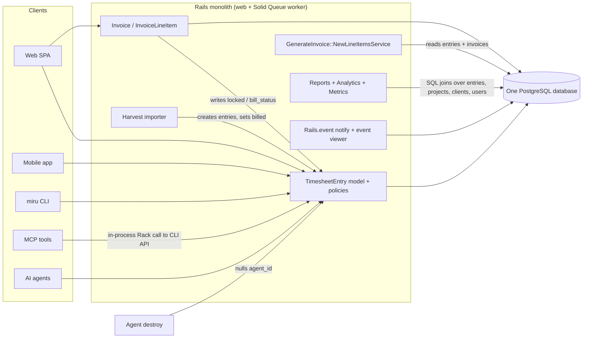
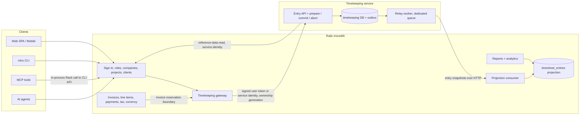
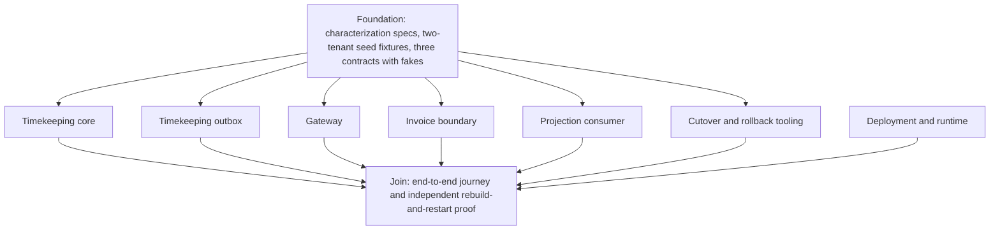

# Cobb Your Dependencies: separating timekeeping from billing and reporting

**Status:** Proposed design for review. This document does not authorize anyone to implement the architecture or start the migration.

**Publishing note:** The docs site build (`docs/docusaurus.config.js`) includes only `intro.md`, `contributing-guide/`, `product-guide/` and `ai/`. This file is therefore not published on the docs site. It is meant to be read in the repository and in review.

## How to read this document

Each statement in this document falls into one of three kinds, and every section labels which one it holds:

- **Observed:** read from the code or specs in this repository. Every observed statement cites the file it comes from. Line numbers appear only where they were checked while writing.
- **Assumption:** believed true but not proven by the code here, for example how production data is distributed. An assumption is never used as the only ground for a decision.
- **Proposed:** part of the target design. A proposed rule is not current behaviour, even when it reads like a requirement.

"Monolith" means the single Rails application in this repository. "Tenant", "company" and "workspace" all mean the `Company` record that owns a customer's data.

### Goals, in order

1. **Depth over breadth.** One real, complete extraction, proven end to end, including rollback and re-cutover. Not a broad rewrite left half done.
2. **Boundaries that reduce complexity.** The entry and invoice callbacks that lock time today become three components a reader can understand on their own: a write gateway (section 3.1), one reservation rule (section 7.2), and one read model (section 3.3).
3. **Real parallel work.** Implementation lanes that are independent because their contracts are fixed (section 14).

### Decided scope

The repository owner reviewed and decided these against the code at `main`. They are inputs to this design, not options.

- **One new service.** One independently deployable Timekeeping application with its own database, in this repository. Identity, catalogue, billing and reporting stay in the monolith.
- **One cutover for the whole dataset.** Both seeded businesses move together, in one bounded write pause, under one global ownership generation (section 10). Tenant isolation is proven by tests on both tenants.
- **Durations and money keep their current types and values** (section 8.1).
- **`timesheet_entries` is the one read model,** a read-only projection written only by the projection consumer (section 3.3).
- **One event stream, one consumer, no broker** (section 5.4).
- **Every entry writer keeps its route and goes through one gateway** (sections 3.1 and 10.1).
- **Characterization first:** today's real behaviour is pinned by specs before any change (section 12.1).
- **The gateway and the invoice reservation boundary are inside the scope.**
- **Three deliberate behaviour fixes,** kept through rollback (section 2.3).

## 1. Existing architecture and its important dependencies

### 1.1 Runtime shape (observed)

- One Rails application image is deployed with Kamal (`config/deploy.yml`). The deployment defines a `web` role and a `worker` role. The worker runs `bundle exec rake solid_queue:start`, so background jobs run on Solid Queue.
- One PostgreSQL database holds every table, including time entries, invoices, payments and reports data (`db/schema.rb`). The app is configured through environment keys such as `DATABASE_URL` and `REDIS_URL`. This document names configuration only by key, never by value.
- Jobs inherit retry rules from `app/jobs/application_job.rb`: `ActiveRecord::Deadlocked` gets `attempts: 3`, and connection failures (`ActiveRecord::ConnectionFailed`, `PG::ConnectionBad`) get `attempts: 5`. `attempts` counts the first run, so these are 2 and 4 retries.
- The existing architecture overview is `docs/contributing-guide/architecture-diagram.md`.



### 1.2 The time entry record (observed)

Source: `app/models/timesheet_entry.rb`, table `timesheet_entries` in `db/schema.rb`.

- One row carries three separate state fields:
  - `bill_status`, an integer enum: `non_billable`, `unbilled`, `billed`.
  - `review_status`, an integer enum: `not_required`, `pending_review`, `approved`, `rejected`.
  - `locked`, a boolean that defaults to `false`.
- `duration` is a `float` column holding minutes. The model allows values from `0.0` to `6000000`.
- Tenancy is derived through `project → client → company` (`has_one :client, through: :project`, `has_one :company, through: :client`). The scope `in_workspace(company)` filters on `company.project_ids`. Step S1/S2 (section 10.2) added a nullable `company_id` column and a `version` column (default 0). A `before_save` callback stamps `company_id` from the project's client on create and on a project change. No existing check reads the column yet: they still go through the association.
- Tenancy is enforced by convention, not by a default scope. No model in `app/models/` declares `default_scope`. Controllers scope their queries through `current_company` (`app/controllers/concerns/current_company_concern.rb`), and a query that does not start from it is not filtered by tenant.
- The model is `audited associated_with: :company`. The audited columns are `duration`, `work_date`, `note`, `bill_status`, `review_status`, `project_id`, `user_id`, `agent_id`, `source`, `source_metadata`, `proof_url`, `proof_metadata` and `discarded_at`. **`locked` is not in that list, so lock and unlock changes leave no audit record today.**
- `has_one :invoice_line_item, dependent: :destroy` ties the entry to billing. Entries are normally soft-deleted through `Discardable`, so this destroy cascade only runs on a hard delete.
- After create, the model emits `TimesheetEntries::Created` (`app/events/timesheet_entries/created.rb`).
- `source` takes one of `manual`, `cli`, `mcp`, `automation`, `import`. The model infers it from `source_metadata`.

### 1.3 Writers of time entries (observed)

| Entry point | Code | User context |
|---|---|---|
| Web API (also used by mobile) | `app/controllers/api/v1/timesheet_entry_controller.rb`; mobile routes to it through `config/routes/api.rb` (`controller: "/api/v1/timesheet_entry"`), covered by `spec/requests/api/v1/mobile/timesheet_entries_spec.rb` | Signed-in user; `Current.user` set by `app/controllers/concerns/set_current_details.rb` |
| Bulk move and delete | `app/controllers/api/v1/timesheet_entry/bulk_action_controller.rb` | Signed-in user |
| CLI | `app/controllers/api/v1/cli/timesheet_entries_controller.rb` | Signed-in user; reads entries through `current_user.timesheet_entries.kept.in_workspace(current_company)` |
| MCP tools | `app/mcp/tools/time_create_tool.rb`, `time_update_tool.rb`, `time_delete_tool.rb` | The user's credential. The tools call the CLI API **in-process**, not over HTTP: `app/mcp/tools/base_tool.rb` calls `MCP::Miru::ApiProxy.request`, which runs `Rack::MockRequest.new(Rails.application).request(...)` and sets `miru.event_source = "mcp"` (`app/mcp/api_proxy.rb:40`). So the CLI controller is the MCP writer too. |
| Agent | `app/controllers/api/v1/agent/timesheet_entries_controller.rb` | `Current.user` set to the agent's user (`app/controllers/api/v1/agent/base_controller.rb`). The controller passes `source: "automation"`, but the model's `normalize_source_fields` rewrites it to `mcp` when `source_metadata["mcp_server"]` is present (`inferred_source`, `app/models/timesheet_entry.rb:251-254`). |
| Harvest import | `app/services/imports/harvest_time_entries_importer.rb` (`create_entry`) | Runs as a job; no request user |
| Billing callbacks | `app/models/invoice.rb`, `app/models/invoice_line_item.rb` (section 1.4) | Whatever user saved the invoice |
| Agent destroy | `app/models/agent.rb:17`, `has_many :timesheet_entries, dependent: :nullify`. Destroying an agent rewrites `agent_id` to `NULL` on its entries. No controller destroys an agent directly; the destroy runs through `has_many :agents, dependent: :destroy` on `User` (`app/models/user.rb:39`) and on `Company` (`app/models/company.rb:49`). | Whoever destroys the user or company |
| Seed and demo data | `db/seeds.rb:325-329` (`seed_entry!`, which also sets `locked: false`), `db/seeds.rb:435` and `:602` (`update!(bill_status: :billed)`), `db/seeds/timesheet_data.rb:185` (`find_or_create_by!`), and `Analytics::DemoSeeder#seed_timesheet_entries` (`app/services/analytics/demo_seeder.rb:162`, run by `lib/tasks/analytics_demo.rake`) | No request user |

The desktop timer client was not traced while writing this section. Whether it calls the web API or the CLI API is an open question for the review.

**User hard delete (observed).** A super admin can permanently delete a user: `Api::V1::UsersController#destroy` calls `target_user.destroy!` (`app/controllers/api/v1/users_controller.rb:51-82`). `User` declares `has_many :timesheet_entries` with no `dependent:` option (`app/models/user.rb:38`), so the foreign key `timesheet_entries → users` (`db/schema.rb:1443`) makes the delete fail when the user has any entry. That key is the only check that stops a user with time entries from being deleted.

### 1.4 Billing writes timekeeping state directly (observed)

This coupling is the main reason timekeeping cannot be deployed on its own today.

- `app/models/invoice.rb:62` runs `after_save :lock_timesheet_entries, if: :draft?`. On every save of a draft invoice, it sets `locked: true` on every entry the invoice references, through `TimesheetEntry.in_workspace(company)`.
- `app/models/invoice.rb:63` runs `after_discard :unlock_timesheet_entries, if: :draft?`. It unlocks only when the invoice is still a draft. **A discarded invoice that has left draft leaves its entries locked.**
- **Discarding a draft also leaves its entries locked.** The unlock at line 63 runs first. Then `after_discard :update_invoice_number` (line 64) calls `self.update(invoice_number: "ARC-...")` (`app/models/invoice.rb:323-325`). That save fires `after_save :lock_timesheet_entries, if: :draft?` (line 62) again, because the invoice is still a draft, and the entries end the discard locked.
- Single invoice delete is a soft `invoice.discard!` (`app/controllers/api/v1/invoices_controller.rb:59-62`). Bulk delete is a hard destroy: `current_company.invoices.where(id: params[:invoices_ids])`, with no `.kept` filter, then `destroy` on each (`app/controllers/api/v1/invoices/bulk_deletion_controller.rb:7-8`). An invoice with payments fails to destroy (`has_many :payments, dependent: :restrict_with_error`, `app/models/invoice.rb:42`) and is reported back with a 422. Otherwise `has_many :invoice_line_items, dependent: :destroy` (line 40) runs each line item's `before_destroy :unlock_timesheet_entries`, which unlocks only when the invoice is a draft. **So a hard-destroyed non-draft invoice leaves its entries locked with no invoice, kept or discarded, that references them.**
- `app/models/invoice_line_item.rb:11` runs `before_destroy :unlock_timesheet_entries`. It unlocks only when the parent invoice is a draft. It uses `TimesheetEntry.where(id: associated_timesheet_entry_ids)` with **no workspace filter**. `dependent: :destroy` on `invoice_line_item_time_entries` (line 6) runs first, so unless `linked_timesheet_entries` was already loaded on that instance, `linked_timesheet_entry_ids` is empty by then and the unlock reaches only the direct `timesheet_entry_id`. In that case, which includes the bulk delete's freshly loaded line items, **a project aggregate line's linked entries stay locked with no invoice referencing them**, even on a draft (L4).
- `Invoice#update_timesheet_entry_status!` (`app/models/invoice.rb:126-128`) sets `bill_status: :billed` on the invoice's kept entries, through `TimesheetEntry.kept.where(id:)` with no workspace filter.
- An entry is referenced by an invoice in one of two ways:
  - Directly, through `invoice_line_items.timesheet_entry_id`.
  - As part of a project aggregate line, through the join table `invoice_line_item_time_entries` (`linked_timesheet_entry_ids`). `app/mcp/tools/invoice_create_tool.rb` accepts these ids too.
- Both line-item validations, `timesheet_entry_belongs_to_invoice_company` and `linked_timesheet_entries_belong_to_invoice_company` (`app/models/invoice_line_item.rb`), require the entry's company to equal the invoice's company.
- `db/schema.rb` declares foreign keys from both billing tables to `timesheet_entries`: `invoice_line_item_time_entries → timesheet_entries` and `invoice_line_items → timesheet_entries`, together with `timesheet_entries → agents`. Step S1 (section 10.2) drops all three, but only in a release that follows one already running the model validations that refuse an id that names no row: the existence checks in `app/models/invoice_line_item.rb` and `app/models/timesheet_entry.rb`, and the required `belongs_to :timesheet_entry` on `InvoiceLineItemTimeEntry`. Those validations are in place now; `db/migrate/20261020120000_drop_timesheet_entry_foreign_keys.rb` keeps the keys.
- Spec: `spec/requests/api/v1/invoices/create_spec.rb` (around lines 180–212) asserts that entries are locked after an invoice is created.
- Mobile collections create invoices and payments outside `InvoicePolicy`. `Api::V1::Mobile::CollectionsController` skips Pundit's `verify_authorized` and checks only that the company has pro access and that the user is an owner, admin, book keeper or **employee** (`authorize_mobile_collection!`, `app/controllers/api/v1/mobile/collections_controller.rb`). An employee can therefore create a `sent` invoice (`create_invoice!`) and record a cash or UPI payment (`record_manual_payment!`). These invoices carry one line item with no time entry, so they reference no entries.

### 1.5 Choosing entries to invoice (observed)

Source: `app/services/generate_invoice/new_line_items_service.rb`.

- Candidates are limited to the client's kept projects (`client.projects.kept`), entries whose stored `company_id` is the client's company, `bill_status: "unbilled"` and `discarded_at: nil`. The team-member filter options read the same company's entries.
- `filtered_ids` excludes entries that are already on a line item of a kept invoice and are still unbilled. It reads only the client's company's kept invoices (`company_kept_invoice_ids`) and only that company's entries, so another company's invoices cannot change the list.
- Entries on a discarded invoice are no longer excluded. Because `locked` is not part of the candidate filter, an entry that stayed locked after a non-draft discard can still be offered for a new invoice if it is unbilled.
- Rates come from `ProjectMembersPresenter#project_to_member_hourly_rate`. The service only **suggests** a quantity: the entry's float `duration` for a direct line (`app/services/generate_invoice/new_line_items_service.rb:112`) and the float sum `entries.sum(&:duration)` for a project aggregate (`:141`). The client then posts the line item's `quantity`, and `invoice_line_items.quantity` is an `integer` column (`db/schema.rb:622`), so any fractional minutes are cast away when the line item is stored.
- Nothing in the database stops one entry from appearing on two invoices. `invoice_line_items.timesheet_entry_id` has only non-unique indexes. `invoice_line_item_time_entries` is unique only on the pair `(invoice_line_item_id, timesheet_entry_id)` (`db/schema.rb`, `idx_line_item_time_entries_unique_pair`).

### 1.6 Money and rounding (observed)

Sources: `app/models/invoice.rb`, `app/models/invoice_line_item.rb`, `db/schema.rb`.

- Stored columns:
  - `invoices.amount`, `amount_due`, `amount_paid`, `outstanding_amount`, `discount`, `tax` and `base_currency_amount` are `decimal(20,2)`.
  - `invoices.exchange_rate` is `decimal(18,10)`.
  - `invoice_line_items.rate` is `decimal(20,2)`, and `quantity` is an `integer` of minutes.
  - `invoice_taxes.amount` is `decimal(20,2)` and `value` is `decimal(20,4)`.
- The invoice subtotal is computed in floats: `sum((quantity.to_f / 60) * rate.to_f).round(2)`. The total is `(subtotal - discount.to_f + tax.to_f).round(2)`.
- Tax amounts are summed as `BigDecimal` and rounded to 2 places. Each tax line is recalculated from the subtotal only while the invoice is new or a draft (`should_recalculate_invoice_taxes?`).
- `totals_recalculation_needed?` is also true when `status` changes. So a status change can rewrite `amount`, `amount_due` and `outstanding_amount` from the stored line items. For a paid or waived invoice, `amount_due` and `outstanding_amount` become `0`.
- Line-level `total_cost` rounds to 3 places: `(hours_spent * rate).round(3)` (`app/models/invoice_line_item.rb:48-50`). `InvoiceLineItem.total_cost_of_all_line_items` uses SQL `sum(quantity * rate) / 60.0`, rounded to 3 (`app/models/invoice_line_item.rb:22-24`). The two invoice-level and line-level paths therefore round differently.
- **The PDF does not print the stored `amount` as its total.** `PdfGeneration::InvoiceService` recomputes the subtotal as `total_cost_of_all_line_items` (rounded to 3) and the total as `subtotal + tax - discount`, unrounded (`PdfGeneration::InvoiceTotals` in `app/services/pdf_generation/invoice_totals.rb:16-36`, which `InvoiceService` and `InvoiceService.printed_totals` both read). The stored `amount` is `(subtotal - discount + tax).round(2)` from a float subtotal rounded to 2 (`total_attributes_for` in `app/models/invoice.rb`). So the printed total can differ from the stored `amount`.
- `base_currency_amount = (amount * rate).round(2)`. The rate is looked up for the issue date (or today) through `CurrencyConversionService.get_exchange_rate` and stored with `exchange_rate_date`.
- The audit log does not cover the invoice's money. `audited` on `Invoice` lists only `amount`, `base_currency_amount`, `exchange_rate`, `exchange_rate_date`, `currency`, `status`, `amount_paid` and `amount_due` (`app/models/invoice.rb:10-11`). It omits `discount`, `tax` and `outstanding_amount`. `InvoiceLineItem` and `InvoiceTax` are not audited at all. Financial parity across a migration therefore has to be proven by comparing snapshots of the stored values and the rendered PDF totals (section 13), not by reading the audit log.

### 1.7 Reporting reads timekeeping data in SQL (observed)

- `app/services/reports/time_entries/report_service.rb` builds report rows from `TimesheetEntry` with `includes(:user, project: :client)` and company and date filters. It groups and sums duration.
- `app/services/analytics/team_productivity_analytics.rb` sums duration by user and splits it into billable (`unbilled` or `billed`) and non-billable.
- `app/services/metrics/data_builder.rb` filters `bill_status: :billable` at lines 85 and 140. `billable` is not one of the enum's values. Line 86 filters `:non_billable`, which is a real value. What the `:billable` queries return at runtime was not checked while writing this document; they are recorded as a defect to confirm, and kept as they are (section 15.1).
- The client revenue report also reads time entries: `Reports::ClientRevenues` sums `TimesheetEntry.kept` duration per client in `hours_logged_by_client` (`app/services/reports/client_revenues/report_decorator.rb:159-168`). The accounts-aging and outstanding/overdue reports (`app/services/reports/accounts_aging/`, `outstanding_overdue_invoices/`) read only billing tables.
- Other readers that aggregate entries: `app/controllers/analytics_controller.rb` (`analytics_timesheet_entries`, line 371), `app/controllers/api/v1/projects_controller.rb:21`, the totals in `app/models/client.rb` and `app/models/project.rb`, `app/services/clients/index_service.rb`, `app/services/team/index_decorator.rb`, `app/services/team/removal_impact_service.rb`, `app/services/weekly_reminder_for_missed_entries_service.rb`, `app/services/reports/time_entries/` and `app/services/analytics/growth_metrics_service.rb`.
- The entry API's own list reads go through `TimeTrackingIndexService` (`app/services/time_tracking_index_service.rb`), used by `app/controllers/api/v1/timesheet_entry_controller.rb` and `app/controllers/api/v1/time_tracking_controller.rb`.

### 1.8 Events and idempotency (observed)

- Events are in-process. `app/events/application_event.rb` builds `{ actor, data }`. The time-entry events cover creation only (`TimesheetEntries::Created`). Invoices emit `Invoices::Created`, `Invoices::Sent` and `Invoices::StatusChanged`.
- `docs/ai/events.md` says events are stored in the same transaction, behind a savepoint, so a failed insert cannot abort the operation. It calls the history "best-effort observability, not a mandatory audit trail or delivery queue". Pruning is manual with a seven-day default. No outbox or message broker exists.
- MCP write tools deduplicate through `app/mcp/idempotency_store.rb`:
  - The key is a SHA-256 digest of the tool name, a digest of the caller's authorization value, and the client's idempotency key. The key is therefore scoped to the caller.
  - A Postgres advisory lock guards each key.
  - Only successful responses are cached, in `mcp_idempotency_records`, for 24 hours.
  - Spec: `spec/mcp/idempotency_store_spec.rb`.
  - The store wraps the in-process call to the CLI API (`write_request` in `app/mcp/tools/base_tool.rb`), so deduplication happens before the request reaches the time-entry controller.

## 2. Observed behaviour that must be preserved

Each row below is current behaviour, cited to its source. The target design must keep it unless it is listed in the deliberate-fixes table (section 2.3). Rows marked **(quirk)** are odd but observed. Changing them would change customer-visible state, so they are preserved as they are, and any correction needs a separate owner decision.

**Agent calls do not get every row in 2.1.** The agent API skips Pundit (`skip_after_action :verify_authorized`, `app/controllers/api/v1/agent/base_controller.rb:7`) and only creates entries. Its one check before saving is a project scope: the project must be found in `ProjectPolicy::Scope.new(current_agent.user, current_company).resolve` (`app/controllers/api/v1/agent/timesheet_entries_controller.rb:4-18`, `:28-31`). The model validations, including S1–S4 and S7 below, still run on `save!`. The policy rows A1–A5 do not apply to it.

### 2.1 Authorization

| # | Behaviour | Source |
|---|---|---|
| A1 | Owner and admin see every kept entry in their current workspace; other users see only their own kept entries in it. | `TimesheetEntryPolicy::Scope#resolve` in `app/policies/timesheet_entry_policy.rb` |
| A2 | `update?` and `destroy?` refuse any `billed` entry, for every role. | `app/policies/timesheet_entry_policy.rb`; `spec/policies/timesheet_entry_policy_spec.rb` |
| A3 | A user who is not owner or admin of the entry's company cannot change an entry whose `work_date` is older than `company.timesheet_edit_days` days. | `stale_entry_for_non_privileged?` in the policy; `timesheet_edit_days` validated to `1..365` in `app/models/company.rb:83` |
| A4 | Non-privileged users may change only their own entries. | `update?` in the policy |
| A5 | Only owner or admin may create an entry for another user in the web API; others get `Pundit::NotAuthorizedError`. | `timesheet_entry_user` in `app/controllers/api/v1/timesheet_entry_controller.rb` |
| A6 | An employee cannot edit a `locked` entry; an admin can. | `prevent_edit_if_locked` in `app/models/timesheet_entry.rb`; `spec/models/timesheet_entry_spec.rb:496-530` |
| A7 | An employee cannot change an entry away from `billed`. | `ensure_billed_status_should_not_be_changed` in the model |
| A8 **(quirk)** | Both A6 and A7 are skipped when `Current.user` is nil, which is the case for jobs and imports. | Same model methods (`return if Current.user.nil?`) |
| A9 **(quirk)** | The bulk controller re-implements the checks in `entry_locked?` (billed, or past the edit window for non-privileged users). It does **not** check `locked`. Bulk move uses non-raising `update`, so an entry that fails validation is skipped silently while the response still reports success. | `app/controllers/api/v1/timesheet_entry/bulk_action_controller.rb` |
| A10 **(quirk)** | Delete paths (`discard!`, `discard_all`) do not run validations, so A6 never applies to deletes. Policy and bulk checks still apply. | Controllers above; `Discardable` |
| A11 **(quirk)** | Any user allowed to update an entry can set `bill_status` to `billed` through the web, CLI or MCP update parameters, because only changes *away from* `billed` are guarded. | `timesheet_entry_params` and `cli_timesheet_entry_params` permit `bill_status`; `app/mcp/tools/time_update_tool.rb` allows `billed` |

### 2.2 State values and transitions

| # | Behaviour | Source |
|---|---|---|
| S1 | A new entry gets `unbilled` on a billable project and `non_billable` otherwise, unless a value is given. | `ensure_bill_status_is_set` |
| S2 | An entry cannot be created as `billed`. | `ensure_bill_status_is_not_billed` |
| S3 | `unbilled` is rejected on a non-billable project. | `validate_billable_project` |
| S4 | An entry with an agent is forced to `pending_review` when its review status is blank or `not_required`; other entries default to `not_required`. | `ensure_review_status_is_set`; `spec/models/timesheet_entry_spec.rb:215` |
| S5 | **No code moves an entry to `approved` or `rejected`.** A search of `app/` for `review_status` finds only the model and the demo seeder. The review queue described in `docs/miru-ai-agent-billing-autoplan.md` is not built. | Search of `app/**/*.rb` |
| S6 | Invoicing ignores `review_status`: `pending_review` entries can be offered and invoiced today. | `app/services/generate_invoice/new_line_items_service.rb` has no review filter |
| S7 | An agent entry must belong to the agent's company, and its user must be the agent's user. | `validate_agent_belongs_to_workspace` |

### 2.3 Locking and billing

| # | Behaviour | Source |
|---|---|---|
| L1 | Every save of a draft invoice locks every entry it references, scoped to the invoice's company. | `app/models/invoice.rb:62`, `lock_timesheet_entries` |
| L2 **(quirk)** | Discarding a draft invoice leaves its entries **locked**. `after_discard :unlock_timesheet_entries` unlocks them, then `after_discard :update_invoice_number` calls `update`, which fires `after_save :lock_timesheet_entries` again while the invoice is still a draft. Fixed by the target design (deliberate fixes, below). | `app/models/invoice.rb:62-64`, `:323-325` |
| L3 **(quirk)** | Discarding an invoice that has left draft does **not** unlock its entries; they stay locked with no kept invoice holding them. | Same callback, `if: :draft?` |
| L4 **(quirk)** | Destroying a line item on a draft invoice unlocks its **direct** entry (`timesheet_entry_id`); on a non-draft invoice it unlocks nothing. The unlock uses `TimesheetEntry.where(id:)` with no workspace filter. A project aggregate line's linked entries can stay locked even on a draft: `has_many :invoice_line_item_time_entries, dependent: :destroy` (line 6) is declared before `before_destroy :unlock_timesheet_entries` (line 11), so the join rows are already gone when the unlock reads `linked_timesheet_entry_ids`. That read finds nothing unless `linked_timesheet_entries` was already loaded on the same instance. A small ActiveRecord 8.1.3.1 model with the same callback order showed both cases: a freshly loaded line item, as the bulk delete destroys, left the linked entries locked; a preloaded one unlocked them. The S0 characterization specs pin the real paths (section 12.1). This covers a line item removed from a draft and every line item of a draft destroyed by the bulk invoice delete; the line items of a hard-destroyed non-draft leave all their entries locked (section 1.4). | `app/models/invoice_line_item.rb:6`, `:11`, `:133-141` |
| L5 **(quirk)** | Among invoice flows, only `InvoiceMailer#invoice` marks entries `billed`, through `after_action :update_status` (`app/mailers/invoice_mailer.rb:4`, `:73`). That mailer is enqueued only by `Invoice#send_to_email` (`app/models/concerns/invoice_sendable.rb`). A repository search finds no production caller of `send_to_email`; only `spec/models/invoice_spec.rb:200-215` calls it. Outside invoices, `billed` is also set by the Harvest import (L7), by any user allowed to edit the entry (A11), and by the seed data (section 1.3). | Search for `send_to_email` and `bill_status: :billed` |
| L6 **(quirk)** | The live send path, `send_invoice` in `app/controllers/api/v1/invoices_controller.rb`, uses `InvoiceMailer#send_invoice` and `record_send!`. These set the invoice to `sent` and emit `Invoices::Sent`, but never mark entries billed. **Entries on sent invoices therefore usually stay `locked` and `unbilled`.** | `app/controllers/api/v1/invoices_controller.rb:64`; `app/models/concerns/invoice_sendable.rb` |
| L7 **(quirk)** | The Harvest import creates entries as `unbilled` and then calls `entry.update!(bill_status: :billed)` with no invoice. So `billed` is not always backed by an invoice link. | `app/services/imports/harvest_time_entries_importer.rb` (`create_entry`); `spec/services/imports/harvest_time_entries_importer_spec.rb` |
| L8 | A line item's direct and linked entry ids resolve only to entries whose stored `company_id` equals the invoice's company. A missing id, another company's id and an entry with a NULL `company_id` all get the same "not found" error. | `app/models/invoice_line_item.rb` validations; `spec/models/invoice_line_item_spec.rb` ("company of the timesheet entries") |

**Deliberate fixes.** The repository owner chose to fix three legacy billing behaviours. Historical invoices and amounts do not change. These three are the only rows in section 2 the target design changes, and all three fixes are kept through rollback.

| Case | Today (observed) | After (proposed) | What a user sees |
|---|---|---|---|
| An entry already on a kept invoice is put on a second one | Allowed. Both invoices lock one boolean. Candidate selection hides such entries (`filtered_ids`, section 1.5), but explicit ids through the API or MCP (`app/mcp/tools/invoice_create_tool.rb`) get through, and no database constraint stops it (section 1.5). | Prepare is refused: the entry is on another invoice. | An explicit double allocation fails with a clear error instead of billing the time twice. Normal selection is unchanged. |
| A draft invoice is discarded (L2) | Its entries stay locked. `after_discard :unlock_timesheet_entries` runs, then `update_invoice_number` calls `update`, which fires `after_save :lock_timesheet_entries` again (`app/models/invoice.rb:62-64`, `:323-325`). | Its reservations are released. | An employee can edit time that was on a discarded draft. |
| A project aggregate line is removed from a draft, or a draft is destroyed (L4) | Its linked entries can stay locked with no invoice referencing them (the callback-order quirk in L4). | The entries the removed line referenced are released at commit when no remaining direct or grouped line of the draft references them; a destroyed draft releases its whole set. | Removing a line from a draft frees the time it covered. The direct entry's behaviour is unchanged. |

**Preserved as they are:** a discarded non-draft keeps its entries locked (L3); a line-item destroy releases only on a draft (L4); a sent invoice leaves entries unbilled (L6); the bulk move skips failing entries silently (A9); `bill_status` stays settable by any user who may edit the entry and by the import (A11, L7).

### 2.4 Money and history

| # | Behaviour | Source |
|---|---|---|
| M1 | Stored invoice and line-item amounts (section 1.6) are the customer's record. Past invoices show these stored values, not values recomputed from current rates. The PDF is the exception: it recomputes its subtotal (rounded to 3) and its total (unrounded) from the stored line items, tax and discount, so its printed total can differ from the stored `amount`. | `db/schema.rb`; `Invoice` callbacks only recompute on changes; `app/models/invoice_line_item.rb:22-24`, `:48-50`; `app/services/pdf_generation/invoice_totals.rb:16-36` |
| M2 | Line items copy `rate` and `quantity` when they are created; later entry or rate changes do not reach existing line items. | `app/services/generate_invoice/new_line_items_service.rb`; `app/models/invoice_line_item.rb` |
| M3 | Rounding differs by path (2 places at invoice level, 3 at line level) as described in section 1.6. Any figure a customer has seen must still come out the same. | `app/models/invoice.rb`, `app/models/invoice_line_item.rb` |
| M4 | Time-entry audit history, and the invoice columns `audited` lists, are kept per company. The audit log does not cover `discount`, `tax`, `outstanding_amount`, line items or invoice taxes (section 1.6), so it cannot prove financial parity; the financial snapshot comparison in section 13 does. | `app/models/timesheet_entry.rb`, `app/models/invoice.rb:10-11` |

### 2.5 Behaviour recorded but not preserved as-is

These are observed, but the target design must not expose them across a service boundary, because doing so would let one tenant reach another tenant's data. Later sections state the replacement and disclose it as a deliberate departure.

| # | Behaviour | Source | Why it is not carried forward |
|---|---|---|---|
| X1 | The line-item unlock looks entries up with `TimesheetEntry.where(id:)` and no company filter. | `app/models/invoice_line_item.rb`, `unlock_timesheet_entries` | Inside one process, the ids come from rows the company-match validations already checked. As a network command taking raw ids, the same lookup would let one tenant unlock another tenant's entries. |
| X2 | The candidate filter read `Invoice.kept.pluck(:id)` for every company. It now reads only the client's company's kept invoices and entries, and offers only entries whose stored `company_id` is the client's company. | `app/services/generate_invoice/new_line_items_service.rb`, `filtered_ids` | The returned rows were still limited to the client's projects, but another company's invoices could hide this company's entries. As a cross-service query, the old shape would collect invoice ids across tenants. |

For a single tenant, replacing X1 and X2 with company-scoped versions leaves the visible result unchanged.

### 2.6 Assumptions used later

These are not proven by the repository. They are stated here so later sections do not treat them as facts.

- **Assumption:** production holds entries in each quirk state (L3, L6, L7). The code allows them, but no production data was inspected.
- **Assumption:** the desktop timer writes through one of the APIs in section 1.3. This was not traced (section 1.3).
- **Assumption:** no external system reads `rails_event_viewer_entries` as a feed. No subscriber exists in `app/` (a search of the repository for `Rails.event.subscribe` finds no code), but other deployments were not checked.

## 3. Target architecture, service responsibilities and data ownership (proposed)

### 3.1 One new service, Timekeeping

The target extracts exactly one service, **Timekeeping**. It is an independently deployable application with its own database, kept in this repository. Identity, catalogue, billing and reporting stay in the monolith. There is no second service.

The time-locking callbacks of section 1.4 become three parts, each of which can be read on its own:

1. **The gateway**: one module in the monolith that is the only code allowed to write entry state or reservations.
2. **The reservation rule**: an entry has at most one reservation by a kept invoice (section 7).
3. **The read model**: `timesheet_entries`, kept as a read-only projection of Timekeeping (section 3.3).



Clients keep calling the monolith's existing routes. The monolith checks the session as it does today, and the gateway forwards the write to Timekeeping with a short-lived signed token (section 6) and the current ownership generation (section 10). Every client URL, the mobile routes and the MCP path stay unchanged. MCP needs no path of its own, because its tools call the CLI controller in-process (section 1.3).

**The gateway (proposed).** While Timekeeping owns the data, every entry-writing flow goes through the gateway. Each call carries the current ownership generation, and a stale generation is refused. The gateway covers:

- the web and mobile controller;
- the bulk controller;
- the CLI controller, which also serves MCP: MCP calls it in-process through `Rack::MockRequest` (`app/mcp/api_proxy.rb:40`), not over HTTP;
- the agent controller;
- the Harvest import;
- the invoice reservation boundary, which replaces the lock callbacks in `app/models/invoice.rb` and `app/models/invoice_line_item.rb` and `Invoice#update_timesheet_entry_status!`;
- **agent destroy:** `has_many :timesheet_entries, dependent: :nullify` (`app/models/agent.rb:17`) becomes a Timekeeping command that nulls `agent_id` on that company's entries, with an audit row.

Seed and demo-data builders (`db/seeds.rb`, `db/seeds/timesheet_data.rb`, `Analytics::DemoSeeder`) run only in the initial legacy state, before the first handoff begins. Each checks the ownership record before its first write and refuses once a handoff has begun, in either ownership state, and after a rollback: the prepared monolith writes its own authoritative tables and `timesheet_entries` stays a projection. Reseeding needs a fresh demo reset. The single-writer guard test (section 12.2) runs all three builders in each later state and asserts they change nothing.

Rules the gateway applies to every writer:

- **Generation on every write.** A writer that makes many writes checks the generation on each one, not once per job. These writers are the Harvest import, the bulk move and agent destroy. When the generation rises partway through, the remaining writes are refused. The writer fails visibly, and it is retried against the new owner.
- **Stale generation in the bulk move.** A generation refusal fails the whole bulk request with an error. It is not one of the silently skipped entries of A9. A9 covers entries that fail validation; the generation is an admission decision. This order between the two rules is a design choice.
- **The invoice-number rewrite is not a reservation change.** The invoice reservation boundary runs only when an invoice changes which entries it holds, or is discarded or destroyed. It never runs on every invoice save. A discarded draft's `update_invoice_number` save (`app/models/invoice.rb:323-325`) therefore cannot reserve its entries again (L2).

A single-writer guard test runs every flow above and fails if anything other than the projection consumer changes a `timesheet_entries` row (section 12).

### 3.2 Responsibilities

| Service | Owns and decides | Does not own |
|---|---|---|
| **Timekeeping** | Time entries (`duration`, `work_date`, `note`, `project_id`, `user_id`, `agent_id`, `source`, `source_metadata`, proof fields, `discarded_at`); `bill_status`; `review_status`; reservations (the replacement for `locked`, section 7) and their terminal operation records; entry audit history; entry rules A1–A11 for the callers section 6 names; entry idempotency receipts; the entry outbox. | Users, roles, companies, projects, clients, rates, invoices, money. |
| **Monolith: identity and catalogue** | Users, sessions, API tokens, roles (rolify), companies and `timesheet_edit_days`, clients, projects (`billable`, membership, hourly rates), agents. | Entry rows. |
| **Monolith: gateway** | Forwarding every entry write and every reservation operation to the current owner, with the current ownership generation (section 3.1). | Any decision about entry rules. It checks its input and hands off. |
| **Monolith: billing** | Invoices, line items (with their copied `rate` and `quantity`), invoice taxes, payments, exchange rates, invoice audit history, the choice of which entries to invoice, and the invoice operation ledger with its pending intents (section 9). | Entry state. It changes entry state only through the gateway. |
| **Monolith: reporting** | Reports, analytics and metrics, read from `timesheet_entries` (section 3.3). | Entry state. The projection is read-only and never authoritative. |

### 3.3 Authoritative data ownership

| Fact | Authority after migration | Others may hold |
|---|---|---|
| Entry fields, `bill_status`, `review_status` | Timekeeping | `timesheet_entries` projection (read-only copy) |
| Whether an entry is reserved, and by which invoice | Timekeeping (section 7) | The projection's `locked` boolean, which says only that a reservation exists |
| `company_id` of an entry | Timekeeping, stored on the entry (see 6.1) | Projection |
| Project `billable`, client → company, membership, rates | Monolith | Timekeeping reads them fresh per write (section 3.4) |
| Role of a user in a company, `timesheet_edit_days` | Monolith | Carried in the signed token per request |
| Invoice and line-item money, line-item → entry links | Monolith billing | Nobody else |

**One read model, one writer.** `timesheet_entries` stays in the monolith's database as a read-only projection of Timekeeping. Only the projection consumer writes it (section 5.4). No request path writes it as well ("write-through"). Aggregate readers keep their current queries unchanged.

**Two read rules.**

- **Reads that decide money, or that a user makes right after writing, read Timekeeping.** These are the entry API's own list and show reads (web, mobile, CLI, MCP, agent), including `TimeTrackingIndexService` behind `app/controllers/api/v1/timesheet_entry_controller.rb` and `app/controllers/api/v1/time_tracking_controller.rb`. They also include invoice candidate selection (`GenerateInvoice::NewLineItemsService`) and invoice validation.
- **Every aggregate reads the projection and may lag.** These are reports, analytics, metrics, the dashboard, project, client and team totals, and reminders: the readers listed in section 1.7.

**Billing rows hold no tokens.** The line-item columns `timesheet_entry_id` and `invoice_line_item_time_entries.timesheet_entry_id` stay as plain ids. A reservation is identified by (entry, invoice) and lives in Timekeeping, so rollback never edits billing tables.

**Foreign keys.** Three keys point from or into `timesheet_entries` at rows that can change on the other side of the boundary. They are dropped before cutover, in their own migration, in the release after the one that ships the model validations replacing them (section 10.2, step S1). `db/migrate/20261020120000_drop_timesheet_entry_foreign_keys.rb` keeps them; the drop is a later migration. The `db/schema.rb` line numbers below are from an earlier version of that file:

- `invoice_line_item_time_entries → timesheet_entries` (`db/schema.rb:1282`) and `invoice_line_items → timesheet_entries` (`:1284`). Otherwise a new entry can be invoiced before the projection holds its row, and the key rejects the line item. Existence and same-company (L8) are checked by the prepare response, which is authoritative (section 5.3).
- `timesheet_entries → agents` (`:1325`). Agent destroy nulls `agent_id` in Timekeeping, and the null reaches the projection later. A kept key would either refuse the agent delete or stop the relay on a snapshot it cannot insert. While the relay is behind, an aggregate join can see an `agent_id` whose agent row is gone. This is a design choice, disclosed here.

The keys `timesheet_entries → projects` (`:1326`) and `timesheet_entries → users` (`:1327`) stay. Today the users key is the only check that stops a user with time entries from being hard-deleted (section 1.3). After cutover that key sits on the projection, which lags: a user with a freshly logged, not yet projected entry would delete cleanly, and that entry's snapshot would then fail the key and stall the one relay that feeds every report and rollback. So, from the first handoff on, the monolith refuses a user hard delete (the super-admin destroy, `app/controllers/api/v1/users_controller.rb:51-82`) with a clear error. It reads the ownership record (section 10.1) and nothing else. Un-gating it is a production-rollout item (section 15.4). The refusal runs first in the destroy, before its audit row and before any dependent effect (the agent destroys through `User`, `app/models/user.rb:39`), so a refused delete leaves no trace. It holds from the moment the first handoff begins, in either ownership state, during a handoff, after an aborted handoff and after a rollback: the gate reads the ownership record and refuses whenever `handoff_step` is set or the generation is above its initial value. Before the first handoff the monolith behaves as today. No new distributed check is added. Normal employment discard, team removal and project or client discard are unchanged. No code in `app/` destroys a project.

### 3.4 Reference data Timekeeping needs, and how it reads it

Timekeeping's rules read facts the monolith owns: project `billable` (S1, S3), client → company (tenancy), project membership, the agent's user and company (S7), the user's role and `timesheet_edit_days` (A1–A7).

Today (observed), the role and `timesheet_edit_days` are read in `authorize`, before the write's transaction opens. The controller calls `authorize` (`app/controllers/api/v1/timesheet_entry_controller.rb:30`, `:40`, `:48`), and the policy reads `record.project.client.company.timesheet_edit_days` (`app/policies/timesheet_entry_policy.rb:46`). Only the model validations, which read project `billable` and the agent's company, run inside the save's transaction. The target reads the same facts once per request, as fresh as today:

- **User-delegated writes.** The monolith mints the signed token per request. Its claims carry the user's current role in the company, `timesheet_edit_days`, and for each project the request touches: `company_id`, `billable` and whether the user is a member. Timekeeping takes these claims as the facts for that write.
- **Background writes** (reservation operations, imports and agent destroy). Timekeeping calls a monolith read endpoint, `GET /internal/v1/companies/{company_id}/reference?project_ids=…`, with its own service identity, before deciding.
- **Agents (S7).** The reference response lists every agent of the company, active or not, as `{ id, user_id }` only (`contracts/timekeeping/reference.yml`, `agent_fields`). Timekeeping checks an entry's agent against this list before the write, so a snapshot the projection would refuse is not committed. The list is read before the write's transaction opens, so an agent moved or deleted in between is still caught by the projection's own check.
- **Deploy order for the agents list.** Deploy the monolith first: callers that do not read `agents` ignore the extra key. A Timekeeping that requires `agents` beside a monolith that does not send it refuses every write that reads the reference endpoint with `503 reference_unavailable`. To roll back, roll Timekeeping back first, then the monolith.
- **When the facts cannot be read** (expired token, missing project claim, monolith endpoint down), the write is refused with a retryable `503 reference_unavailable`. It fails closed: Timekeeping never guesses and never falls back to an older copy.
- There are no cross-database joins.

The cost: entry writes depend on the monolith being up. Today they do too, because they run inside it, so this is no worse for availability. It is still recorded as an integration risk.

### 3.5 What stays in the monolith, and why

- **Billing stays.** Invoices are bound to clients, payments, taxes, exchange rates, Stripe and receivables reports (`app/services/reports/accounts_aging/`, `outstanding_overdue_invoices/`). Extracting billing would add a second network boundary through money flows without giving any table a clearer owner.
- **Reporting stays.** It is a read concern over data from both sides. A projection inside the monolith serves it without a third service.
- **Identity and catalogue stay.** Every other feature depends on users, companies and projects.

## 4. Alternatives considered

| Option | What it costs | Verdict |
|---|---|---|
| A. Move timekeeping code into modules or service classes inside the monolith | No independent deployment and no separate data ownership, which the goal rules out explicitly. Billing callbacks could still write entry rows. | Rejected. Useful only as a preparatory refactor before extraction. |
| B. Separate deploy, shared database | Deploys split, but both apps write `timesheet_entries`, so nobody owns the data. Schema changes need lock-step deploys. | Rejected. It keeps the coupling in section 1.4 and adds deploy coordination. |
| **C. One Timekeeping service with its own database (recommended)** | One new network boundary, two outboxes (Timekeeping's entry snapshots, and billing's delivery of commit and abort), a reservation protocol, and a migration. | Chosen. It is the smallest change that gives timekeeping its own deploy and data, and it removes billing's direct writes. |
| D. Two services: Timekeeping and Billing | Billing would have to call back for users, clients, projects, payments and rates. Every invoice screen becomes a cross-service read. | Rejected as unnecessary distributed complexity. It may be revisited later on its own merits. |
| E. Timekeeping plus a separate Reporting service | Another service and database for read-only data. Revenue reports would need billing data replicated too. | Rejected. The projection inside the monolith is enough. |
| F. Event-fed copies of reference data inside Timekeeping (instead of section 3.4) | Fewer synchronous calls, but a role, edit-window or project change would apply only when its event arrives. That weakens authorization rules A1–A7 for a period. | Rejected, recorded for review. It could return only with an owner decision that accepts the delay. |

## 5. API and event contracts, compatibility and versioning (proposed)

### 5.1 Common rules for every contract

- Every request and every event carries `company_id`. Timekeeping checks it against the entry's stored `company_id` and against the caller's identity (section 6). A mismatch returns `404 not_found`, the same answer as for a missing id, so a caller cannot probe other tenants.
- Every state-changing request carries an `Idempotency-Key` header. Timekeeping stores it in `idempotency_records`, keyed by `(company_id, actor_type, actor_id, operation, key)` and kept for at least 24 hours, which matches the MCP store (`app/mcp/idempotency_store.rb`). Only successful (2xx) responses are stored, as in the MCP store. A retry with the same key and the same body returns the stored success; a retry after an error, including a `409`, is evaluated again, so a conflict that has since cleared does not keep failing. The same key with a different body returns `422 idempotency_key_reused`. A key from another company or actor never matches. The 24 hours is a minimum, not an expiry: a stored receipt keeps answering replays until it is removed.
- A retried delete whose own lookup no longer finds the entry (the first delete committed, so the show route answers `not_found`) is sent as `DELETE` with `Idempotency-Replay: only` and the same `Idempotency-Key`. Timekeeping answers it only from the stored receipt and otherwise returns `404 not_found` with nothing changed, so it can never discard an entry the caller's lookup and policy did not approve. It also carries `If-Match: replay-only`, which never matches a version, so a Timekeeping release that does not read the header refuses it with `409 version_conflict` rather than discarding.
- Every API path is versioned in the URL (`/v1/…`). Every event carries `schema_version`. Additive changes (new optional fields) keep the version. Removing or retyping a field needs a new version, and both versions run in parallel until every consumer has moved.
- Money travels as decimal strings, for example `"125.50"`, never as floats (section 8). Timekeeping's contracts carry no money: billing keeps its own money, rate and quantity values. `duration` travels as a JSON number holding the stored float unchanged. It is never converted or rounded on the way (section 8.3).
- Write responses return the entry's `version` (a counter that rises on every change). Versions only advance, across cutover, rollback and re-cutover too (section 10). Updates may send `If-Match: <version>`; a stale version returns `409 version_conflict`. Clients that do not send it keep today's last-write-wins behaviour.
- Every state-changing request from the gateway carries the current ownership generation. A request with a stale generation returns `409 stale_generation` and changes nothing.

### 5.2 Entry API (user-delegated)

Illustrative shapes. Field names follow the current JSON in `app/views/api/v1/` where one exists.

```text
POST   /v1/companies/{company_id}/entries
PATCH  /v1/companies/{company_id}/entries/{entry_id}
DELETE /v1/companies/{company_id}/entries/{entry_id}
GET    /v1/companies/{company_id}/entries/{entry_id}
GET    /v1/companies/{company_id}/entries?from=&to=&user_id=&project_id=
POST   /v1/companies/{company_id}/entries/bulk-move
POST   /v1/companies/{company_id}/entries/bulk-delete

Headers: Authorization: Bearer <signed user token>, Idempotency-Key: <uuid>,
         Ownership-Generation: <n>
Entry body: { project_id, user_id?, work_date, duration: 90.0, note, bill_status?,
              source, source_metadata, agent_id?, proof_url?, proof_metadata? }
Response:   { id, company_id, version, ...fields, locked: true|false }
```

`locked` in responses is `true` when the entry has a reservation (section 7), so client JSON does not change. The list and show reads are the entry API's own reads, served by Timekeeping (section 3.3). Bulk endpoints return a per-entry result list. To preserve A9, the monolith's bulk route still reports overall success as it does today; the per-entry list is new information it may log. A stale generation is not a per-entry result: it fails the whole bulk request (section 3.1).

### 5.3 Reservation operations and service commands (service identity)

The invoice reservation boundary uses three operations: prepare, commit and abort. Each is idempotent by a stable `operation_id`, which the monolith writes into its pending operation intent before it calls prepare (section 9). `invoice_id` is the stable invoice identity. It stays valid after the invoice row is hard-deleted, so the same operations cover invoice creation and deletion.

```text
POST /v1/companies/{company_id}/reservations/prepare
  { invoice_id, operation_id, generation, disposition: "active" | "retained",
    entries: [ entry_id, ... ] }                       -- the invoice's desired entry set
  -> 200 { operation_id, state: "prepared" | "committed" | "aborted",
           entries: [ { entry_id, company_id } ] }     -- company of each entry, authoritative for L8
  -> 409 { reason: "conflict", conflicts: [ { entry_id,
           reason: "on_another_invoice" | "provisional_elsewhere" | "not_found" } ] }   (nothing reserved)
  -> 409 { reason: "unresolved_operation", operation_id, retryable: true }
  -> 409 { reason: "stale_generation" }

POST /v1/companies/{company_id}/reservations/commit
  { invoice_id, operation_id, generation }
  -> 200 { reserved: <count>, released: <count> }

POST /v1/companies/{company_id}/reservations/abort
  { invoice_id, operation_id, generation }
  -> 200 { dropped: <count> }
```

- **prepare** reserves the invoice's new entries provisionally and keeps its committed ones.
- **commit** makes the desired entry set the reservation set and releases the entries it removed.
- **abort** drops only this operation's provisional reservations.
- `disposition: "retained"` is sent for a discarded or destroyed non-draft invoice, which keeps its reservations as a known owner. A discarded or destroyed draft sends an empty desired set, which releases its reservations at commit. Section 7 holds the rule these follow.
- A prepare is all or nothing: one conflict reserves nothing. `not_found` covers an entry outside `company_id`, so a caller cannot probe other tenants.
- A prepare for an operation that is already terminal returns its stored state and changes nothing. A new prepare for an invoice whose earlier operation is not yet terminal either carries that operation's outcome or gets `unresolved_operation` (retryable). Timekeeping keeps a terminal record (committed or aborted) for each (invoice, operation).
- `operation_id` is unique only within `company_id`. A replayed or guessed id from another company never matches.

```text
POST /v1/companies/{company_id}/invoices/{invoice_id}/mark-billed
  { operation_id, generation }
  -> 200 { billed: <count> }

POST /v1/companies/{company_id}/agents/{agent_id}/detach-entries
  { operation_id, generation }
  -> 200 { detached: <count> }
```

- **mark-billed** replaces `Invoice#update_timesheet_entry_status!`. It sets `bill_status: billed` on the kept entries that the invoice holds by committed reservation. Today that method runs only from the uncalled mailer path (L5), and the migration does not call it more often.
- **detach-entries** is agent destroy. It nulls `agent_id` on that company's entries for the agent and writes an audit row for each entry.

### 5.4 The entry snapshot stream

There is one event stream, one consumer and no broker. The stream exists so that `timesheet_entries` keeps every aggregate reader working (section 3.3).

**The outbox.** Every change to an entry, including a reservation change that flips `locked`, writes one **entry snapshot** row to Timekeeping's outbox in the same transaction as the change. The snapshot is the whole entry row:

- the columns of `timesheet_entries` in `db/schema.rb`: `id`, `project_id`, `user_id`, `agent_id`, `work_date`, `duration`, `note`, `bill_status`, `review_status`, `locked`, `source`, `source_metadata`, `external_run_id`, `external_session_id`, `proof_url`, `proof_metadata`, `discarded_at`, `created_at`, `updated_at`;
- `company_id` and `version`, which the projection gains as columns;
- `generation`: the ownership generation under which the write was admitted;
- `outbox_position`: the row's position in the owner's outbox.

`locked` says only that a reservation exists. It cannot carry which invoice owns the reservation, so reservations never travel through this stream (section 10). A column added to entries later is added to the snapshot in the same release. Payloads carry ids, not user names or emails.

**The relay.** A relay job delivers outbox rows in `outbox_position` order, over HTTP, to an internal monolith endpoint:

```text
POST /internal/v1/timekeeping/entry-snapshots
  Authorization: <Timekeeping service identity>
  { snapshots: [ { generation, outbox_position, entry: { ...snapshot } } ] }
  -> 200 { applied: <count>, ignored: <count> }
  -> 409 { reason: "stale_generation" }
```

The relay runs on its own queue, worked by its own dedicated worker. This follows the existing `billing_sync` worker in `config/solid_queue.yml`. That worker is started for the relay; the `default` worker is not (section 11). The relay marks a row sent only after a `200`, so delivery is at least once.

**The projection consumer** behind that endpoint is the only writer of `timesheet_entries`:

- It upserts by entry `id` and applies a snapshot only when its `version` is higher than the row's. A duplicate or reordered snapshot leaves the row unchanged, so no separate table of processed events is needed.
- A discard arrives as a snapshot with `discarded_at` set (a "tombstone"), never as a row delete. A delayed older snapshot therefore meets the newer row and cannot bring a discarded entry back.
- It accepts a snapshot whose `generation` is the current owner's. During a handoff, between closing admission and the ownership flip, it also accepts the outgoing owner's previous-generation snapshots, but only up to the final outbox position captured when that owner was frozen. The flip removes that permission. Every other stale-generation snapshot is refused, so a late relay retry from a retired owner cannot overwrite a write accepted after the handoff (section 10).
- While the prepared monolith owns the data after a rollback, its gateway writes its own entry tables and an outbox in one transaction, and the same relay and consumer write `timesheet_entries`.

**Removed from the design.** The monolith's `Projects::Changed`, `ProjectMemberships::Changed` and `Companies::SettingsChanged` events are removed. Nothing consumed them, because authorization reads reference facts synchronously (section 3.4).

**Not the delivery mechanism.** `rails_event_viewer_entries` is not used to deliver anything. `docs/ai/events.md` calls it "best-effort observability, not a mandatory audit trail or delivery queue", and it is pruned after seven days. The existing `Rails.event.notify` calls stay as observability only.

## 6. Tenant isolation, authorization and identity propagation (proposed)

### 6.1 Tenant on every row

- Timekeeping stores `company_id` on every entry, reservation, operation record, idempotency receipt, audit row and outbox row, and indexes queries by it. Today tenancy is enforced only by convention through `current_company` (section 1.2). In Timekeeping, the company is part of every key.
- The value is copied from the project's client's company when the entry is created or moved to another project. A project can change client, but `app/controllers/api/v1/projects_controller.rb` looks the new client up through `current_company.clients`, so a project cannot move to another company through that route. If such a move ever becomes possible, Timekeeping must re-stamp the project's entries in one transaction. That is recorded as a risk, not built.
- Idempotency receipts and invoice operation ids are keyed with `company_id`, in the API and in the handoff checkpoint (section 10). A key replayed or guessed from one company never returns or applies another company's stored result.
- X1 and X2 (section 2.5) are replaced by company-scoped lookups. Every Timekeeping query starts with `WHERE company_id = :company_id`. **This is a deliberate departure from preserving behaviour as-is.** For any single tenant the visible result is the same.

### 6.2 Two kinds of caller

| Kind | Who | Credential | Checks applied |
|---|---|---|---|
| **User-delegated** | Web, mobile, bulk, CLI (which also serves MCP), desktop timer | Short-lived token signed by the monolith: `sub` (user id), `company_id`, `role` in that company, `primary_role` in that company, `edit_days`, `projects` facts, `exp` (60 seconds), `jti`, and `purpose` (`read` or `write`) | A1–A7 and S1–S7, exactly as for that user today. A role claim is valid only for the `company_id` in the same token. `role` is the oldest owner or admin role the user holds in that company, matching the monolith's `has_role?` checks, and otherwise their primary role; it is the role the reference endpoint serves. `primary_role` is the user's lowest-id role there, and A6 and A7 decide on it, as the monolith's locked and billed validations do; a token without it falls back to `role`. Purpose is the only claim that tells a read token from a write token, so Timekeeping refuses a read token on every write route; a token without `purpose` is treated as a write token (section 11.2). Deploy the Timekeeping that reads `primary_role` before the monolith that signs the raised `role`. An older Timekeeping decides A6 on `role`, so it would let a raised role edit a locked entry. To roll Timekeeping back past that version: first roll back every monolith process, so none still signs a raised `role` on a write token (rolling back further, past read-token refusal, also needs `TIMEKEEPING_READ_TOKENS_ENABLED` cleared, section 11.2); then wait at least the token lifetime (`Timekeeping::UserToken::TTL`, 60 seconds) after the last of them stops, so every issued raised token has expired; only then deploy the older Timekeeping. |
| **Agent** | The agent API | The same signed token, for the agent's user, with `agent_id` set | Today's checks only: the project scope (the project must be in `ProjectPolicy::Scope` for the agent's user and company), then the model rules S1–S4 and S7. The agent API skips Pundit today (`app/controllers/api/v1/agent/base_controller.rb:7`, `timesheet_entries_controller.rb:4-18`), so A1–A5 do not apply to it. |
| **Background** | Invoice reservation boundary, Harvest import, agent destroy | Service credential (mutual TLS or a signed service token) bound to one `company_id` per request and to a named operation list | Only the named operations: `reservations.prepare`, `reservations.commit`, `reservations.abort`, `invoices.mark_billed`, `entries.import` and `agents.detach_entries`. Company scoping applies to every operation. |

CLI and MCP calls are user-delegated, not background. `app/controllers/api/v1/cli/timesheet_entries_controller.rb` scopes to `current_user`, and the MCP tools call it in-process with the user's own credential (section 1.3). The monolith keeps checking those credentials and mints the user token for them.

Timekeeping verifies the token signature with a public key it loads from configuration (`TIMEKEEPING_TOKEN_PUBLIC_KEY`). It never trusts a plain header or body field for user, company or role.

### 6.3 Where each rule is enforced

| Rule | Today | After migration |
|---|---|---|
| A1 scope | `TimesheetEntryPolicy::Scope` | Timekeeping, from the token's `role` and `sub` |
| A2 billed refusal, A4 own entries, A3 edit window | Policy | Timekeeping, from the token |
| A5 create for others | Web controller | Timekeeping, from the token |
| A6 locked, A7 away from billed | Model, skipped when `Current.user` is nil | Timekeeping, for every user-delegated and agent call. A6 reads "the entry has a reservation". |
| A8 nil-user bypass | Implicit, any code path | Allowed only to the named background operations above. An anonymous or user-delegated request never gets it. |
| A9 bulk ignores `locked` | Bulk controller | Preserved: Timekeeping's bulk endpoints apply the same checks as the bulk controller today, and report per-entry results. A stale generation fails the whole request (section 3.1). |
| A10 deletes skip A6 | `discard!` skips validations | Preserved: delete checks policy rules A2–A4, not A6 |
| A11 users may set `billed` | Permitted params | Preserved |
| Agent project scope | Agent controller; no Pundit | Preserved: Timekeeping applies the project scope and S1–S4 and S7, nothing more |
| L8 entry and invoice share a company | Line-item validations in the monolith | Timekeeping's prepare response, which is authoritative: an entry outside the request's `company_id` is reported as `not_found` and nothing is reserved. The line-item validation stays as a second check, using each entry's company from the prepare response. |

A6, A8 and A9 are odd, but they are customer-visible, so they are carried forward (section 2.3).

### 6.4 Audit trail

Timekeeping writes an audit row for every entry change, including reservation changes and agent detach. The row records `company_id`, actor kind and id (user, or service plus the operation) and the changed fields. This closes today's gap where `locked` changes leave no audit record. Existing `audits` rows for entries are copied into Timekeeping at cutover and travel in the handoff checkpoint in both directions (section 10).

## 7. Review, locking, billing associations and state transitions (proposed)

### 7.1 Review state

Timekeeping owns `review_status`. The migration preserves S4, S5 and S6 exactly: agent entries start at `pending_review`, nothing moves them to `approved` or `rejected`, and invoicing ignores review state.

A review workflow (approve or reject commands, and whether billing may claim `pending_review` entries) is **future work**. If built, it belongs in Timekeeping, behind its own versioned commands, and needs an owner decision on S6 first.

### 7.2 One reservation rule replaces `locked`

**The rule:** an entry has at most one reservation by a kept invoice. A reservation is identified by (entry, invoice) and is either **provisional** or **committed**. Nothing else is a billing lock.

A reservation is a row in Timekeeping. It carries its own owner, so it does not depend on, or cascade from, any invoice row:

```text
reservations(company_id, entry_id, invoice_id, state: 'provisional' | 'committed',
             disposition: 'active' | 'retained', operation_id, created_at)
  unique (company_id, entry_id) where state = 'committed'
  unique (company_id, entry_id) where state = 'provisional'

invoice_operations(company_id, invoice_id, operation_id, state: 'prepared' | 'committed' | 'aborted',
                   desired_entry_ids, disposition: 'active' | 'retained',
                   generation, created_at, finished_at)
  unique (company_id, invoice_id) where state = 'prepared'    -- at most one unresolved operation per invoice
```

- Prepare writes the operation row, with the desired entry set and the disposition from its request, in the same transaction as its provisional reservations. Commit reads them from that row, not from the request, so any worker or a restarted service applies exactly the change prepare accepted, including removals of entries that are committed now but absent from the desired set.

- `invoice_id` is the stable invoice identity. It has no foreign key, so a reservation of a hard-destroyed invoice keeps its owner: the tenant (`company_id`), the invoice identity and the disposition.
- `disposition: 'retained'` marks a reservation held by a discarded or destroyed **non-draft** invoice. It is a known owner. It keeps the entry locked against edits, and it can pass to a successor invoice (below).
- `invoice_operations` is Timekeeping's terminal record per (invoice, operation): committed or aborted. It is never deleted with an invoice.
- An entry is "locked" exactly when it has a reservation, provisional or committed. The monolith shows that as `locked: true`, so client JSON does not change, and A6 reads "the entry has a reservation".

**One decision table.** The rule lives in one shared library that both applications use: Timekeeping, and the prepared monolith that rollback returns to (section 10). Neither re-implements it. For each entry in an invoice's desired set, prepare decides:

| The entry's current reservations | prepare by invoice I |
|---|---|
| None | Add a provisional reservation by I |
| Committed by I | Keep it; no change |
| Committed by another invoice J, `active` | Refuse: `on_another_invoice` (deliberate fix, section 2.3) |
| Committed by another invoice J, `retained` | Add a provisional reservation by I; J's committed reservation stays until I commits |
| Provisional by another operation | Refuse: `provisional_elsewhere` |
| Entry not in the request's company | Refuse: `not_found` |

A prepare is all or nothing: one refusal reserves nothing. The three operations then act only on what prepare recorded:

- **prepare:** reserve the invoice's new entries provisionally; keep its committed ones.
- **commit:** make the desired entry set the reservation set; release the entries it removed. A provisional reservation becomes committed, and any `retained` reservation of another invoice on the same entry is dropped.
- **abort:** drop only this operation's provisional reservations. Committed reservations, including a `retained` one a successor was trying to take over, stay as they were.

Each operation is idempotent by its stable `operation_id`. A prepare that arrives after its own operation is terminal changes nothing. An invoice has at most one unresolved operation: a new prepare whose earlier operation is not yet terminal either carries that operation's outcome or is refused as retryable (section 5.3). Removals take effect only at commit, so a failed save never unlocks an entry the committed draft still holds.

**Discarded and deleted invoices.**

- A **discarded draft** sends an empty desired set. Its reservations are released at commit (deliberate fix, section 2.3). The discard's later `update_invoice_number` save is not a reservation operation, so it cannot reserve them again (section 3.1).
- A **discarded non-draft** keeps its reservations as a known owner: the boundary commits them with `disposition: 'retained'` (L3 preserved). The entry stays locked against edits until another invoice's operation commits for it. While that operation is provisional, the old committed reservation stays. If it aborts, the old state is untouched. A second prepare for the same entry while one is provisional is refused.
- A **bulk invoice delete** is a hard destroy today (section 1.4). It goes through the same boundary:
  - A destroyed draft releases its reservations, as a line-item destroy on a draft does today (L4).
  - A destroyed non-draft keeps them as a known owner, like a discarded non-draft. Its invoice and line-item rows are gone, so the reservation itself carries the owner: the tenant, the stable invoice identity, and the disposition (`retained`, and passable to a successor). There is no invoice snapshot and no replacement chain.
  - A failed delete, for example an invoice with payments, leaves the prior state as it was: its operation aborts. A successful delete keeps the edit lock and allows the same provisional successor transition as above.

```mermaid
stateDiagram-v2
  [*] --> Free
  Free --> Provisional: prepare by invoice I
  Provisional --> Committed: commit (I's operation)
  Provisional --> Free: abort (I's operation)
  Committed --> Committed: prepare by I again (kept, no change)
  Committed --> Free: commit of a set without the entry (removal), or of a discarded or destroyed draft
  Committed --> Retained: commit of a discarded or destroyed non-draft
  Retained --> Retained: prepare by successor J (J provisional; retained reservation stays)
  Retained --> Retained: abort of J's operation (old state untouched)
  Retained --> Committed: commit of J's operation (owner becomes J)
  Committed --> Committed: prepare by another invoice (refused, on_another_invoice)
```



Mapping of today's callbacks:

| Today | Target |
|---|---|
| L1 draft save locks entries | The invoice reservation boundary prepares and commits the draft's desired entry set when it changes (section 9.2) |
| L2 draft discard leaves entries locked (re-lock) | Empty desired set; reservations released at commit. **Deliberate fix** (section 2.3) |
| L3 non-draft discard keeps locks | Reservations kept with `disposition: 'retained'`. **Preserved quirk.** |
| L4 line-item destroy on draft unlocks; on non-draft does not | On a draft, the entry leaves the desired set and is released at commit. On a non-draft, the boundary sends no removal, so the reservation stays. Preserved for direct entries. **Deliberate fix** (section 2.3, D7): a removed line's entries leave the desired set only when no remaining direct or grouped line of the draft references them, and are then released at commit; today a removed aggregate line's linked entries can stay locked with no invoice referencing them (L4). The same holds for every line of a draft destroyed by the bulk delete. |
| Bulk hard destroy of an invoice | Draft: released. Non-draft: `retained`, carrying its own owner. Failed destroy: operation aborted, prior state kept (section 1.4) |
| Two kept invoices on one entry | Refused at prepare: `on_another_invoice`. **Deliberate fix** (section 2.3) |
| L5 mark billed via uncalled mailer | `mark-billed` (section 5.3), called only from the same path |
| L6 sent invoices leave entries unbilled | Preserved: sending does not call `mark-billed` |
| L7 import marks billed without invoice | Import writes through the gateway with `bill_status: billed` under its service identity |

### 7.3 Bill status

Timekeeping owns `bill_status` and applies S1–S3 and A7. Allowed changes:

```text
non_billable <-> unbilled          (user edit, project rules S1/S3)
unbilled     ->  billed            (user edit A11, import L7, mark-billed L5)
```

No path moves an entry out of `billed`. The policy refuses updates and deletes of billed entries for every role (A2), and none of the named background operations (`reservations.prepare`, `reservations.commit`, `reservations.abort`, `invoices.mark_billed`, `entries.import`, `agents.detach_entries`) moves an entry out of `billed`. Timekeeping still applies A7 as a second check, as the model does today.

### 7.4 Future work, not part of the migration

- Marking entries billed when an invoice is sent (would change L6).
- Releasing reservations when a non-draft invoice is discarded (would change L3).
- A review queue (would change S5 and possibly S6).

Each is a customer-visible change and is kept out of the migration's acceptance criteria and failure handling. Exclusivity (one kept invoice per entry), the release on draft discard and the release of a removed line's entries on a draft are not future work: they are the three deliberate fixes, inside this migration (section 2.3).

## 8. Financial precision, rounding and historical invoices (proposed)

### 8.1 What never changes

The monolith keeps every money column and every rounding rule in section 1.6. Billing stays in the monolith partly so that this code does not move.

**Money and type preservation applies to the migration and the handoff. Moving data between owners never recomputes or converts a value. Normal billing operations a user is authorized to make keep their existing recalculation behaviour.**

So migration, cutover, rollback, re-cutover and reconciliation never recompute a stored `amount`, `tax`, `discount`, `amount_due`, `outstanding_amount`, `base_currency_amount`, line-item `rate` or `quantity`, or any `invoice_taxes` row. No step of those procedures writes a billing table (section 10). Billing rows hold no tokens, so there is nothing in them to rewrite. Section 10 refers to this rule rather than repeating it.

### 8.2 Line items are snapshots

M2 is kept: line items copy `rate` and `quantity` at creation. A later entry snapshot for an entry that is already on a line item does not change that line item. If billing wants to warn that an entry changed after it was invoiced, it may record a note; it never edits the amount.

### 8.3 On the wire

- Money: decimal strings with the column's scale (`"125.50"`, exchange rates with up to 10 places). Never JSON numbers.
- Duration: `duration` stays a float in Timekeeping, the same type as today's column. It travels as a JSON number holding the stored float unchanged, and the copy at cutover moves it unchanged. No step converts or rounds it. Changing it to a decimal is deferred (section 15).
- Line-item `quantity` stays an integer of minutes in the monolith. Today (observed) the client posts it: `GenerateInvoice::NewLineItemsService` only suggests the float `duration` for a direct line and the float sum of durations for a project aggregate (`app/services/generate_invoice/new_line_items_service.rb:112`, `:141`). Because `invoice_line_items.quantity` is an `integer` column (`db/schema.rb:622`), fractional minutes are cast away when the line item is stored. The target keeps this unchanged.

### 8.4 The status-change recalculation

`totals_recalculation_needed?` recalculates totals when `status` changes (section 1.6). This stays in the monolith unchanged. No migration step writes `status`, so the migration never triggers it.

## 9. Transactions, consistency, retries, duplicates, concurrency and partial failures (proposed)

### 9.1 Transaction boundaries

- Timekeeping: an entry change, its audit row, its idempotency record and its outbox row commit together in one transaction.
- Monolith billing: an invoice or line-item change, its successful operation outcome and the outbox row that delivers commit, commit together in one transaction. The pending operation intent is the one write outside it: it commits on its own, before the remote prepare, so that a rollback of the invoice transaction cannot erase it (9.2).
- Between the two applications there is no shared transaction. Consistency comes from the durable intent, the ordered save, idempotent operations and recovery.

### 9.2 Save order

Every invoice change that alters which entries the invoice holds goes through the same four steps: a draft save that changes its entry set, a discard, a line-item destroy on a draft, and a bulk hard destroy. The monolith keeps one operation ledger for this, with no foreign key to `invoices`, so it survives invoice deletion:

```text
invoice_operation_intents(company_id, invoice_id, operation_id, state: 'pending' | 'committed' | 'failed',
                          generation, desired_entry_ids, disposition: 'active' | 'retained',
                          created_at, finished_at)
invoice_entry_holdings(company_id, invoice_id, entry_ids, disposition: 'active' | 'retained', updated_at)
invoice_operation_outbox_items(company_id, invoice_id, operation_id, kind: 'commit' | 'abort', payload,
                               attempts, delivered_at, created_at)
```

The intent stores the whole request (entry set and disposition), so a retry or recovery resends the stored request and never recomputes it. `invoice_entry_holdings` records what each invoice holds, one row per (company_id, invoice_id), with no foreign key to `invoices`. `invoice_operation_outbox_items` holds the commit and abort messages waiting for delivery, unique per (company_id, operation_id, kind).

Timekeeping keeps its own terminal record of the same operations (`invoice_operations`, section 7.2).

```text
1. Take the serialization lock on the stable invoice identity: a Postgres advisory lock on
   (company_id, invoice_id), not a lock on the invoice row, so creation and deletion are covered
   where no row exists to lock. On creation the monolith allocates the invoice id from the invoices
   sequence before step 1, and inserts with that id at step 3. Then, in its own short transaction
   that commits at once, write the pending operation intent (state 'pending', a new operation_id,
   the current generation).
2. Call prepare with the invoice's desired entry set, synchronously, with a bounded timeout
   (proposed: 5 seconds).
3. Continue only when prepare returns 200 with state 'prepared'. A 200 with a terminal state
   ('committed' or 'aborted') never re-runs the change: the save reconciles it with its durable
   intent. If the intent is 'committed', the save returns the existing successful outcome; if it is
   'failed' or 'aborted', the save fails; if the two disagree or the intent is still 'pending', the
   save fails with a retryable reconciliation error and makes no second change. On 'prepared': in one
   transaction, save or destroy the invoice, set the intent to 'committed' (WHERE state = 'pending'),
   and write an outbox row that asks for commit. If that update changes no row, roll the transaction
   back and fail the save with a retryable error. Otherwise commit.
4. After the database commit, the outbox delivers commit, retrying until it is answered.
   Every failure path (a 409, a timeout, a 5xx, or a failed database commit) resolves the durable
   outcome in one transaction: update the intent from 'pending' to 'failed', and only if that update
   wins (one row changed) insert, in the same transaction, the outbox row that asks for abort. If the
   update changes no row, read the intent: if it is 'committed', the commit outbox row already exists
   and the save sends nothing more. If the outcome cannot be read, because the database is
   unreachable, leave the durable outcome untouched and send no abort; recovery resolves it once the
   outcome can be read.
```

**Recovery.** A crash after prepare always leaves a `pending` intent to recover from, because step 1 committed it before the remote call. Recovery picks up an intent that has stayed `pending` longer than the save's time limit (proposed: 60 seconds). Age only selects which intents recovery looks at; it never releases anything by itself. Recovery then works in this order:

1. It takes the same advisory lock on (company_id, invoice_id). Holding the lock rules out a commit still in progress: the save holds the invoice's serialization lock from step 1 until the transaction that records the definitive intent outcome and its matching outbox row commits. Outbox delivery is asynchronous and does not extend the lock.
2. It records a definitive failure: `UPDATE invoice_operation_intents SET state = 'failed' WHERE company_id = ? AND invoice_id = ? AND operation_id = ? AND state = 'pending'`, scoped to the same (company_id, invoice_id) whose lock it holds. If the update changes no row, the save already committed, and recovery leaves it alone.
3. In the same transaction as its update, and only if the update won, it writes the outbox row that asks for abort.

A missing response or elapsed time alone never releases a reservation. Only a commit that removes the entry, or an abort after the failure is recorded, releases it.

What this order gives:

- Prepare makes its new reservations provisional before the invoice change commits, so no one can edit an entry on a saved draft, as with L1 today.
- Removals take effect only at commit, so a failed save never unlocks an entry the committed draft still holds.
- A successful outcome commits atomically with the invoice change.
- The cost is that a save waits for one HTTP call, bounded by the timeout. While Timekeeping is down, saves that change an invoice's entry set fail with a retryable error, where today they succeed. This is a disclosed availability change.
- Saves that do not change the entry set send no operation. Those include the invoice-number rewrite after a discard (section 3.1).

While the prepared monolith owns the data after a rollback, it runs the same steps against its own reservation table, using the same shared decision table (sections 7.2 and 10).

### 9.3 Failure cases

| Case | State that survives | How it is detected and repaired | Proving test |
|---|---|---|---|
| Prepare answer lost (timeout or 5xx) | Invoice change not made; intent `failed`; any provisional reservations dropped by abort; committed reservations untouched | The save records the failure, then the outbox delivers abort until answered. The user retries the save | Integration: Timekeeping applies the prepare but the answer is dropped; the save fails; after abort each entry's reservation state equals its state before the save |
| Prepare refused: `on_another_invoice` | Nothing reserved; intent `failed` | The save fails with "entry is on another invoice" (deliberate fix, section 2.3); abort is still delivered and changes nothing | Contract: invoice A commits entry X; invoice B prepares X by explicit id; 409 `on_another_invoice`; X still reserved by A only |
| Prepare refused: `provisional_elsewhere` or `unresolved_operation` | Nothing reserved; intent `failed` | The save fails with a retryable error | Contract: an open operation of invoice A holds X provisionally; B prepares X; 409 `provisional_elsewhere`. A second prepare for A with a new operation while the first is unresolved gets `unresolved_operation` |
| Database commit fails after a 200 prepare | Intent `failed`; abort drops this operation's provisional reservations; committed ones stay | Failure recorded first, then abort | Integration: force a commit failure after prepare on a saved draft that adds X and removes Y; X ends free, Y ends still reserved by the draft |
| Crash after the intent is set `failed`, before the abort outbox row exists | Cannot happen: the `failed` update and the abort outbox row are one transaction (section 9.2 step 4), so either both exist or the intent is still `pending` | Recovery resolves the `pending` intent under the invoice-identity lock | Integration: kill the process between the prepare failure and the transaction commit; the intent is still `pending`; run recovery; it records `failed` and the abort is delivered |
| Crash after prepare, before the invoice commits | Intent `pending`; provisional reservations kept | Recovery takes the invoice-identity lock, records `failed` only if the intent is still `pending`, then delivers abort | Integration: kill the worker after prepare; run recovery; entries back to their state before the save. Repeat with the save paused but still holding the lock: recovery waits and changes nothing |
| Commit answer lost, or relay down after the invoice commits | Invoice and intent `committed`; outbox row unsent; provisional reservations already lock their entries | The outbox retries commit; commit is idempotent by `operation_id` | Integration: stop the relay after a save; the entries show `locked: true`; restart; commit applies once |
| Prepare arrives after its operation is terminal | Terminal record unchanged | Timekeeping returns the stored state and changes nothing (section 5.3) | Contract: commit operation O; replay prepare O; 200 with `committed`; no reservation added. Same after abort |
| Prepare answers 200 with a terminal state (`committed` or `aborted`) | Invoice and reservations as the earlier run left them; no second change | The step 3 reconciliation rule (section 9.2), on the matching pair of the remote operation state and the durable intent: remote `committed` with intent `committed` returns the existing success; remote `aborted` with intent `failed` fails the save; any other pair, including an intent still `pending`, fails with a retryable reconciliation error and makes no change | Contract: replay a save whose operation O is `committed`; the save returns the existing outcome and changes nothing. Replay one whose O is `aborted`; the save fails. Force the intent `pending` with O `committed`; a retryable reconciliation error and no change |
| Commit or abort delivered twice or out of order | Terminal state of the first to apply | Both are idempotent by `operation_id`; an abort after commit, or a commit after abort, changes nothing | Contract: commit O, then abort O, then commit O; reservations equal those after the first commit |
| Saved draft fails a save that removes an entry | Entry still reserved by the committed draft | Removals take effect only at commit; abort drops only provisional reservations | Integration: a draft holds X; a save removes X and its commit fails; X still shows `locked: true` |
| Two saves of one invoice start together | Reservations of whichever saves commit | The advisory lock on the invoice identity makes the second save wait until the first ends | Integration: start two saves of one draft at once; the second waits; both commit; each entry has at most one committed reservation |
| Two invoices prepare one entry at once | One provisional reservation | Prepares serialize on the entry row; the second sees the first and gets `provisional_elsewhere` | Concurrency: two parallel prepares for X; exactly one 200 |
| Successor prepares an entry held by a discarded or destroyed non-draft, then aborts | The old `retained` committed reservation, unchanged | Abort drops only the successor's provisional reservation | Integration: discard non-draft A holding X; B prepares X (200); B aborts; X still reserved by A and still locked against edits |
| Successor commits an entry held `retained` | Reservation by the successor only | Commit drops the retained reservation on that entry | Integration: as above, but B commits; X reserved by B only |
| Draft discarded | Reservations released at commit | Discard sends an empty desired set; the `update_invoice_number` save sends nothing (deliberate fix, section 2.3) | Integration: a draft holds X; discard it; X shows `locked: false` and an employee can edit it |
| Hard delete of a non-draft fails (payments) | Invoice, line items and reservations as before | The destroy rolls back; the intent is recorded `failed` and the operation aborts | Integration: bulk-delete a non-draft with a payment; 422; its entries' reservations unchanged |
| Hard delete of a non-draft succeeds | Reservations `retained`, carrying tenant, invoice identity and disposition; the operation ledger kept | The commit sets `disposition: 'retained'`; nothing references the deleted rows | Integration: bulk-delete a non-draft holding X; X still locked against edits; a new invoice can prepare and commit X |
| Stale ownership generation | No change | `409 stale_generation`; the save fails with a retryable error and is retried against the current owner | Contract: prepare with an old generation; 409; nothing reserved |
| Reference facts unavailable | No change | Write refused with `503 reference_unavailable`; client or job retries | Integration: monolith reference endpoint down; entry write refused; nothing written |
| Relay down | Outbox rows stay unsent | The relay resumes in `outbox_position` order | Integration: stop the relay, make changes, restart; projection matches, no duplicates |
| Snapshot delivered twice or out of order | Projection row at the highest version | The version check in the consumer (section 5.4) | Contract: deliver v2, then v1, then v2 again; projection holds v2. A tombstone v3 followed by a late v2 leaves the entry discarded |
| Late snapshot from a retired owner | Projection unchanged | The consumer refuses a stale generation outside the handoff window (section 5.4) | Contract: after the flip, deliver a previous-generation snapshot; 409; row unchanged |

Mark-billed on send is not in this table, because sending does not mark entries billed (L6, section 7.4).

### 9.4 Concurrency on entries

- Entry updates take a row lock in Timekeeping and bump `version`. Clients that send `If-Match` get conflict detection; others keep last-write-wins, as today.
- A user edit and a prepare on the same entry serialize on the entry row. A prepare that commits first makes a later employee edit fail with the locked error (A6), as today. Because a provisional reservation exists before the invoice change commits (section 9.2), there is no moment when a saved draft's entries are editable.

## 10. Migration, checkpoint, reconciliation, cutover and rollback (proposed)

The whole dataset moves at once: both seeded businesses, in one bounded write pause, under one global ownership generation. Rollback and re-cutover use the same procedure in the other direction (10.5). The money and type preservation rule of section 8.1 governs every step in this section, and no step writes a billing table.

### 10.1 One owner at a time: the ownership generation

Exactly one application owns entry data at any moment: Timekeeping, or the monolith. Ownership never moves per company or per entry point. If it moved per entry point, a web edit could land in Timekeeping while a CLI edit to the same entry landed in the monolith, and the two stores would disagree about the employee's time.

The monolith keeps one ownership record for the whole dataset:

```text
timekeeping_ownership(generation bigint, owner: 'monolith' | 'timekeeping',
                      handoff_step: null | 'close_admission' | 'settle' | 'freeze' | 'checkpoint'
                                    | 'sequence' | 'reconcile',
                      changed_at, changed_by)                              -- exactly one row
```

- **The generation only rises.** It starts at 1 with the monolith as owner. Every handoff raises it by one: the first cutover to 2, a rollback to 3, a re-cutover to 4. An aborted handoff does not lower it.
- **Each owner admits writes at one generation.** Timekeeping, and the prepared monolith's local path (below), each store the generation they admit writes at, or none while fenced. A write, prepare, commit, abort or command that carries any other generation returns `409 stale_generation` and changes nothing (section 5.1). This also refuses a command that was queued before a handoff and delivered after it.
- **The gateway reads the record on every write.** When `handoff_step` is set, the gateway refuses entry writes, prepares and service commands with a retryable `503 ownership_moving`, so invoice saves that change an entry set fail with a retryable error during the pause. The monolith also refuses every other invoice, line-item, invoice-tax and payment write with the same `503` while `handoff_step` is set, so the financial snapshot comparison (10.4) compares two states with no billing write between them. Every monolith billing write transaction (invoice, line item, invoice tax, payment, mobile-collection payment included) takes FOR SHARE on the `timekeeping_ownership` row and reads `handoff_step` under that lock. Whether every client (web, mobile, CLI, MCP, timer) retries a `503` today was not checked; this is an open question in section 15.

**Every writer goes through the gateway.** The writers are those of section 3.1:

- the web and mobile controller (`app/controllers/api/v1/timesheet_entry_controller.rb`);
- the bulk controller (`app/controllers/api/v1/timesheet_entry/bulk_action_controller.rb`);
- the CLI controller (`app/controllers/api/v1/cli/timesheet_entries_controller.rb`), which also serves MCP in-process;
- the agent controller (`app/controllers/api/v1/agent/timesheet_entries_controller.rb`);
- the Harvest import (`app/services/imports/harvest_time_entries_importer.rb`);
- the invoice reservation boundary, which replaces the lock callbacks in `app/models/invoice.rb` and `app/models/invoice_line_item.rb` and `Invoice#update_timesheet_entry_status!`;
- agent destroy (`app/models/agent.rb:17`), as the `detach-entries` command.

The web and mobile controller writes through `Timekeeping::Gateway` (`app/services/timekeeping/gateway.rb`). Each create, update and destroy runs in one transaction that first reads the `timekeeping_ownership` row FOR SHARE. Because that row is global, a handoff pauses every company's entry writes at once. A missing row, a set `handoff_step`, or an owner or store value the code does not know is refused with `503 ownership_moving`, never written to the legacy table and never answered with 404. The gateway picks the store from `Timekeeping::EntryOwner`, not from the generation, so a legacy store left at a raised generation by an aborted handoff still writes `timesheet_entries`, inside a transaction marked `SET LOCAL miru.writer = 'legacy_gateway'`. When Timekeeping owns the data, an update or destroy first reads the entry through the entry API's `show` route, and every forwarded write carries a write user token minted for the signed-in user, the locked generation as `Ownership-Generation`, and the request's `X-Request-Id`; the lookup sends that `X-Request-Id` too. The prepared branch calls an injected local owner; until that exists, the web and mobile controller refuses it with the same `503 ownership_moving`.

Writers that make many writes check the generation on each write, and a refused remainder fails visibly (section 3.1). The single-writer guard test (section 12.2) runs every flow above and fails if anything other than the projection consumer changes a `timesheet_entries` row.

**The prepared monolith.** Rollback returns to a monolith that already enforces the corrected reservation rule, never to the old boolean callbacks. Its local path holds the same tables as Timekeeping, in the monolith's database: entries, `reservations`, `invoice_operations`, entry audit rows, `idempotency_records` and an entry outbox. It uses the same shared decision table (section 7.2). Its outbox feeds `timesheet_entries` through the same relay and projection consumer (section 5.4). These tables stay empty until a rollback loads a checkpoint into them.

**Before the first cutover,** the monolith is the legacy owner at generation 1. It writes `timesheet_entries` directly, as today, and `locked` is still today's boolean. The first cutover is the only handoff that reads that legacy source, which is why it alone runs the pre-flight (10.4). From the first cutover onward, `timesheet_entries` is only a projection, whichever application owns the data.

### 10.2 Steps before the first cutover

| Step | What happens | Who writes entries | Done when |
|---|---|---|---|
| S0. Characterize | Pin today's real behaviour with specs, including the behaviours this document had wrong, and build the two-tenant seed fixtures (sections 12 and 14). | Monolith (legacy) | The characterization specs pass on `main` unchanged |
| S1a. Release the reference checks | Ship the model validations that refuse a missing entry or agent (section 1.4) with all three keys still in place. `db/migrate/20261020120000_drop_timesheet_entry_foreign_keys.rb` removes no key, and `db/schema.rb` declares them. | Monolith (legacy) | Full existing suite green; every web and worker process on every deploy route runs this release |
| S1b. Drop the foreign keys | In a later release, one migration of its own drops `invoice_line_item_time_entries → timesheet_entries` (`db/schema.rb:1282`), `invoice_line_items → timesheet_entries` (`:1284`) and `timesheet_entries → agents` (`:1325`; line numbers from an earlier `db/schema.rb`), for the reasons in section 3.3. It removes them with `if_exists: true`, and its rollback keeps the dangling-reference check. The keys to `projects` and `users` stay. Never ship it in the same release as S1a. | Monolith (legacy) | Full existing suite green |
| S2. Prepare the monolith | Add `company_id` and `version` to `timesheet_entries` (`company_id` backfilled from project → client → company, `version` defaulting to 0). Add the gateway, the ownership record (generation 1, owner `monolith`), `invoice_operation_intents` (section 9.2), the projection endpoint and consumer, and the prepared monolith's local tables, empty. No behaviour changes: until the first cutover, the gateway's local path writes `timesheet_entries` as today. | Monolith (legacy) | Full existing suite green; `company_id` matches the derived company for every row |
| S3. Stand up Timekeeping | Start the service and its database locally with no traffic: entry API, reservation operations, service commands, outbox and relay worker. | Monolith (legacy) | Contract suite (section 12.3) green against a test instance |
| S4. First cutover | Run the handoff procedure (10.5) from the monolith to Timekeeping, with the pre-flight (10.4). | Timekeeping | Every check in 10.4 passes and ownership has flipped |

**Why S1 takes two releases.** Every deploy route migrates while processes from the previous release still write. Both Kamal configurations boot one host at a time (`boot: limit: 1`). `config/deploy.kamal.yml` builds `Dockerfile.kamal`, whose `bin/docker-entrypoint` runs `./bin/rails db:prepare` in the first new web container. `config/deploy.yml` builds `Dockerfile.production`, which starts Falcon without that entrypoint, so on that route migrations run only when an operator runs the `db-migrate` alias. That alias, in both configurations, runs `bin/rails db:migrate` inside a running container. `bin/render-predeploy` runs `db:prepare` before the new release starts. The Solid Queue worker role never migrates and runs old code until its own container is replaced. If the keys and their validations changed in one release, those old web and worker processes would write with neither, and one dangling row would also block the drop migration's rollback. With S1a released first, the old processes during the S1b rollout are S1a processes, which carry the validations. An app-only rollback after S1b (for example `kamal rollback`) also lands on S1a.

**Before deploying over processes that lack the checks, on a database that already lost the keys.** An earlier version of `db/migrate/20261020120000_drop_timesheet_entry_foreign_keys.rb` dropped the keys, and Rails never re-runs a recorded migration. On such a database, if any running web or worker process lacks the validations (for example after an app-only rollback), restore the keys before a rolling deploy:

1. Run `bin/rails db:migrate:up db:migrate:down VERSION=20261020120000` in a one-off container of the release being deployed. The `up` first is needed because the old drop removed keys one at a time outside a transaction: if it stopped part-way, some keys are gone but the version was never recorded, and `db:migrate:down` skips a version that is not recorded. `up` records it without changing any key, and does nothing when it is already recorded. Do not use a running container: a release without the validations also lacks this migration file, so the command there stops with `UnknownMigrationVersionError`. The `db-migrate` alias uses `--reuse`, so it runs in a running container too. With Kamal, push the new image first, then run `kamal app exec --version=<new version> "bin/rails db:migrate:up db:migrate:down VERSION=20261020120000"` without `--reuse`. On Render, run it as a one-off job on the new image. The `down` counts rows that point at a missing record before it changes anything.
2. If no row dangles, it restores all three keys, validates them and removes the version from `schema_migrations`. The next migration run records the version again, and its `up` keeps the keys. With `config/deploy.kamal.yml` and on Render, the deploy runs `db:prepare` itself. With `config/deploy.yml`, run `kamal db-migrate` once the new release is up. Deploy as usual.
3. If it refuses with `DanglingReferencesError`, it names each column and count and changes no data. Do not continue as a rolling deploy. Stop every old web and worker process, repair the named rows by hand, then deploy.

The same steps apply before an app-only rollback to code without the validations on a database whose keys are gone. In that case a running container may run step 1, because the release still running carries this migration. Where every running process already carries the validations, no restore is needed.

After S4, the acceptance journey (section 13) continues with new writes, a rollback, more new writes and a re-cutover, each with the same procedure. There are no per-company waves, no shadow reads, no per-report read flags, no multi-day soak gates and no rollback window that ends. Those are deferred as rollout notes for a production move (section 15). `timesheet_entries` is never retired: as a projection it keeps every aggregate reader working with no rewrite.

### 10.3 The checkpoint, ids and versions

Every handoff moves data with one frozen, verified checkpoint, taken from the outgoing owner after it is frozen (10.5, step 4). Nothing in the checkpoint is rebuilt from the projection or from the `locked` boolean. `locked` says only that a reservation exists, not which invoice owns it, so reservations travel in the checkpoint itself.

**What the checkpoint holds.** Every row carries its `company_id`.

- Every entry, as a full snapshot with every column as stored, including `bill_status`, `review_status`, `discarded_at` and its `version`. It never infers `billed` from invoice links. Entries billed with no invoice (L7), locked but unbilled on sent invoices (L6), and held by a discarded non-draft (L3) are copied as they are. `duration` is copied as the same float, never converted or rounded (section 8.3).
- Each entry's reservation owner and state: `invoice_id`, `state`, `disposition`. This includes the owner metadata of destroyed invoices (tenant, stable invoice identity, disposition), which no billing row holds any more.
- The entry audit rows, with their original timestamps and authors.
- Every terminal invoice-operation receipt (`invoice_operations`, committed or aborted).
- The entry API's idempotency receipts, keyed by tenant (section 6.1), so a client retry after the handoff returns its stored result.

The checkpoint is read in one database snapshot of the frozen source and carries a row count and a checksum per table and per company. Loading it into the incoming owner is idempotent: it replaces the incoming owner's tables in one transaction, so a load that is interrupted and resumed gives the same result.

**First cutover: reservations from the legacy boolean.** The legacy monolith has no reservation rows, so the first checkpoint derives them from `locked` and the invoice links, by the pre-flight's classification (10.4):

- An entry with `locked = true` that is referenced by exactly one kept invoice becomes a committed reservation by that invoice, `disposition: 'active'`.
- An entry with `locked = true` that is held by a discarded non-draft invoice, and by no kept invoice, becomes a committed reservation by that invoice, `disposition: 'retained'` (L3).
- An entry locked only by the old draft-discard re-lock (L2) is released, as a listed correction, only when no other committed or pending owner exists.
- An entry that is referenced by a kept invoice but has `locked = false` is never given a reservation silently: the pre-flight lists it as an **unlocked link** (10.4), and the disposition recorded for it decides whether it becomes a committed reservation by that invoice. Without a reservation, a second invoice could prepare it after cutover, which the double-allocation fix exists to refuse.
- Orphans and conflicts are copied only with the disposition recorded for each (10.4).

Later handoffs copy the reservation table as it is.

**Ids: one owner, one allocator.** Timekeeping keeps the existing entry ids. At each handoff, inside the fence, the incoming owner's id sequence is set above the highest id in the checkpoint: at cutover Timekeeping's, at rollback the monolith's. A sequence only advances: it is set only if the new value is higher than its current one.

**Versions: they only advance.** The checkpoint carries each entry's `version`, and the incoming owner continues from it, so its next write to that entry gets a higher version. No owner restarts or reuses a lower version. This is what lets the projection consumer compare versions across cutover, rollback and re-cutover (section 5.4). Rows the legacy monolith wrote carry version 0 from the S2 column default, so Timekeeping's first write to any of them is newer.

The checkpoint copies no money. The first cutover reads invoice links to derive reservations, and no handoff step writes a billing table. Billing rows hold no tokens, so a rollback never edits them (section 8.1).

### 10.4 Pre-flight and reconciliation

**Pre-flight (first cutover only).** Today's legacy states are listed, never normalized quietly. Inside the write fence, before any copy, the pre-flight lists:

- **orphans:** entries locked with no invoice, kept or discarded, that references them. Today a bulk hard destroy of a non-draft invoice creates exactly these, because its line items unlock only on a draft (section 1.4). Removing a project aggregate line from a draft, or bulk-deleting a draft with one, can create them too, when the unlock does not see the aggregate's linked entries (L4). Any such action run before the first cutover makes this list non-empty.
- **conflicts:** entries referenced by two or more kept invoices, or with more than one plausible historical owner.
- entries held by a discarded non-draft invoice: kept, as `retained` reservations (10.3).
- entries locked only by the old draft-discard re-lock (section 2.3): released at cutover as a listed correction, only when no other committed or pending owner exists;
- **unlocked links:** entries referenced by a kept invoice but with `locked = false`, for example on an invoice created directly as non-draft, which no draft save ever locked (10.3).

Cutover proceeds only when the orphan, conflict and unlocked-link lists are empty, or every item has a recorded disposition. The pre-flight is an assertion the cutover runs, not an assumption: for the two seeded businesses, the characterization fixtures assert that the orphan and conflict lists are empty and that the unlocked-link list equals the recorded seed disposition, and the cutover checks every list again on the live data. The seed disposition is a short reviewed list of the seeded invoices whose linked entries are unlocked, checked in with the fixtures. There is no general repair tool; money is unchanged.

**Corrected entries reach the projection.** On the first cutover, an entry whose reservation state differs from its legacy `locked` value (a released draft-discard re-lock, or an orphan or unlocked link whose disposition changes it) is a listed correction. After loading the checkpoint, Timekeeping writes one snapshot per corrected entry to its outbox, at version 1 and the new generation. The relay delivers them after the flip, and the projection then shows the corrected `locked` value.

**Reconciliation (every handoff, step 6).** It compares the loaded checkpoint against the frozen source and writes a report. It **never repairs to "intended" behaviour**. Any difference that the pre-flight did not list aborts the handoff.

| Check | Compared | Must hold |
|---|---|---|
| Entries | Every entry snapshot, field by field, with its `version` | Checkpoint equals source; `duration` compared as the stored float, bit for bit |
| Totals | Count and sum of `duration` per company, per user, per month | Equal |
| Reservations | Per entry: owner `invoice_id`, `state`, `disposition`, including destroyed-invoice owners | Equal; no `provisional` reservation remains; at most one committed reservation per entry. First cutover: equal to the pre-flight's classification (10.3) |
| Projection | Every entry in the checkpoint against its `timesheet_entries` row, after the step 3 drain | Same fields and `version`; `locked` is true exactly when the entry has a reservation, except for the first cutover's listed corrections, whose snapshots are delivered after the flip |
| Audit rows | Count and checksum per company | Equal |
| Operation receipts | Every `invoice_operations` row, and every `invoice_operation_intents` row in the monolith | Equal; no operation `prepared` and no intent `pending`; each `committed` intent has a committed operation, and each `failed` intent has an aborted operation or none |
| Idempotency receipts | Count and checksum per company, keyed by tenant | Equal |
| Id sequence | The incoming owner's sequence against the highest checkpoint id | Sequence is higher |
| Money | The financial snapshot: invoice `amount`, `tax`, `discount` and `outstanding_amount`, every line item's `rate` and `quantity`, every `invoice_taxes` row, and the rendered PDF totals, taken at the end of step 2, once every billing operation admitted before step 1 has settled, and again after step 6. Billing writes are refused between the two (10.1) | Identical (section 13). The audit log cannot prove this, because `audited` on `Invoice` omits `discount`, `tax` and `outstanding_amount`, and line items and taxes are not audited |

Every check is keyed by `company_id`. No report or result mixes companies.

### 10.5 The handoff procedure, in both directions

Cutover, rollback and re-cutover run the same seven steps. Only the direction changes: the **outgoing owner** is the application that owns the data when the handoff starts, and the **incoming owner** is the other one. The procedure covers the whole dataset at once, under one global generation.

```text
handoff(outgoing, incoming):
  1. Close admission.
     In one monolith transaction: generation := generation + 1, handoff_step := 'close_admission'.
     Its update of the ownership row waits for every billing write transaction that holds FOR SHARE
     on that row (section 10.1), with the same 60 s timeout, so no billing write admitted before
     step 1 commits after it.
     The outgoing owner stops admitting writes: every write transaction it runs holds a shared lock on
     its own ownership row, and closing takes an exclusive lock on that row, so it waits for the
     transactions already admitted and none can commit after it (timeout 60 s, else stop and resume
     or abort). New writes, new prepares, service commands and every queued command that carries the
     old generation are refused from here on. A writer that makes many writes (Harvest import, bulk
     move, agent destroy) is not drained as a whole job: each of its writes is its own admitted
     transaction, and its remaining writes are refused and fail visibly (section 3.1).
  2. Settle.
     Resolve every registered invoice operation from its durable outcome. The monolith delivers commit
     for each 'committed' intent and abort for each 'failed' one, and runs recovery (section 9.2) on
     each intent still 'pending'. During this step only, the outgoing owner still applies a commit or
     abort that carries the old generation, and only for an operation it registered in its own
     invoice_operations. It accepts no new prepare.
     The step ends when no intent is 'pending' and no operation is 'prepared': no pending billing
     operation crosses the handoff.
  3. Freeze.
     The outgoing owner stops applying commit and abort, so nothing can change its data any more.
     Capture its final outbox position P. Drain the outbox into the projection through P. Until the
     flip, the projection consumer accepts the outgoing owner's previous-generation snapshots, but
     only those with outbox_position <= P (section 5.4).
  4. Checkpoint.
     Take one frozen, verified checkpoint of the outgoing owner (10.3) and load it into the incoming
     owner. On the first cutover only, run the pre-flight (10.4) inside the fence before any copy.
  5. Sequence.
     Advance the incoming owner's id sequence above the highest checkpoint id (10.3).
  6. Reconcile.
     Run every check in 10.4 against the source. Abort on any unexplained difference.
  7. Flip.
     In one monolith transaction: owner := incoming, handoff_step := null. The incoming owner admits
     writes at the new generation. The projection consumer's permission for previous-generation
     snapshots ends. From here on, a late commit, abort or snapshot from the retired owner is refused
     with 409 stale_generation and cannot change the retired owner or the projection.
```

**The first cutover.** The legacy monolith registers no invoice operations and has no entry outbox, so steps 2 and 3 have nothing to resolve or drain: `timesheet_entries` is itself the frozen source. Step 4 runs the pre-flight and derives reservations from `locked` (10.3).

**Fenced throughout.** The outgoing owner stays fenced from step 1 through the flip, including through copy, reconciliation, an interruption and a resume. After the flip it stays fenced, because it admits no generation, until a later handoff makes it the incoming owner.

**Resumable.** `handoff_step` records the last step that completed. After an interruption, the operator re-runs the handoff, and it resumes from the step that failed. Every step is safe to repeat: settle re-delivers idempotent operations, the drain stops at the same position P, the checkpoint load replaces the incoming owner's tables in one transaction, the sequence only advances, and reconciliation only reads.

**Abort.** Before the flip, an operator may abort instead of resuming. Abort first completes steps 2 and 3 if they have not completed, so every operation is settled and the outgoing owner's outbox is drained through P while the projection still accepts its previous-generation snapshots. If those steps cannot complete (for example, the projection endpoint is down), the handoff stays fenced and resumable, and abort waits. Only then does the outgoing owner admit writes again at the raised generation, and `handoff_step` returns to null. Snapshots it writes from then on carry the raised generation, so the projection accepts them. Nothing has changed outside the ownership record and the incoming owner's tables, which nothing reads until a flip, and which the next handoff's load replaces. The generation stays raised, so a command queued before the attempt is still refused.

**Why no write is lost.**

- Between steps 1 and 7, nobody admits writes. Step 1 waits for the transactions already admitted, so the outbox position captured at step 3 is final.
- Step 2 resolves every pending billing operation before the freeze, so the checkpoint holds no provisional reservation and no operation crosses the handoff unresolved.
- The checkpoint carries every write accepted on either side, every reservation owner, every operation receipt and every idempotency receipt, and step 6 checks each against the source.
- The bounded drain lets the outgoing owner's last snapshots reach the projection. The flip then refuses any later one, so a delayed relay retry cannot overwrite a write the incoming owner accepted.

## 11. Deployment, configuration and operational observability (proposed)

### 11.1 Deployment

- Timekeeping is its own application image with its own `web` role and its own PostgreSQL database. It does not share the monolith's database user. **The demo environment is local only.** Both applications run on one developer machine, each from its own image, and there is no deploy lane for the demo: no Kamal configuration is written for Timekeeping. AC4's two deploys (section 13) rebuild and restart Timekeeping while the monolith stays at its prior artifact, then the monolith while Timekeeping stays unchanged, with versions recorded and the contract suite (section 12.3) green after each; there is no paired release. The second Kamal configuration and a demo host are production-rollout items (section 15.4).
- **The relay runs on a dedicated queue, worked by a dedicated worker.** This follows the existing `billing_sync` worker in `config/solid_queue.yml`, which has its own queue next to `default`, with one thread and one process. The relay's queue is worked only by its own worker, so a slow or failing relay never delays other jobs, and other jobs never delay snapshots.
- **The invoice operation outbox and recovery run on their own dedicated queue and worker in the monolith.** That worker delivers commit and abort from the invoice outbox (section 9.2 step 4) and runs the recovery sweep over intents pending past the save's time limit. It follows the same `billing_sync` pattern.
- **Start only the dedicated workers: the relay worker and the invoice operation worker.** The default worker is not started, because the seeded data already holds queued integration jobs and the default worker would run them.
- The monolith and Timekeeping deploy independently. The contract rules in section 5.1 (additive changes keep the version; breaking changes add a version) make this safe.
- Database migrations on either side must be backward-compatible with the previous release of the other side.

### 11.2 Configuration (key names only)

| Key | Where | Purpose |
|---|---|---|
| `TIMEKEEPING_DATABASE_URL` | Timekeeping | Its own database |
| `TIMEKEEPING_TOKEN_PUBLIC_KEY` | Timekeeping | Verifies user tokens minted by the monolith |
| `TIMEKEEPING_TOKEN_PRIVATE_KEY` | Monolith | Signs user tokens |
| `TIMEKEEPING_SERVICE_TOKEN` (or mutual TLS certificates) | Both | Background service identity |
| `TIMEKEEPING_BASE_URL` | Monolith | Where to forward entry requests |
| `TIMEKEEPING_READ_TOKENS_ENABLED` | Monolith | When on, signs delegated entry reads as read tokens; when off, they use the default write token. Both carry the same role (section 6.2, user-delegated row), so the flag chooses only the `purpose` claim and no longer holds back an owner or admin role. Set it only once every running Timekeeping refuses read tokens on write routes. A monolith rolled back past `primary_role` signs a raised role on read tokens only while this flag is on. So before rolling Timekeeping back past the version that refuses read tokens on write routes, also clear the flag on every monolith process and restart them, and start the `UserToken::TTL` wait from the last restart |
| `MONOLITH_REFERENCE_URL` | Timekeeping | Reference-data read endpoint (section 3.4) |
| `MONOLITH_SNAPSHOT_URL` | Timekeeping | The projection endpoint the relay delivers to (section 5.4) |
| `TIMEKEEPING_PROJECTION_URL` | Monolith | The monolith's own base URL, where its relay delivers the local entry outbox after a rollback. It must be `https`, or plain `http` to `localhost`, `127.0.0.1` or `::1`; any other URL is refused and nothing is sent, because the request carries the service token and customers' entries |

There is no broker, so there is no broker key. In the local demo each application reads these keys from its own process environment, and the two applications share no database credential. Keys that hold credentials (`TIMEKEEPING_DATABASE_URL`, the token keys and the service token) are secrets and never sit in a checked-in file; a production move supplies them as `DATABASE_URL` is supplied today, under `env.secret` in `config/deploy.yml`, and URLs that hold no credential as plain values under `env.clear`, as `REDIS_URL` is today (`config/deploy.yml:59`). This document names no values.

### 11.3 Observability

Every log line and metric carries `company_id`, `request_id` and the actor kind. The monolith passes `request_id` to Timekeeping in a header so that one request can be traced across both.

| Signal | Alert when |
|---|---|
| Outbox lag (oldest unsent row age) of the current owner | Over 5 minutes |
| Invoice operation intents still `pending` | Any older than 10 minutes |
| `503 ownership_moving` | Lasts longer than the planned write pause |
| `409 stale_generation` count | Any outside a handoff |
| `503 reference_unavailable` rate | Over 1% of writes for 5 minutes |
| Prepare refusals (`on_another_invoice`) | Reported, as the visible effect of the double-allocation fix |
| Reconciliation differences (section 10.4) | Any unexplained difference; any change in the financial snapshot pages at once |
| Timekeeping p95 latency for entry writes | Over 300 ms (proposed; to tune against today's baseline) |

The existing `Rails.event.notify` history stays as it is, as observability only.

## 12. Regression, contract, integration and end-to-end verification (proposed)

### 12.1 Regression: existing specs stay green

These existing specs cover the observed behaviour in section 2. They run against whichever application owns the data: against the monolith before cutover and after a rollback, and through a test adapter against Timekeeping after cutover. Any spec change during the migration must be explained as a disclosed behaviour change; the three deliberate fixes (section 2.3) are the only planned ones.

| Behaviour | Existing specs |
|---|---|
| Entry rules S1–S4, S7, A6, A7 | `spec/models/timesheet_entry_spec.rb` |
| Policy A1–A4 | `spec/policies/timesheet_entry_policy_spec.rb` |
| Bulk A9, A10 | `spec/requests/api/v1/timesheet_entries/bulk_actions/update_spec.rb`, `spec/requests/api/v1/timesheet_entries/bulk_actions/destroy_spec.rb` |
| Web listing | `spec/requests/api/v1/timesheet_entry/index_spec.rb` |
| CLI and MCP | `spec/requests/api/v1/cli/timesheet_entries/create_spec.rb`, `update_spec.rb`, `destroy_spec.rb`; `spec/mcp/tools/write_tools_spec.rb`; `spec/mcp/idempotency_store_spec.rb` |
| Agent S4, S7 | `spec/requests/api/v1/agent/timesheet_entries/create_spec.rb` |
| Locking L1, mark billed L5 | `spec/requests/api/v1/invoices/create_spec.rb`, `spec/models/invoice_spec.rb` |
| Line-item company rule L8 | `spec/models/invoice_line_item_spec.rb` |
| Send path L6 | `spec/requests/api/v1/invoices/send_invoice_spec.rb`, `spec/system/invoices/send_invoice_spec.rb` |
| Import L7 | `spec/services/imports/harvest_time_entries_importer_spec.rb` |
| Reports | `spec/services/reports/time_entries/`, `spec/services/analytics/team_productivity_analytics_spec.rb`, `spec/services/metrics/data_builder_spec.rb` |
| Characterization (S0): L2, L3, L4, L6, A9, A10, S7, orphans, PDF totals, the lookup comparison | `spec/characterization/invoice_entry_locking_spec.rb`, `spec/characterization/timesheet_entry_rules_spec.rb`, `spec/characterization/entry_lookups_and_pdf_totals_spec.rb` |

**Not every listed spec pins what its row says (observed).** The characterization specs above fill these gaps; the other listed specs still do not:

- The send specs never check `bill_status`; L6 is pinned in `spec/characterization/invoice_entry_locking_spec.rb`.
- `spec/models/timesheet_entry_spec.rb` and the agent create spec do not check S7 (an agent entry belongs to the agent's company and user); it is pinned in `spec/characterization/timesheet_entry_rules_spec.rb`.
- The bulk specs do not check A10 (deletes skip A6), and never mention `locked`, so they do not pin A9's two quirks: the bulk move ignores `locked`, and it skips a failing entry silently while reporting success. Both are pinned in `spec/characterization/timesheet_entry_rules_spec.rb`.

**Characterization work, first (step S0 in section 10.2).** Before any other change, add specs that pin today's real behaviour, including the behaviours an earlier version of this document described wrongly:

- L2 as it really is: a discarded draft's entries end up locked again;
- L3: a discarded non-draft leaves its entries locked;
- L4: a line-item destroy on a non-draft leaves its entries locked; removing a project aggregate line from a draft through the invoice update, and bulk-deleting a draft that has one, each with the aggregate's linked entries' `locked` state asserted afterwards;
- L6: a sent invoice leaves its entries locked and `unbilled`;
- A9: the bulk move ignores `locked`, and it skips a failing entry silently;
- A10 and S7;
- L8;
- a bulk hard delete of a non-draft invoice leaves orphans (section 10.4);
- the PDF totals: the printed subtotal rounded to 3 places and the unrounded total, against the stored `amount` (M1).

The L2 spec pins today's re-lock. When the deliberate fix lands, that spec changes as a disclosed behaviour change (section 2.3).

### 12.2 Guard tests

- **Single-writer guard.** While Timekeeping owns the data, a test runs every writer listed in section 10.1 and fails if anything other than the projection consumer changes a `timesheet_entries` row. The writers are the web and mobile controller, the bulk controller, the CLI controller and MCP, the agent controller, the Harvest import, the invoice reservation boundary and agent destroy (`detach-entries`). It also runs the three seed and demo builders in each post-handoff state, rollback included, and asserts they write nothing (section 3.1). The test runs again while the prepared monolith owns the data after a rollback, where the same rule holds.
- **Tenant guard.** On both seeded tenants, for each Timekeeping endpoint and command and for the projection endpoint: a request for company A carrying an entry id, invoice id, operation id or idempotency key from company B returns `404` or no match, and changes nothing.
- **Money guard.** A test takes the financial snapshot of section 10.4 before and after the first cutover, a rollback and a re-cutover, with no user billing edit between them, and fails on any difference.

### 12.3 Contract tests

Three contracts are fixed first, each with a fake on its consumer's side, so each lane can build and test against the contract alone (section 14). Each runs in both applications' CI on every change:

- **The entry API** (section 5.2): request and response shapes, `locked` meaning "has a reservation", `duration` as the unconverted float, `409 stale_generation`.
- **Prepare, commit and abort**, with the service commands (section 5.3): every row of the failure table in section 9.3 whose proving test is marked "Contract".
- **The entry snapshot event** (section 5.4): the snapshot shape, the version upsert, tombstones, and the generation and outbox-position rules.
- Idempotency, across all three: same key and body returns the same answer; same key, new body gives `422`; the same key or operation id from another company or actor does not match.

### 12.4 Integration tests

- Each row of section 9.3 whose proving test is marked "Integration" or "Concurrency", against real databases for both applications and a real relay.
- **Invoicing with the relay paused.** Pause the relay. Create an entry through the web API. The entry list shows it at once, because it reads Timekeeping. Put the new entry on a draft invoice: candidate selection offers it, prepare reserves it, and the line item saves, because the foreign keys into `timesheet_entries` are gone (section 3.3). The projection does not have the row yet. Resume the relay: the projection catches up, with `locked: true`.
- **Alternating writers across cutover, rollback and re-cutover, on both tenants.** For one entry in each seeded company: a web edit and a CLI edit, then the cutover starts. Edits sent during the pause get `503`, and their retries succeed after the flip. More alternating web and CLI edits follow, then a rollback, two more edits, a re-cutover and two more edits. The test asserts these hold for each tenant:
  - the final `duration` and `note` are the last accepted values in Timekeeping and in the projection;
  - the audit history lists every accepted edit exactly once;
  - no write of one tenant appears in the other.
- **Interrupted handoff with snapshots still queued.** Make writes so the outgoing owner's outbox holds undelivered snapshots, then start a handoff. Interrupt it after step 3 has captured the final outbox position, and again during step 4. Resume each time. The test asserts:
  - the queued snapshots up to that position reach the projection;
  - the handoff completes from the step that failed;
  - after the flip, a previous-generation snapshot redelivered by the relay is refused with `409 stale_generation` and leaves the row unchanged.
  It repeats the run with an abort instead of a resume, once after step 3 and once before it with snapshots still unsent. Each time it asserts that every unsent previous-generation snapshot reaches the projection before the outgoing owner admits writes again at the raised generation, and that its later snapshots reach the projection too.
- **User hard delete refused once extraction has begun.** With the relay paused, create a first entry for a user, then attempt the super-admin destroy: it is refused before its audit row and before any dependent effect, the user and the entry are unchanged, and the relay then resumes and projects the entry. Repeat after a rollback to the prepared monolith: still refused.
- **Aggregate line removed from a draft.** A draft holds two lines: a direct line for entry X and a grouped (project aggregate) line that references X and Y. Removing the grouped line keeps X reserved, because the direct line still references it, and releases Y. Removing the remaining direct line releases X. Destroying the draft releases its whole set. A save or destroy that fails keeps every prior reservation. The rule under test is the desired set: the entries still referenced by the remaining direct and grouped lines; a removal releases only entries absent from it.
- **Rollback waits for running writes.** Start a Timekeeping entry update that pauses before commit, then start a rollback. Step 1 waits until the update commits or aborts, and the update's change is in the checkpoint.
- **Checkpoint load re-run.** Load the same checkpoint twice; the row counts and checksums are equal.
- **Report parity.** On both seeded tenants, each reader in section 1.7 returns the same output from the projection after cutover as from `timesheet_entries` before it.

### 12.5 End-to-end tests

Run locally with both applications, through the real clients, on both seeded tenants:

- Create, edit and delete an entry from the web app, the CLI and an MCP tool; check that the entry list and the time report show the change.
- Create a draft invoice from entries, save it twice, remove one entry, re-add it, send the invoice; check that entries show `locked` as today and stay `unbilled` (L6).
- Put an entry that is already on a kept invoice onto a second invoice by explicit id; check that the save fails with "entry is on another invoice" (deliberate fix, section 2.3).
- Discard a sent invoice; check that its entries stay locked (L3).
- Open a draft invoice before the first cutover, so the old callback locks its entries. Cut over, then discard the draft; check that its entries are unlocked (deliberate fix, L2). Repeat with removing one line item instead of discarding (L4).
- As an employee, try to edit a locked entry and an entry outside the edit window; check that both are refused as today.

## 13. Acceptance criteria for the implementation (proposed)

The implementation is accepted, in the local demo, only when every item below holds, each shown by the named test.

| # | Criterion | Shown by |
|---|---|---|
| AC1 | **The journey, end to end, on both tenants:** create and edit entries → a direct and a grouped draft invoice → reservations → reports and PDF → cutover → new writes → rollback → new writes → re-cutover. | End-to-end journey (sections 12.5 and 14) |
| AC2 | **Financial parity by snapshot,** not by the audit log: before and after migration, rollback and re-cutover, compare invoice `amount`, `tax`, `discount` and `outstanding_amount`, every line item's `rate` and `quantity`, every `invoice_taxes` row, and the rendered PDF totals. Identical, or the run fails. (`audited` on `Invoice` omits `discount`, `tax` and `outstanding_amount`, and line items and taxes are not audited, so the audit log cannot prove this.) | Money guard (12.2); money check in reconciliation (10.4) |
| AC3 | **Rollback and re-cutover** keep every write accepted on either side, every reservation owner, and every idempotency receipt. | Alternating writers test (12.4); reconciliation (10.4) |
| AC4 | **Independent deployment:** two deploys, one of each application, with no paired release. | Rebuild and restart Timekeeping while the monolith stays at its prior artifact, then the monolith while Timekeeping stays unchanged; versions recorded; contract suite (12.3) green after each (section 11.1) |
| AC5 | **Relay paused:** a newly created entry can be invoiced at once and appears in the entry list; the projection catches up when the relay resumes. | Invoicing with the relay paused (12.4) |
| AC6 | **Failure cases:** outage, retry, duplicate and reordered delivery; a lost response on prepare and on commit; a crash after prepare and before the invoice commits; a prepare that arrives after its operation is terminal; a stale generation; a failed and a successful hard delete of a non-draft invoice; an interrupted and resumed handoff. | The proving test of each row in section 9.3; interrupted handoff (12.4) |
| AC7 | **Tenant isolation** and ownership guards on both tenants; the single-writer guard passes. | Tenant guard and single-writer guard (12.2) |

## 14. Implementation sequence and parallel work (proposed)

The work is cut into lanes by capability. A lane is independent because the contract it builds against is fixed first, with a fake on the consumer's side, not because the work was split into pieces of equal size. How each lane is broken into issues is the implementer's judgement.



An edge from Foundation means the lane's own piece of it, not all of it.

**Foundation, per lane.** Each lane starts when its own contract and fake (the 'Builds against' column) and the characterization specs that cover its behaviour are ready. No lane waits for the whole Foundation. The pieces are:

- characterization specs that pin today's real behaviour: the true draft-discard re-lock, L3, L4, L6 and A9, and the PDF totals (section 12.1, step S0 in section 10.2);
- the two-tenant seed fixtures, which also assert that the pre-flight's orphan and conflict lists are empty and the unlocked-link list equals the recorded seed disposition (section 10.4);
- three contracts, each with a fake on its consumer's side: the entry API (section 5.2), prepare, commit and abort (section 5.3), and the entry snapshot event (section 5.4). Section 12.3 tests them.

**Then, each lane on its own contract and tests:**

| Lane | What it builds | Builds against |
|---|---|---|
| Timekeeping core | The service shell, the entry API and its rules, idempotency, and the shared reservation decision table (section 7.2) | Entry API and reservation contracts |
| Timekeeping outbox | The relay, on its dedicated queue and worker (section 11.1) | Snapshot event contract; a fake projection endpoint |
| Gateway | Forwarding in every writer of section 10.1, agent destroy included; the ownership check in the seed and demo writers (section 3.1); the user token and its reference claims (section 3.4); the generation fence | Entry API contract; a fake Timekeeping |
| Invoice boundary | The reservation module that replaces the lock callbacks; the foreign-key migration (step S1); candidate selection and validation through Timekeeping; the prepared monolith's local reservation table; and the invoice operation worker (section 11.1) | Reservation contract; a fake Timekeeping |
| Projection consumer | The version upsert into `timesheet_entries`, tombstones, the generation rule, and the split between the two read rules (section 3.3) | Snapshot event contract; a fake relay |
| Cutover and rollback tooling | The fence, the pre-flight, the sequence and version handoff, the drain, the checkpoint, the reconcile, and the financial snapshot diff (section 10) | The ownership record and the checkpoint shape (sections 10.1 and 10.3) |
| Deployment and runtime | The second image, its CI build job and the local demo runtime (section 11.1). Start early: it depends on nothing and every proof in section 13 needs it | Nothing |

**Join, last.** The end-to-end journey of AC1 and the independent rebuild-and-restart proof of AC4 (section 13). This is the one point where every lane meets, and it needs one owner.

**Runtime.** Start only the dedicated workers: the relay worker and the invoice operation worker. The default worker is not started, because the seeded data already holds queued integration jobs and the default worker would run them (section 11.1).

## 15. Risks, unresolved questions and decisions that need review

### 15.1 Decisions

The repository owner has decided D1 to D4 and D7. They are recorded here so a reader can see what was open in the first version of this design and how it was closed. D5 is kept as the design's own choice. D6, the rollback window, is removed: rollback has no end date, because `timesheet_entries` is never retired (section 10.2).

| # | Decision | Decided |
|---|---|---|
| D1 | Refuse a reservation on an entry another kept invoice already holds (section 7.2) | **Decided: exclusive.** Prepare refuses the entry from the first cutover. There is no shadow mode (deliberate fix, section 2.3). |
| D2 | Duration type | **Decided: keep `float`.** No conversion and no round-trip check (section 8.3). |
| D3 | How snapshots are delivered | **Decided: a dedicated queue and worker** for the relay, on Solid Queue. There is no broker (section 11.1). |
| D4 | Legacy quirks | **Decided:** the draft-discard re-lock (L2), double allocation and the release of a removed line's entries on a draft (L4, D7) are fixed (section 2.3). L3, L6, A8, A9 and the `:billable` filter in `app/services/metrics/data_builder.rb` are kept as they are. |
| D5 | Entries kept locked by a discarded or destroyed non-draft (L3) | Kept as known owners with disposition `retained`, and released only when a successor invoice commits for them (section 7.2). The pre-flight lists them (section 10.4). |
| D7 | Removing a project aggregate line from a draft, or destroying a draft (L4, section 7.2) | **Decided: released.** A removed line's entries leave the desired set only when no remaining direct or grouped line of the draft references them, and are then released at commit. Nothing on the invoice binds them once the line is gone. Third deliberate fix (section 2.3). |

### 15.2 Open questions

- How does the desktop timer write entries (section 1.3)? Whichever API it calls, that controller is a gateway writer (section 10.1).
- Which clients (web, mobile, CLI, MCP, timer) retry a `503 ownership_moving` answer (section 10.1)? For the demo a client that does not retry shows an explicit retryable failure and never a silent success. Adding a retry to each client is a production-rollout item (section 15.4).
- What does `bill_status: :billable` in `app/services/metrics/data_builder.rb` return today? The answer decides what report parity compares against.
- Are there external readers of `rails_event_viewer_entries` (section 2.6)?

### 15.3 Risks

| Risk | Effect | Mitigation |
|---|---|---|
| A writer is missed by the gateway | It writes the projection directly, and Timekeeping never sees the change | The writer list in section 10.1; the single-writer guard (section 12.2); reconciliation (section 10.4) |
| Monolith outage blocks entry writes | Users cannot log time | Same as today (writes run in the monolith now); `503 reference_unavailable` is retryable; alert in 11.3 |
| Timekeeping outage blocks draft invoice saves | Saves that change an invoice's entry set fail with a retryable error while Timekeeping is down; today they succeed. This is a disclosed availability change, chosen so that a saved draft's entries are always reserved | Timekeeping availability alert (11.3); the bounded prepare timeout (section 9.2); the save can be retried unchanged |
| Billing writes pause during a handoff | Every invoice, line-item, invoice-tax and payment write, including mobile-collection payments, gets a retryable `503 ownership_moving` for the length of the write pause. This is a disclosed availability change, chosen so the financial snapshot comparison (section 10.4) compares two states with no billing write between them | Keep the pause short; the `503 ownership_moving` alert (11.3); clients retry |
| Reservation protocol bugs | Entries stuck reserved, or a save that fails without a clear reason | Contract and integration tests for every row of section 9.3; recovery from the durable intent (section 9.2); reconciliation (section 10.4) |
| Report parity gaps | Customers see different numbers | The projection keeps today's table and columns; report parity test (section 12.4) |
| Relay lag | Aggregates show stale totals for a while | Money and read-after-write reads go to Timekeeping (section 3.3); outbox lag alert (section 11.3) |
| Longer request path (monolith → Timekeeping) | Higher latency | Latency alert; keep payloads small |
| A project moves to another company in future | Entries carry the wrong `company_id` | Not possible through the current route; if added, it must re-stamp entries (section 6.1) |

### 15.4 Deferred: future rollout notes

These are outside this design's scope. They are kept here so that a later production move can pick them up with their reasons.

- **Per-company waves, shadow reads, 7-day gates, 30-day observation, 90-day retirement.** A production rollout needs them. Two seeded businesses moved in one pause do not, and they bring mixed ownership and its ID and sync machinery.
- **Retiring `timesheet_entries`, and a second reporting model.** The table as a projection keeps every aggregate reader working with no rewrite.
- **Changing `duration` to a decimal.** It adds a conversion and a round-trip check and changes no result.
- **User hard delete once the first handoff has begun.** The monolith refuses it (the super-admin destroy) with a clear error, in either ownership state (section 3.3); un-gating it is a production-rollout item.
- **The second Kamal configuration and a deployed demo host.** The demo runs both applications locally. A production move writes the Kamal configuration and applies the independent-deploy rules of section 11.1 against a real host.
- **Client retry of `503 ownership_moving`.** Every client retries before a production cutover. The demo needs only the explicit failure, never a silent success.
- **More services, a broker, or a general event platform.** One consumer does not need them.
- **Payroll, scheduling, or new features.** Out of scope.
