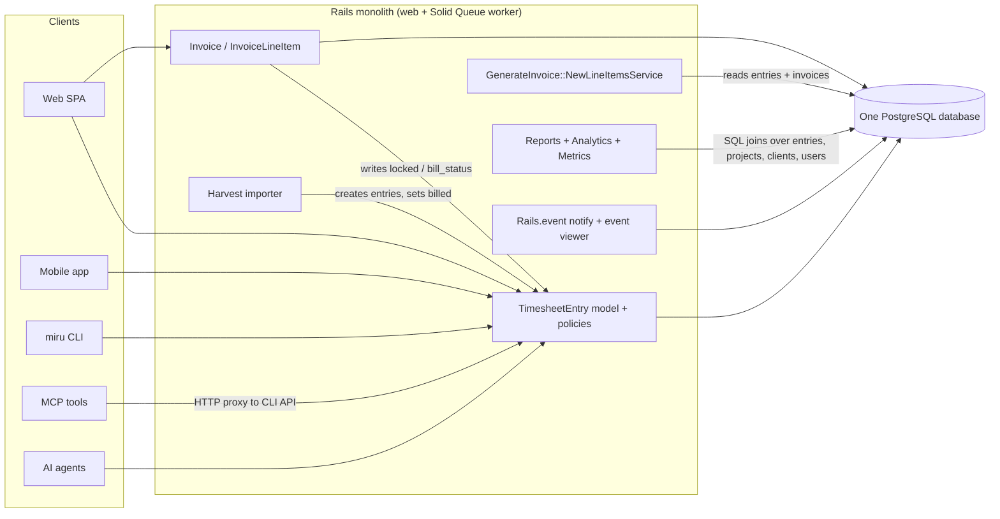
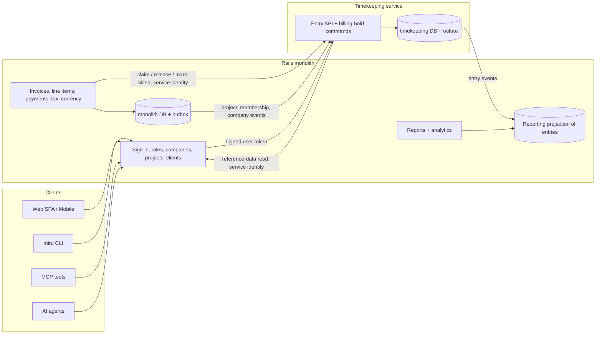
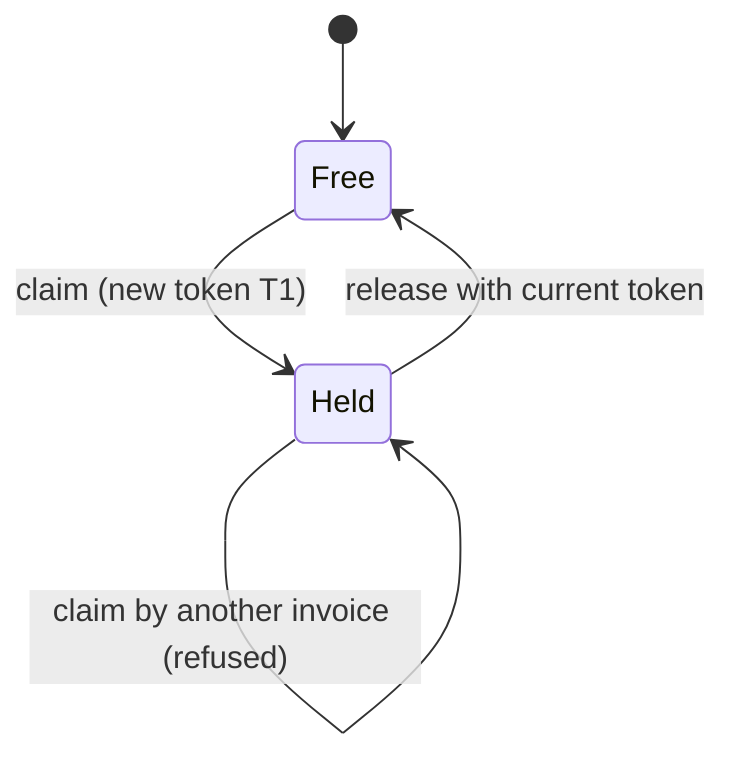

# Cobb Your Dependencies: separating timekeeping from billing and reporting

**Status:** Proposed design for review. This document does not authorize anyone to implement the architecture or start the migration.

**Publishing note:** The docs site build (`docs/docusaurus.config.js`) includes only `intro.md`, `contributing-guide/`, `product-guide/` and `ai/`. This file is therefore not published on the docs site. It is meant to be read in the repository and in review.

## How to read this document

Each statement in this document falls into one of three kinds, and every section labels which one it holds:

- **Observed:** read from the code or specs in this repository. Every observed statement cites the file it comes from. Line numbers appear only where they were checked while writing.
- **Assumption:** believed true but not proven by the code here, for example how production data is distributed. An assumption is never used as the only ground for a decision.
- **Proposed:** part of the target design. A proposed rule is not current behaviour, even when it reads like a requirement.

"Monolith" means the single Rails application in this repository. "Tenant", "company" and "workspace" all mean the `Company` record that owns a customer's data.

## 1. Existing architecture and its important dependencies

### 1.1 Runtime shape (observed)

- One Rails application image is deployed with Kamal (`config/deploy.yml`). The deployment defines a `web` role and a `worker` role. The worker runs `bundle exec rake solid_queue:start`, so background jobs run on Solid Queue.
- One PostgreSQL database holds every table, including time entries, invoices, payments and reports data (`db/schema.rb`). The app is configured through environment keys such as `DATABASE_URL` and `REDIS_URL`. This document names configuration only by key, never by value.
- Jobs inherit retry rules from `app/jobs/application_job.rb`: `ActiveRecord::Deadlocked` is retried 3 times, and connection failures 5 times.
- The existing architecture overview is `docs/contributing-guide/architecture-diagram.md`.



### 1.2 The time entry record (observed)

Source: `app/models/timesheet_entry.rb`, table `timesheet_entries` in `db/schema.rb`.

- One row carries three separate state fields:
  - `bill_status`, an integer enum: `non_billable`, `unbilled`, `billed`.
  - `review_status`, an integer enum: `not_required`, `pending_review`, `approved`, `rejected`.
  - `locked`, a boolean that defaults to `false`.
- `duration` is a `float` column holding minutes. The model allows values from `0.0` to `6000000`.
- The row has no `company_id`. Tenancy is derived through `project → client → company` (`has_one :client, through: :project`, `has_one :company, through: :client`). The scope `in_workspace(company)` filters on `company.project_ids`.
- The model is `audited associated_with: :company`. The audited columns are `duration`, `work_date`, `note`, `bill_status`, `review_status`, `project_id`, `user_id`, `agent_id`, `source`, `source_metadata`, `proof_url`, `proof_metadata` and `discarded_at`. **`locked` is not in that list, so lock and unlock changes leave no audit record today.**
- `has_one :invoice_line_item, dependent: :destroy` ties the entry to billing. Entries are normally soft-deleted through `Discardable`, so this destroy cascade only runs on a hard delete.
- After create, the model emits `TimesheetEntries::Created` (`app/events/timesheet_entries/created.rb`).
- `source` takes one of `manual`, `cli`, `mcp`, `automation`, `import`. The model infers it from `source_metadata`.

### 1.3 Writers of time entries (observed)

| Entry point | Code | User context |
|---|---|---|
| Web API (also used by mobile) | `app/controllers/api/v1/timesheet_entry_controller.rb`; mobile routes to it through `config/routes/api.rb` (`controller: "/api/v1/timesheet_entry"`), covered by `spec/requests/api/v1/mobile/timesheet_entries_spec.rb` | Signed-in user; `Current.user` set by `app/controllers/concerns/set_current_details.rb` |
| Bulk move and delete | `app/controllers/api/v1/timesheet_entry/bulk_action_controller.rb` | Signed-in user |
| CLI | `app/controllers/api/v1/cli/timesheet_entries_controller.rb` | Signed-in user; reads entries through `current_user.timesheet_entries.kept.in_workspace(current_company)` |
| MCP tools | `app/mcp/tools/time_create_tool.rb`, `time_update_tool.rb`, `time_delete_tool.rb` | The user's credential; tools forward HTTP requests to the CLI API through `app/mcp/tools/base_tool.rb` |
| Agent | `app/controllers/api/v1/agent/timesheet_entries_controller.rb` | `Current.user` set to the agent's user (`app/controllers/api/v1/agent/base_controller.rb`); forces `source: "automation"` |
| Harvest import | `app/services/imports/harvest_time_entries_importer.rb` (`create_entry`) | Runs as a job; no request user |
| Billing callbacks | `app/models/invoice.rb`, `app/models/invoice_line_item.rb` (section 1.4) | Whatever user saved the invoice |

The desktop timer client was not traced while writing this section. Whether it calls the web API or the CLI API is an open question for the review.

### 1.4 Billing writes timekeeping state directly (observed)

This coupling is the main reason timekeeping cannot be deployed on its own today.

- `app/models/invoice.rb:62` runs `after_save :lock_timesheet_entries, if: :draft?`. On every save of a draft invoice, it sets `locked: true` on every entry the invoice references, through `TimesheetEntry.in_workspace(company)`.
- `app/models/invoice.rb:63` runs `after_discard :unlock_timesheet_entries, if: :draft?`. It unlocks only when the invoice is still a draft. **A discarded invoice that has left draft leaves its entries locked.**
- `app/models/invoice_line_item.rb:10` runs `before_destroy :unlock_timesheet_entries`. It unlocks only when the parent invoice is a draft. It uses `TimesheetEntry.where(id: associated_timesheet_entry_ids)` with **no workspace filter**.
- `Invoice#update_timesheet_entry_status!` (`app/models/invoice.rb:126`) sets `bill_status: :billed` on the invoice's kept entries.
- An entry is referenced by an invoice in one of two ways:
  - Directly, through `invoice_line_items.timesheet_entry_id`.
  - As part of a project aggregate line, through the join table `invoice_line_item_time_entries` (`linked_timesheet_entry_ids`). `app/mcp/tools/invoice_create_tool.rb` accepts these ids too.
- Both line-item validations, `timesheet_entry_belongs_to_invoice_company` and `linked_timesheet_entries_belong_to_invoice_company` (`app/models/invoice_line_item.rb`), require the entry's company to equal the invoice's company.
- `db/schema.rb` declares foreign keys from both billing tables to `timesheet_entries`.
- Spec: `spec/requests/api/v1/invoices/create_spec.rb` (around lines 180–212) asserts that entries are locked after an invoice is created.

### 1.5 Choosing entries to invoice (observed)

Source: `app/services/generate_invoice/new_line_items_service.rb`.

- Candidates are limited to the client's kept projects (`client.projects.kept`), `bill_status: "unbilled"` and `discarded_at: nil`.
- `filtered_ids` excludes entries that are already on a line item of a kept invoice and are still unbilled. To find those invoices it calls `Invoice.kept.pluck(:id)` **across all companies**. The local variable is named `discarded_invoice_ids` but holds kept invoice ids. The result still only contains the client's own projects, so the global list widens the work done, not the returned rows.
- Entries on a discarded invoice are no longer excluded. Because `locked` is not part of the candidate filter, an entry that stayed locked after a non-draft discard can still be offered for a new invoice if it is unbilled.
- Rates come from `ProjectMembersPresenter#project_to_member_hourly_rate`. The service returns the entry's `duration` as `quantity`, and the line item stores it.
- Nothing in the database stops one entry from appearing on two invoices. `invoice_line_items.timesheet_entry_id` has only non-unique indexes. `invoice_line_item_time_entries` is unique only on the pair `(invoice_line_item_id, timesheet_entry_id)` (`db/schema.rb`, `idx_line_item_time_entries_unique_pair`).

### 1.6 Money and rounding (observed)

Sources: `app/models/invoice.rb`, `app/models/invoice_line_item.rb`, `db/schema.rb`.

- Stored columns:
  - `invoices.amount`, `amount_due`, `amount_paid`, `outstanding_amount`, `discount`, `tax` and `base_currency_amount` are `decimal(20,2)`.
  - `invoices.exchange_rate` is `decimal(18,10)`.
  - `invoice_line_items.rate` is `decimal(20,2)`, and `quantity` is an `integer` of minutes.
  - `invoice_taxes.amount` is `decimal(20,2)` and `value` is `decimal(20,4)`.
- The invoice subtotal is computed in floats: `sum((quantity.to_f / 60) * rate.to_f).round(2)`. The total is `(subtotal - discount.to_f + tax.to_f).round(2)`.
- Tax amounts are summed as `BigDecimal` and rounded to 2 places. Each tax line is recalculated from the subtotal only while the invoice is new or a draft (`should_recalculate_invoice_taxes?`).
- `totals_recalculation_needed?` is also true when `status` changes. So a status change can rewrite `amount`, `amount_due` and `outstanding_amount` from the stored line items. For a paid or waived invoice, `amount_due` and `outstanding_amount` become `0`.
- Line-level `total_cost` rounds to 3 places: `(quantity / 60.0 * rate).round(3)`. `InvoiceLineItem.total_cost_of_all_line_items` uses SQL `sum(quantity * rate) / 60.0`, rounded to 3. The two invoice-level and line-level paths therefore round differently.
- `base_currency_amount = (amount * rate).round(2)`. The rate is looked up for the issue date (or today) through `CurrencyConversionService.get_exchange_rate` and stored with `exchange_rate_date`.
- Invoice money and status changes are audited (`audited associated_with: :company` on `Invoice`).

### 1.7 Reporting reads timekeeping data in SQL (observed)

- `app/services/reports/time_entries/report_service.rb` builds report rows from `TimesheetEntry` with `includes(:user, project: :client)` and company and date filters. It groups and sums duration.
- `app/services/analytics/team_productivity_analytics.rb` sums duration by user and splits it into billable (`unbilled` or `billed`) and non-billable.
- `app/services/metrics/data_builder.rb` (lines 85, 86 and 140) filters `bill_status: :billable`. `billable` is not one of the enum's values. What this query returns at runtime was not checked while writing this document; it is recorded as a defect to confirm, not as behaviour to preserve.
- Revenue and receivables reports read only billing tables: `app/services/reports/client_revenues/`, `accounts_aging/` and `outstanding_overdue_invoices/`.

### 1.8 Events and idempotency (observed)

- Events are in-process. `app/events/application_event.rb` builds `{ actor, data }`. The time-entry events cover creation only (`TimesheetEntries::Created`). Invoices emit `Invoices::Created`, `Invoices::Sent` and `Invoices::StatusChanged`.
- `docs/ai/events.md` says events are stored in the same transaction, behind a savepoint, so a failed insert cannot abort the operation. It calls the history "best-effort observability, not a mandatory audit trail or delivery queue". Pruning is manual with a seven-day default. No outbox or message broker exists.
- MCP write tools deduplicate through `app/mcp/idempotency_store.rb`:
  - The key is a SHA-256 digest of the tool name, a digest of the caller's authorization value, and the client's idempotency key. The key is therefore scoped to the caller.
  - A Postgres advisory lock guards each key.
  - Only successful responses are cached, in `mcp_idempotency_records`, for 24 hours.
  - Spec: `spec/mcp/idempotency_store_spec.rb`.
  - The store sits in front of the HTTP proxy, so deduplication happens before the request reaches the time-entry API.

## 2. Observed behaviour that must be preserved

Each row below is current behaviour, cited to its source. The target design must keep it unless a later section names it as a deliberate, disclosed departure. Rows marked **(quirk)** are odd but observed. Changing them would change customer-visible state, so they are preserved as they are, and any correction needs a separate owner decision.

### 2.1 Authorization

| # | Behaviour | Source |
|---|---|---|
| A1 | Owner and admin see every kept entry in their current workspace; other users see only their own kept entries in it. | `TimesheetEntryPolicy::Scope#resolve` in `app/policies/timesheet_entry_policy.rb` |
| A2 | `update?` and `destroy?` refuse any `billed` entry, for every role. | `app/policies/timesheet_entry_policy.rb`; `spec/policies/timesheet_entry_policy_spec.rb` |
| A3 | A user who is not owner or admin of the entry's company cannot change an entry whose `work_date` is older than `company.timesheet_edit_days` days. | `stale_entry_for_non_privileged?` in the policy; `timesheet_edit_days` validated to `1..365` in `app/models/company.rb:83` |
| A4 | Non-privileged users may change only their own entries. | `update?` in the policy |
| A5 | Only owner or admin may create an entry for another user in the web API; others get `Pundit::NotAuthorizedError`. | `timesheet_entry_user` in `app/controllers/api/v1/timesheet_entry_controller.rb` |
| A6 | An employee cannot edit a `locked` entry; an admin can. | `prevent_edit_if_locked` in `app/models/timesheet_entry.rb`; `spec/models/timesheet_entry_spec.rb:421-455` |
| A7 | An employee cannot change an entry away from `billed`. | `ensure_billed_status_should_not_be_changed` in the model |
| A8 **(quirk)** | Both A6 and A7 are skipped when `Current.user` is nil, which is the case for jobs and imports. | Same model methods (`return if Current.user.nil?`) |
| A9 **(quirk)** | The bulk controller re-implements the checks in `entry_locked?` (billed, or past the edit window for non-privileged users). It does **not** check `locked`. Bulk move uses non-raising `update`, so an entry that fails validation is skipped silently while the response still reports success. | `app/controllers/api/v1/timesheet_entry/bulk_action_controller.rb` |
| A10 **(quirk)** | Delete paths (`discard!`, `discard_all`) do not run validations, so A6 never applies to deletes. Policy and bulk checks still apply. | Controllers above; `Discardable` |
| A11 **(quirk)** | Any user allowed to update an entry can set `bill_status` to `billed` through the web, CLI or MCP update parameters, because only changes *away from* `billed` are guarded. | `timesheet_entry_params` and `cli_timesheet_entry_params` permit `bill_status`; `app/mcp/tools/time_update_tool.rb` allows `billed` |

### 2.2 State values and transitions

| # | Behaviour | Source |
|---|---|---|
| S1 | A new entry gets `unbilled` on a billable project and `non_billable` otherwise, unless a value is given. | `ensure_bill_status_is_set` |
| S2 | An entry cannot be created as `billed`. | `ensure_bill_status_is_not_billed` |
| S3 | `unbilled` is rejected on a non-billable project. | `validate_billable_project` |
| S4 | An entry with an agent is forced to `pending_review` when its review status is blank or `not_required`; other entries default to `not_required`. | `ensure_review_status_is_set`; `spec/models/timesheet_entry_spec.rb:140` |
| S5 | **No code moves an entry to `approved` or `rejected`.** A search of `app/` for `review_status` finds only the model and the demo seeder. The review queue described in `docs/miru-ai-agent-billing-autoplan.md` is not built. | Search of `app/**/*.rb` |
| S6 | Invoicing ignores `review_status`: `pending_review` entries can be offered and invoiced today. | `app/services/generate_invoice/new_line_items_service.rb` has no review filter |
| S7 | An agent entry must belong to the agent's company, and its user must be the agent's user. | `validate_agent_belongs_to_workspace` |

### 2.3 Locking and billing

| # | Behaviour | Source |
|---|---|---|
| L1 | Every save of a draft invoice locks every entry it references, scoped to the invoice's company. | `app/models/invoice.rb:62`, `lock_timesheet_entries` |
| L2 | Discarding a draft invoice unlocks its entries. | `app/models/invoice.rb:63` |
| L3 **(quirk)** | Discarding an invoice that has left draft does **not** unlock its entries; they stay locked with no kept invoice holding them. | Same callback, `if: :draft?` |
| L4 | Destroying a line item on a draft invoice unlocks its entries; on a non-draft invoice it does not. | `app/models/invoice_line_item.rb:10`, `unlock_timesheet_entries` |
| L5 **(quirk)** | Only `InvoiceMailer#invoice` marks entries `billed`, through `after_action :update_status` (`app/mailers/invoice_mailer.rb:4`, `:73`). That mailer is enqueued only by `Invoice#send_to_email` (`app/models/concerns/invoice_sendable.rb`). A repository search finds no production caller of `send_to_email`; only `spec/models/invoice_spec.rb:200-215` calls it. | Search for `send_to_email` |
| L6 **(quirk)** | The live send path, `send_invoice` in `app/controllers/api/v1/invoices_controller.rb`, uses `InvoiceMailer#send_invoice` and `record_send!`. These set the invoice to `sent` and emit `Invoices::Sent`, but never mark entries billed. **Entries on sent invoices therefore usually stay `locked` and `unbilled`.** | `app/controllers/api/v1/invoices_controller.rb:64`; `app/models/concerns/invoice_sendable.rb` |
| L7 **(quirk)** | The Harvest import creates entries as `unbilled` and then calls `entry.update!(bill_status: :billed)` with no invoice. So `billed` is not always backed by an invoice link. | `app/services/imports/harvest_time_entries_importer.rb` (`create_entry`); `spec/services/imports/harvest_time_entries_importer_spec.rb` |
| L8 | A line item's linked entries must belong to the invoice's company. | `app/models/invoice_line_item.rb` validations; no spec in `spec/models/invoice_line_item_spec.rb` covers this rule |

### 2.4 Money and history

| # | Behaviour | Source |
|---|---|---|
| M1 | Stored invoice and line-item amounts (section 1.6) are the customer's record. Past invoices show these stored values, not values recomputed from current rates. | `db/schema.rb`; `Invoice` callbacks only recompute on changes |
| M2 | Line items copy `rate` and `quantity` when they are created; later entry or rate changes do not reach existing line items. | `app/services/generate_invoice/new_line_items_service.rb`; `app/models/invoice_line_item.rb` |
| M3 | Rounding differs by path (2 places at invoice level, 3 at line level) as described in section 1.6. Any figure a customer has seen must still come out the same. | `app/models/invoice.rb`, `app/models/invoice_line_item.rb` |
| M4 | Time-entry and invoice audit history is kept per company through `audited`. | `app/models/timesheet_entry.rb`, `app/models/invoice.rb` |

### 2.5 Behaviour recorded but not preserved as-is

These are observed, but the target design must not expose them across a service boundary, because doing so would let one tenant reach another tenant's data. Later sections state the replacement and disclose it as a deliberate departure.

| # | Behaviour | Source | Why it is not carried forward |
|---|---|---|---|
| X1 | The line-item unlock looks entries up with `TimesheetEntry.where(id:)` and no company filter. | `app/models/invoice_line_item.rb`, `unlock_timesheet_entries` | Inside one process, the ids come from rows the company-match validations already checked. As a network command taking raw ids, the same lookup would let one tenant unlock another tenant's entries. |
| X2 | The candidate filter reads `Invoice.kept.pluck(:id)` for every company. | `app/services/generate_invoice/new_line_items_service.rb`, `filtered_ids` | The returned rows are still limited to the client's projects, so no data leaks today. As a cross-service query, the same shape would collect invoice ids across tenants. |

For a single tenant, replacing X1 and X2 with company-scoped versions leaves the visible result unchanged.

### 2.6 Assumptions used later

These are not proven by the repository. They are stated here so later sections do not treat them as facts.

- **Assumption:** production holds entries in each quirk state (L3, L6, L7). The code allows them, but no production data was inspected.
- **Assumption:** the desktop timer writes through one of the APIs in section 1.3. This was not traced (section 1.3).
- **Assumption:** no external system reads `rails_event_viewer_entries` as a feed. No subscriber exists in `app/` (a search of the repository for `Rails.event.subscribe` finds no code), but other deployments were not checked.

## 3. Target architecture, service responsibilities and data ownership (proposed)

### 3.1 One new service, Timekeeping

The target extracts exactly one service, **Timekeeping**. It is a separate deployable application with its own database. The monolith keeps everything else.



Clients keep calling the monolith's existing routes. The monolith checks the session, mints a short-lived signed token (section 6) and forwards entry requests to Timekeeping. This keeps every client URL, the MCP proxy in `app/mcp/tools/base_tool.rb`, and the mobile routes unchanged. A later phase may let clients call Timekeeping directly; that is future work, not part of this migration.

### 3.2 Responsibilities

| Service | Owns and decides | Does not own |
|---|---|---|
| **Timekeeping** | Time entries (`duration`, `work_date`, `note`, `project_id`, `user_id`, `agent_id`, `source`, `source_metadata`, proof fields, `discarded_at`); `bill_status`; `review_status`; billing holds (the replacement for `locked`); entry audit history; entry authorization checks A1–A11; entry idempotency records; the entry outbox. | Users, roles, companies, projects, clients, rates, invoices, money. |
| **Monolith: identity and catalogue** | Users, sessions, API tokens, roles (rolify), companies and `timesheet_edit_days`, clients, projects (`billable`, membership, hourly rates), agents. | Entry rows. |
| **Monolith: billing** | Invoices, line items (with their copied `rate` and `quantity`), invoice taxes, payments, exchange rates, invoice audit history, the choice of which entries to invoice. | Entry state. It changes entry state only through Timekeeping commands. |
| **Monolith: reporting** | Reports, analytics and metrics, read from a company-keyed projection of entries fed by Timekeeping events (section 5.4). | Entry state. The projection is read-only and never authoritative. |

### 3.3 Authoritative data ownership

| Fact | Authority after migration | Others may hold |
|---|---|---|
| Entry fields, `bill_status`, `review_status` | Timekeeping | Reporting projection (read-only copy) |
| Whether an entry is held for billing, and by whom | Timekeeping (`billing_holds`) | Billing keeps the hold token on its line-item association |
| `company_id` of an entry | Timekeeping, stored on the entry (see 6.1) | Projection |
| Project `billable`, client → company, membership, rates | Monolith | Timekeeping reads them fresh per write (section 3.4) |
| Role of a user in a company, `timesheet_edit_days` | Monolith | Carried in the signed token per request |
| Invoice and line-item money, line-item → entry links | Monolith billing | Nobody else |

The billing tables lose their database foreign keys to `timesheet_entries` because the two tables live in different databases. The line-item columns `timesheet_entry_id` and `invoice_line_item_time_entries.timesheet_entry_id` stay as plain ids, valid only together with the hold token that Timekeeping returned for them.

### 3.4 Reference data Timekeeping needs, and how it reads it

Timekeeping's rules read facts the monolith owns: project `billable` (S1, S3), client → company (tenancy), project membership, the agent's user and company (S7), the user's role and `timesheet_edit_days` (A1–A7). Today these are read in the same transaction as the write, so a settings or permission change takes effect at once. The target keeps that freshness:

- **User-delegated writes.** The monolith mints the signed token per request. Its claims carry the user's current role in the company, `timesheet_edit_days`, and for each project the request touches: `company_id`, `billable` and whether the user is a member. Timekeeping takes these claims as the facts for that write.
- **Background writes** (billing commands, imports, jobs). Timekeeping calls a monolith read endpoint, `GET /internal/v1/companies/{company_id}/reference?project_ids=…`, with its own service identity, before deciding.
- **When the facts cannot be read** (expired token, missing project claim, monolith endpoint down), the write is refused with a retryable `503 reference_unavailable`. It fails closed: Timekeeping never guesses and never falls back to an older copy.
- There are no cross-database joins.

The cost: entry writes depend on the monolith being up. Today they do too, because they run inside it, so this is no worse for availability. It is still recorded as an integration risk.

### 3.5 What stays in the monolith, and why

- **Billing stays.** Invoices are bound to clients, payments, taxes, exchange rates, Stripe and receivables reports (`app/services/reports/accounts_aging/`, `outstanding_overdue_invoices/`). Extracting billing would add a second network boundary through money flows without giving any table a clearer owner.
- **Reporting stays.** It is a read concern over data from both sides. A projection inside the monolith serves it without a third service.
- **Identity and catalogue stay.** Every other feature depends on users, companies and projects.

## 4. Alternatives considered

| Option | What it costs | Verdict |
|---|---|---|
| A. Move timekeeping code into modules or service classes inside the monolith | No independent deployment and no separate data ownership, which the goal rules out explicitly. Billing callbacks could still write entry rows. | Rejected. Useful only as a preparatory refactor before extraction. |
| B. Separate deploy, shared database | Deploys split, but both apps write `timesheet_entries`, so nobody owns the data. Schema changes need lock-step deploys. | Rejected. It keeps the coupling in section 1.4 and adds deploy coordination. |
| **C. One Timekeeping service with its own database (recommended)** | One new network boundary, an outbox per side, a hold protocol, and a migration. | Chosen. It is the smallest change that gives timekeeping its own deploy and data, and it removes billing's direct writes. |
| D. Two services: Timekeeping and Billing | Billing would have to call back for users, clients, projects, payments and rates. Every invoice screen becomes a cross-service read. | Rejected as unnecessary distributed complexity. It may be revisited later on its own merits. |
| E. Timekeeping plus a separate Reporting service | Another service and database for read-only data. Revenue reports would need billing data replicated too. | Rejected. The projection inside the monolith is enough. |
| F. Event-fed copies of reference data inside Timekeeping (instead of section 3.4) | Fewer synchronous calls, but a role, edit-window or project change would apply only when its event arrives. That weakens authorization rules A1–A7 for a period. | Rejected, recorded for review. It could return only with an owner decision that accepts the delay. |

## 5. API and event contracts, compatibility and versioning (proposed)

### 5.1 Common rules for every contract

- Every request and every event carries `company_id`. Timekeeping checks it against the entry's stored `company_id` and against the caller's identity (section 6). A mismatch returns `404 not_found`, the same answer as for a missing id, so a caller cannot probe other tenants.
- Every state-changing request carries an `Idempotency-Key` header. Timekeeping stores it in `idempotency_records`, keyed by `(company_id, actor_type, actor_id, operation, key)` and kept for at least 24 hours, which matches the MCP store (`app/mcp/idempotency_store.rb`). A retry with the same key and the same body returns the stored response. The same key with a different body returns `422 idempotency_key_reused`. A key from another company or actor never matches.
- Every API path is versioned in the URL (`/v1/…`). Every event carries `schema_version`. Additive changes (new optional fields) keep the version. Removing or retyping a field needs a new version, and both versions run in parallel until every consumer has moved.
- Money travels as decimal strings, for example `"125.50"`, never as floats (section 8). Durations travel as decimal strings of minutes (section 8.3).
- Write responses return the entry's `version` (a counter that rises on every change). Updates may send `If-Match: <version>`; a stale version returns `409 version_conflict`. Clients that do not send it keep today's last-write-wins behaviour.

### 5.2 Entry API (user-delegated)

Illustrative shapes. Field names follow the current JSON in `app/views/api/v1/` where one exists.

```text
POST   /v1/companies/{company_id}/entries
PATCH  /v1/companies/{company_id}/entries/{entry_id}
DELETE /v1/companies/{company_id}/entries/{entry_id}
GET    /v1/companies/{company_id}/entries?from=&to=&user_id=&project_id=
POST   /v1/companies/{company_id}/entries/bulk-move
POST   /v1/companies/{company_id}/entries/bulk-delete

Headers: Authorization: Bearer <signed user token>, Idempotency-Key: <uuid>
Entry body: { project_id, user_id?, work_date, duration: "90.0", note, bill_status?,
              source, source_metadata, agent_id?, proof_url?, proof_metadata? }
Response:   { id, company_id, version, ...fields, held: true|false }
```

`held` replaces `locked` in responses. The monolith keeps exposing `locked` to clients, set from `held`, so client JSON does not change. Bulk endpoints return a per-entry result list. To preserve A9, the monolith's bulk route still reports overall success as it does today; the per-entry list is new information it may log.

### 5.3 Billing-hold commands (service identity)

```text
POST /v1/companies/{company_id}/holds/claim
  { holder: { invoice_id, association_id }, entry_ids: [...], idempotency_key }
  -> 200 { holds: [ { entry_id, hold_token } ] }
  -> 409 { conflicts: [ { entry_id, reason: "held_by_other" | "not_billable_state" } ] }   (whole batch rejected)

POST /v1/companies/{company_id}/holds/release
  { releases: [ { entry_id, hold_token } ], idempotency_key }
  -> 200 { results: [ { entry_id, outcome: "released" | "no_matching_hold" } ] }

POST /v1/companies/{company_id}/entries/mark-billed
  { entries: [ { entry_id, hold_token } ], idempotency_key }
  -> 200 { results: [ { entry_id, outcome: "billed" | "no_matching_hold" } ] }
```

`association_id` identifies one link between an invoice and an entry: the line item id for a direct link, or the `invoice_line_item_time_entries` row id for an aggregate link. Section 7.2 defines how claim and release behave.

`mark-billed` exists for parity with `Invoice#update_timesheet_entry_status!`, which today runs only from the uncalled mailer path (L5). Nothing in the migration starts calling it more often. Marking entries billed when an invoice is sent is listed under future work (section 7.4).

### 5.4 Events

Timekeeping writes events to its outbox in the same transaction as the change. Names follow the existing pattern in `app/events/` (`TimesheetEntries::Created`):

| Event | Payload (besides the envelope) |
|---|---|
| `TimesheetEntries::Created`, `TimesheetEntries::Updated`, `TimesheetEntries::Discarded` | `entry_id`, `version`, `project_id`, `user_id`, `work_date`, `duration`, `bill_status`, `review_status`, `held`, `changed_fields` |
| `TimesheetEntries::HoldClaimed`, `TimesheetEntries::HoldReleased` | `entry_id`, `holder.invoice_id`, `holder.association_id`, `hold_token`, `version` |
| `TimesheetEntries::Billed` | `entry_id`, `version` |

The monolith writes `Projects::Changed`, `ProjectMemberships::Changed` and `Companies::SettingsChanged` to its outbox. These are used for the reporting projection and for operator visibility, never for authorization decisions (section 3.4).

Envelope: `{ event_id, event_type, schema_version, company_id, occurred_at, actor: { type, id }, data }`. Payloads carry ids, not user names or emails. Consumers look up display data from their own side.

Rules:

- Delivery is at least once. A relay reads unsent outbox rows in order of id and publishes them; it marks a row sent only after the broker acknowledges it.
- Consumers keep a `processed_events(event_id)` table and skip ids they have seen.
- Consumers apply an entry event only when its `version` is higher than the one they hold, so a late or reordered event cannot overwrite newer data.
- Receiving an event never authorizes a write. A consumer that needs to change entry state calls the command API with its own identity.
- **`rails_event_viewer_entries` is not the delivery mechanism.** `docs/ai/events.md` calls it "best-effort observability, not a mandatory audit trail or delivery queue", and it is pruned after seven days. The existing `Rails.event.notify` calls stay as observability only.

The broker product is an open decision for the risks and decisions section. Solid Queue already runs in the monolith and could carry relay jobs; a dedicated broker is the other option.

## 6. Tenant isolation, authorization and identity propagation (proposed)

### 6.1 Tenant on every row

- Timekeeping stores `company_id` on every entry, hold, idempotency record, audit row and outbox row, and indexes queries by it.
- The value is copied from the project's client's company when the entry is created or moved to another project. A project can change client, but `app/controllers/api/v1/projects_controller.rb` looks the new client up through `current_company.clients`, so a project cannot move to another company through that route. If such a move ever becomes possible, the monolith must emit `Projects::Changed` and Timekeeping must re-stamp the project's entries in one transaction. That is recorded as a risk, not built.
- X1 and X2 (section 2.5) are replaced by company-scoped lookups. Every Timekeeping query starts with `WHERE company_id = :company_id`. **This is a deliberate departure from preserving behaviour as-is.** For any single tenant the visible result is the same.

### 6.2 Two kinds of caller

| Kind | Who | Credential | Checks applied |
|---|---|---|---|
| **User-delegated** | Web, mobile, bulk, CLI, MCP, agent, desktop timer | Short-lived token signed by the monolith: `sub` (user id), `company_id`, `role` in that company, `edit_days`, `projects` facts, `agent_id` if any, `exp` (60 seconds), `jti` | All of A1–A7 and S1–S7, exactly as for that user today. A role claim is valid only for the `company_id` in the same token. |
| **Background** | Billing commands, Harvest import, jobs | Service credential (mutual TLS or a signed service token) bound to one `company_id` per request and to a named operation list | Only the named operations: `holds.claim`, `holds.release`, `entries.mark_billed`, `entries.import`. Company scoping always applies. |

CLI and MCP calls are user-delegated, not background. `app/controllers/api/v1/cli/timesheet_entries_controller.rb` scopes to `current_user`, and the MCP tools forward the user's own credential. The monolith keeps checking those credentials and mints the user token for them.

Timekeeping verifies the token signature with a public key it loads from configuration (`TIMEKEEPING_TOKEN_PUBLIC_KEY`). It never trusts a plain header or body field for user, company or role.

### 6.3 Where each rule is enforced

| Rule | Today | After migration |
|---|---|---|
| A1 scope | `TimesheetEntryPolicy::Scope` | Timekeeping, from the token's `role` and `sub` |
| A2 billed refusal, A4 own entries, A3 edit window | Policy | Timekeeping, from the token |
| A5 create for others | Web controller | Timekeeping, from the token |
| A6 locked, A7 away from billed | Model, skipped when `Current.user` is nil | Timekeeping, for every user-delegated call (A6 now reads "held") |
| A8 nil-user bypass | Implicit, any code path | Allowed only to the named background operations above. An anonymous or user-delegated request never gets it. |
| A9 bulk ignores `locked` | Bulk controller | Preserved: Timekeeping's bulk endpoints apply the same checks as the bulk controller today, and report per-entry results |
| A10 deletes skip A6 | `discard!` skips validations | Preserved: delete checks policy rules A2–A4, not A6 |
| A11 users may set `billed` | Permitted params | Preserved |
| L8 entry and invoice share a company | Line-item validations in the monolith | Timekeeping's `holds/claim`: an entry outside the request's `company_id` is reported as not found and the whole claim fails. The monolith keeps its own validation as a second check, reading the entry's company from the claim response. |

A6, A8 and A9 are odd, but they are customer-visible, so they are carried forward. Changing them needs an owner decision, listed with the risks and decisions for review.

### 6.4 Audit trail

Timekeeping writes an audit row for every entry change, including holds. The row records `company_id`, actor kind and id (user, or service plus the operation) and the changed fields. This closes today's gap where `locked` changes leave no audit record. Existing `audits` rows for entries are copied during the backfill and stay readable from the monolith until retirement.

## 7. Review, locking, billing associations and state transitions (proposed)

### 7.1 Review state

Timekeeping owns `review_status`. The migration preserves S4, S5 and S6 exactly: agent entries start at `pending_review`, nothing moves them to `approved` or `rejected`, and invoicing ignores review state.

A review workflow (approve or reject commands, and whether billing may claim `pending_review` entries) is **future work**. If built, it belongs in Timekeeping, behind its own versioned commands, and needs an owner decision on S6 first.

### 7.2 Billing holds replace `locked`

A hold is a row in Timekeeping:

```text
billing_holds(company_id, entry_id, invoice_id, association_id, hold_token, state, created_at, released_at)
unique (company_id, entry_id) where state = 'held'
```

- An entry is "locked" exactly when it has a row in state `held`. The monolith shows that as `locked: true`.
- **Claim** is one conditional insert, keyed by the caller's idempotency key:
  - No current hold: insert one with a fresh random `hold_token`.
  - Current hold with the same `invoice_id` **and** the same `association_id`: return the existing token. This is what lets every draft save (L1) re-send its claims without changing anything.
  - Current hold with the same `invoice_id` but a **different** `association_id`: the draft removed the entry and added it again. Replace the hold with a new token in the same statement. The old token stops matching.
  - Current hold by another invoice: refuse with `409 held_by_other`.
  - A retry with the same idempotency key returns the first answer.
- **Release** names the `hold_token`. It clears the hold only when the token matches the current hold, in one statement (`UPDATE … WHERE entry_id = ? AND hold_token = ? AND state = 'held'`). If nothing matches, it returns `no_matching_hold` and changes nothing.

Billing stores the returned `hold_token` on the line item (direct link) or the `invoice_line_item_time_entries` row (aggregate link).



Mapping of today's callbacks:

| Today | Target |
|---|---|
| L1 draft save locks entries | Billing sends `holds/claim` for every association on the draft |
| L2 draft discard unlocks | Billing sends `holds/release` with each stored token |
| L3 non-draft discard keeps locks | Billing sends nothing; holds stay. **Preserved quirk.** |
| L4 line-item destroy on draft unlocks; on non-draft does not | Release on draft only. Preserved. |
| L5 mark billed via uncalled mailer | `entries/mark-billed`, called only from the same path |
| L6 sent invoices leave entries unbilled | Preserved: sending does not call `mark-billed` |
| L7 import marks billed without invoice | Import calls the entry API with `bill_status: billed` under its service identity |

**Disclosed change:** today nothing stops two invoices from locking the same entry (section 1.5). Refusing a claim held by another invoice closes that path to double billing. Because it can make an invoice save fail where it succeeded before, it is first run in shadow mode during the migration, which logs would-be refusals without enforcing them. Enforcing it needs an owner decision, listed with the risks and decisions for review.

### 7.3 Bill status

Timekeeping owns `bill_status` and applies S1–S3 and A7. Allowed changes:

```text
non_billable <-> unbilled          (user edit, project rules S1/S3)
unbilled     ->  billed            (user edit A11, import L7, mark-billed L5)
billed       ->  unbilled/non_billable  only for owner/admin (A7) or a background operation
```

Billed entries cannot be edited or deleted by any role through the policy (A2), as today.

### 7.4 Future work, not part of the migration

- Marking entries billed when an invoice is sent (would change L6).
- Releasing holds when a non-draft invoice is discarded (would change L3).
- A review queue (would change S5 and possibly S6).

Each is a customer-visible change and is kept out of the migration's acceptance criteria and failure handling.

## 8. Financial precision, rounding and historical invoices (proposed)

### 8.1 What never changes

The monolith keeps every money column and every rounding rule in section 1.6. Migration, replay, backfill and reconciliation never recalculate a stored `amount`, `tax`, `discount`, `amount_due`, `base_currency_amount`, line-item `rate` or `quantity`. Billing stays in the monolith partly so that this code does not move.

### 8.2 Line items are snapshots

M2 is kept: line items copy `rate` and `quantity` at creation. An `Updated` event for an entry that is already on a line item does not change that line item. If billing wants to warn that an entry changed after it was invoiced, it may record a note; it never edits the amount.

### 8.3 On the wire

- Money: decimal strings with the column's scale (`"125.50"`, exchange rates with up to 10 places). Never JSON numbers.
- Duration: `duration` is a float column today. Timekeeping stores it as `numeric(12,4)` and transmits it as a decimal string of minutes. The backfill compares every copied value with the float source and reports any value that does not round-trip. Whether `numeric(12,4)` is enough, or the float type must be kept, is an open decision for review.
- Line-item `quantity` stays an integer, computed in the monolith as today.

### 8.4 The status-change recalculation

`totals_recalculation_needed?` recalculates totals when `status` changes (section 1.6). This stays in the monolith unchanged. No migration step writes `status`, so the migration never triggers it.

## 9. Transactions, consistency, retries, duplicates, concurrency and partial failures (proposed)

### 9.1 Transaction boundaries

- Timekeeping: an entry change, its audit row, its idempotency record and its outbox row commit together in one transaction.
- Monolith billing: an invoice or line-item change and its outbox row commit together. Calls to Timekeeping are not inside that transaction.
- Between them there is no shared transaction. Consistency comes from ordered steps, idempotent commands and a reconciler.

### 9.2 Ordering of a draft save

```text
1. In one monolith transaction: save invoice + associations, each association marked hold_state = 'pending',
   and write an outbox row "claim needed".
2. A job sends holds/claim with idempotency key = hash(invoice_id, association_id, entry_id).
3. On 200: store hold_token on each association, set hold_state = 'held'.
   On 409: set hold_state = 'conflict'; the invoice shows the entries as not held, and the user is told.
4. Removal: set association hold_state = 'releasing' with its token; a job sends holds/release.
```

The synchronous web request may also call claim directly to answer the user at once, with the job as the retry path.

### 9.3 Failure cases

| Case | State that survives | How it is detected and repaired | Proving test |
|---|---|---|---|
| Invoice saved, claim call failed | Association `hold_state = 'pending'`; entry free | The job retries with the same idempotency key until it gets an answer; the reconciler lists associations pending longer than 10 minutes | Integration: Timekeeping returns 503 twice then 200; association ends `held`, one hold row exists |
| Claim succeeded, invoice transaction rolled back | Hold exists with no association | Not possible in the ordering in 9.2, because claim runs after commit. If a synchronous claim is used before commit, the reconciler releases holds whose `invoice_id`/`association_id` the monolith does not have | Integration: force rollback after a synchronous claim; reconciler run releases the orphan hold |
| Discard or line-item delete, release lost | Association `releasing`; hold still `held` | Job retries release with the stored token; reconciler lists `releasing` older than 10 minutes | Integration: drop the first release; retry releases; entry shows `locked: false` |
| Stale release after the same draft re-adds the entry | New hold with token T2 | Late release carries T1, matches nothing, returns `no_matching_hold` | Contract: claim(A, assoc1) → T1; claim(A, assoc2) → T2; release(T1) → no change; entry still held |
| Reordered release from another invoice | Hold of invoice B | Release from A carries A's token, which never matches B's hold | Contract: claim A → T1; release T1; claim B → T2; replay release T1 → no change |
| Duplicate claim (retry, double click, re-save) | One hold | Same idempotency key returns the stored answer; same association returns the same token | Contract: send the same claim three times; one hold row, one token |
| Two drafts claim one entry at once | One hold | The unique index on `(company_id, entry_id) where held` lets one insert win; the other gets 409 | Concurrency: two parallel claims; exactly one 200 |
| Reference facts unavailable | No change | Write refused with `503 reference_unavailable`; client or job retries | Integration: monolith reference endpoint down; entry write refused; nothing written |
| Outbox relay down | Rows stay unsent | Relay resumes from the last sent id; consumers dedupe | Integration: stop relay, make changes, restart; projection matches, no duplicates |
| Event delivered twice or out of order | Consumer state at highest version | `processed_events` and the version check | Contract: deliver v2, then v1, then v2 again; projection holds v2 |

Mark-billed on send is not in this table, because sending does not mark entries billed (L6, section 7.4).

### 9.4 Concurrency on entries

- Entry updates take a row lock in Timekeeping and bump `version`. Clients that send `If-Match` get conflict detection; others keep last-write-wins, as today.
- A user edit and a claim on the same entry serialize on the entry row. A claim that commits first makes a later employee edit fail with the locked error (A6), as today.
